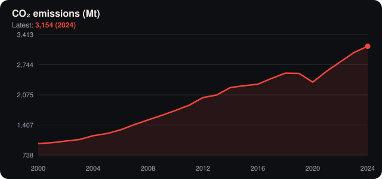
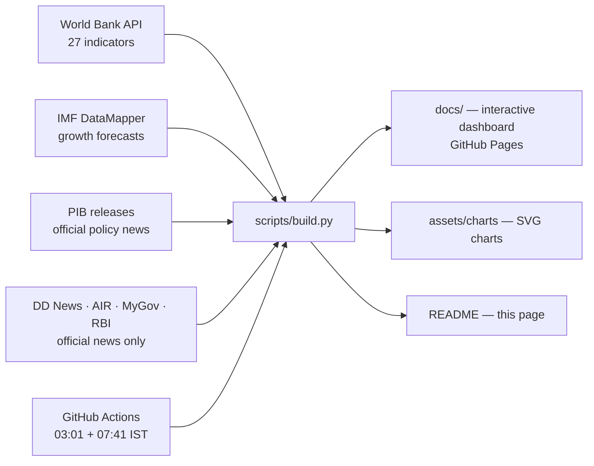

  

  
  
  
  

<b>India's economy, industry, environment and people — in one live, free dashboard.</b> 
GDP and national income from the World Bank, growth forecasts from the IMF, and the day's news for every topic from official government sources only (PIB, DD News, All India Radio, MyGov, RBI) — refreshed automatically twice a day.

  <a href="https://subhadeep998.github.io/India-Development-Dashboard/#economy">📈 Economy</a> ·
  <a href="https://subhadeep998.github.io/India-Development-Dashboard/#industry">🏭 Industry</a> ·
  <a href="https://subhadeep998.github.io/India-Development-Dashboard/#environment">🌿 Environment</a> ·
  <a href="https://subhadeep998.github.io/India-Development-Dashboard/#education">🎓 Education & Scholarships</a> ·
  <a href="https://subhadeep998.github.io/India-Development-Dashboard/#culture">🎭 Arts & Culture</a> ·
  <a href="https://subhadeep998.github.io/India-Development-Dashboard/#food">🌾 Food & Agriculture</a>

---

## 🇮🇳 India at a glance

| 💰 GDP | 📈 Real growth | 👤 GNI per capita | 🔮 IMF growth forecast |
|:--:|:--:|:--:|:--:|
| **US$ 3.96 tn** 2025 | **7.6%** 2025 | **US$ 2,760** 2025 | **7.0% (2026)** IMF WEO |

Last refreshed: 25 Nov 2026, 09:55 IST · Annual figures in current US$ from the World Bank; the forecast is the IMF World Economic Outlook.

---

## 📊 The big trends

<table>
  <tr>
    <td width="50%"></td>
    <td width="50%"></td>
  </tr>
  <tr>
    <td width="50%"></td>
    <td width="50%"></td>
  </tr>
  <tr>
    <td width="50%"></td>
    <td width="50%"></td>
  </tr>
  <tr>
    <td width="50%"></td>
    <td width="50%"></td>
  </tr>
</table>

<a href="https://subhadeep998.github.io/India-Development-Dashboard/"><b>Explore 27 indicators interactively →</b></a>

---

## 📰 Today across India — official sources

### 📈 Economy

GDP, national income, growth, inflation and investment.

- 2026-11-25 · [The Micro, Small and Medium Enterprises Development (Amendment) Bill, 2026](https://news.google.com/rss/articles/CBMid0FVX3lxTE9FZTBOb2xsNFIxaDFIei1YaU1ERnZwbW5pa3BDcDJhVnZmaEF3clJKVGFMcFJLYTJMeWtIb2RPclZNZXdLMGt0ajJPNTh5NS1wTS13bG12VU9rOUE3UmZhVG9oN0dPbHZ5ZHFJSVk0MVROeFVuUGtn?oc=5) — _पीआईबी_
- 2026-11-25 · [PM shares a Sanskrit Subhashitam highlighting the path to supreme spiritual attainment](https://news.google.com/rss/articles/CBMia0FVX3lxTFBURmUxckMwTmJIYW4tajdtRlIxNGUxUi14bXJZQXlibzZMeUdRNEY2WGJIa0FMNFlJYTA5NzBnMHh3UWNzRTNCaEdLVG5qLVBkeDA5S1lmeUxZVW1iQXRRZkdoSlN3MVRnN1pJ?oc=5) — _pib.gov.in_
- 2026-11-25 · [India Retains Third Spot in Lowy’s Asia Power Index 2026, PM Modi Ranked Most Effective Regional Leader](https://news.google.com/rss/articles/CBMixgFBVV95cUxNLWpudjFpM2VkVmVXdHBwWHBVZ0JSQkJtNDIzZWVQRzQzbXlVTzVUT2hKN2k1NHpNWlhYRHpBbk9SLXU1X1o5cExtcGJHLTl4NXRqVVRpUGZMdTFQdTBzUlczUVJwLWt1RUo2bldwR2p0S05jb1hINDJVWWl2YjNSQklLSnRaNVZBeGx3OFZPWllSMXBUWGh4SDhIS25TZG1iV2k3UXk4V250ajJLZFc5ZDZCWHl5S2xGa3AwaGJJU05yVTJ4M1E?oc=5) — _DD News_
- 2026-11-25 · [PM Modi Urges Industry to Prioritise ‘India First’ in Long-Term Investments, Says 500 Million Lifted Out of Poverty](https://news.google.com/rss/articles/CBMi1AFBVV95cUxNNVY1dUY5OThONmNTb3p1NHl3S1daUkNaN2h5OTlfR1ZuWTBuTjQ1OEhQdnI0TXZmWnZXS0xGdkdjVDdXd0lzc1JkeEZuR1NkRzREVko2SUVxU0lBV1d0Sm5oNTFwMDF0SWNReWs2UURKQ0FuNVVZQTNHc1N5TkdMLUhlbkt3WG1JaTVCWkVrSktwdG1HQ05PbWEtR01XZTkxQXd1TEEyXzhSQ1lrMURLbG5vYTl3WWZ6X2NLdkpoMGl0WER5Q0pyVkN2bGpabktqX1lmSQ?oc=5) — _DD News_

[Open the Economy tab →](https://subhadeep998.github.io/India-Development-Dashboard/#economy)

### 🏭 Industry

Manufacturing, industrial output, structure of the economy and infrastructure.

- 2026-11-24 · [Central Government Approves ₹10,600 Crore Production Linked Incentive Scheme to Strengthen Technical Textiles Sector: U…](https://news.google.com/rss/articles/CBMiekFVX3lxTE5zVjRZT19XS0hZM014dTk4ak1yX1NLUjcyVFNjbEcyWXlFa01VOUplV1NSbVBVWHNaRTZzT3JJMy1WOVB1QjJoSFN3WWRwZW11OUE5cU92MWd2cGdRQmdlV2tVUmVDeENGaTVUa01LUmR4aXpSdkZuQkFB?oc=5) — _पीआईबी_
- 2026-11-24 · [Government notifies Startup India Fund of Funds 2.0 with ₹10,000 crore corpus to mobilize capital for startups](https://news.google.com/rss/articles/CBMifkFVX3lxTFB6TklqVVN1LXY1Z2ZMNFJjb0hPZGlSODhuX043bnRSU3ZYSmpMMUxuWlNUdkJvRFBtNnFUaER6SXlCS0NtLUd5NkJCME5ydmxVLVY4VmFiaHpFNFhadjVRMWlYTVFDbEEwdzR3amxLc2JxekRpbEpjWVNJWFRXZw?oc=5) — _pib.gov.in_
- 2026-11-25 · [PM Modi Urges Industry to Prioritise ‘India First’ in Long-Term Investments, Says 500 Million Lifted Out of Poverty](https://news.google.com/rss/articles/CBMi1AFBVV95cUxNNVY1dUY5OThONmNTb3p1NHl3S1daUkNaN2h5OTlfR1ZuWTBuTjQ1OEhQdnI0TXZmWnZXS0xGdkdjVDdXd0lzc1JkeEZuR1NkRzREVko2SUVxU0lBV1d0Sm5oNTFwMDF0SWNReWs2UURKQ0FuNVVZQTNHc1N5TkdMLUhlbkt3WG1JaTVCWkVrSktwdG1HQ05PbWEtR01XZTkxQXd1TEEyXzhSQ1lrMURLbG5vYTl3WWZ6X2NLdkpoMGl0WER5Q0pyVkN2bGpabktqX1lmSQ?oc=5) — _DD News_
- 2026-11-25 · [IAF Launches First Dronathon-2026 at Pokhran to Test Advanced Unmanned Systems](https://news.google.com/rss/articles/CBMipwFBVV95cUxOdjZqSTlZeTFSTEdlSTU0SjdQczFEM1IybTZ6V2JTbzlZT1c5WjV3dzF3bmNZWFBMUWJ6QUhIQWVfMFlwZUVGNjkyUnRvWV9iYlVmaElpX1FXUk1BbUFHdDVzcng0T1hNbUhmMy1Ta1czYVZWRXI1M3dkOUt3Y1N1MVMxUFhDUlhBLVNPSnE5M3pXdnRNaGYxaTVaRDFJWlJGTW8wRmhaMA?oc=5) — _DD News_

[Open the Industry tab →](https://subhadeep998.github.io/India-Development-Dashboard/#industry)

### 🌿 Environment

Emissions, forests, clean energy and air quality.

- 2026-11-24 · [Stakeholders meet at Zoological Survey of India, for reinforcing Integrated, Predictive Approach to Zoonotic Disease Su…](https://news.google.com/rss/articles/CBMiaEFVX3lxTE91ekJfUHIyekxkcFFkemxUb19taFd4NUpFMFQ0TjUxSGJXTUJSVjJid2RyUld1REl2M1lqd2xCSTViWERwZU0yYTJNVngxM0VnYVFGZWt0ZGQ2Q2NNQWJ4aWNmMWpSbnBX?oc=5) — _पीआईबी_
- 2026-11-24 · [National Milk Day 2026 to Be Celebrated in Patna, Bihar, with Launch of Key Initiatives and Dedication of Major Dairy a…](https://news.google.com/rss/articles/CBMiaEFVX3lxTFBHOE5YWm94cVhTelpYYmMwOVpXc1FRZzFWUHJFcTdHdzB4cHlPXy01ZVdjaURPNGJmWFM2NGNsMHM5bU1ndmdSVzVIdnF0MWtGSzZqNE84UG5qNTVab1kySml3Szltc0F5?oc=5) — _पीआईबी_
- 2026-11-25 · [India Retains Third Spot in Lowy’s Asia Power Index 2026, PM Modi Ranked Most Effective Regional Leader](https://news.google.com/rss/articles/CBMixgFBVV95cUxNLWpudjFpM2VkVmVXdHBwWHBVZ0JSQkJtNDIzZWVQRzQzbXlVTzVUT2hKN2k1NHpNWlhYRHpBbk9SLXU1X1o5cExtcGJHLTl4NXRqVVRpUGZMdTFQdTBzUlczUVJwLWt1RUo2bldwR2p0S05jb1hINDJVWWl2YjNSQklLSnRaNVZBeGx3OFZPWllSMXBUWGh4SDhIS25TZG1iV2k3UXk4V250ajJLZFc5ZDZCWHl5S2xGa3AwaGJJU05yVTJ4M1E?oc=5) — _DD News_
- 2026-11-25 · [From snow leopards to coral reefs: India’s biosphere reserves connect conservation with livelihoods](https://news.google.com/rss/articles/CBMiwAFBVV95cUxQM01VVFhuVTNHNW04MlEtTGROSnd3bVdvUmdDQWNjRzdIcV9pRVM1Y0lZSEVLeENteGVaVVNXeXpZajNFMUJsM2JRejhIZzQxTWwyWWZXbmtnaDVIVmpzNm11MXhfNE5BdlFvbTJUai1MZHFOcnAybV9idjJpaHc4SVFhUmxoTFdUSDY4aEl6ZVdNWlRMTDc4X2lzeWVHWFNSdUcxaVlwNVpGOVZIWi1MeXo1a2hERXBvZkU0aTUtMHE?oc=5) — _DD News_

[Open the Environment tab →](https://subhadeep998.github.io/India-Development-Dashboard/#environment)

### 🎓 Education & Scholarships

Education spending, enrolment, literacy — and where to apply for scholarships.

- 2026-11-25 · [Academic Bank of Credits and APAAR](https://news.google.com/rss/articles/CBMieEFVX3lxTFBBT19wRWFOMGEtS3A4Yk12Sl9zVi1faTBpcThfeFBqakY1ZU8wc2JqWUtpR0ZKYTNQZWkwWVZqWDV5T1VVaGNZTUROUGtLVFR3NDNUQ0pEZElzcmtyLWFGM0t4RmVPMjhvMUpTMTd0dkpTMThodDg1VA?oc=5) — _पीआईबी_
- 2026-11-23 · [NHAI’s Barrier-less MLFF Tolling System Boosts Net Toll Revenue by 19.84% Across Operational Fee Plazas](https://news.google.com/rss/articles/CBMifkFVX3lxTE8zMk9FY0w1WlEyY2p6dE9sVEx1TUdyYU9jZHpBc1A4am1UT1hnaHExV2kxdjl3Z0VmcnhSZ20tdzdibi01MjhUakU4ZEJsRXJPbU55ZU5ISlZ0VGJPWlpkcllUYXYzdDhadG1SVWZjT0FNZERxLXdsN2o0ZGhBZw?oc=5) — _pib.gov.in_
- 2026-11-25 · [India Retains Third Spot in Lowy’s Asia Power Index 2026, PM Modi Ranked Most Effective Regional Leader](https://news.google.com/rss/articles/CBMixgFBVV95cUxNLWpudjFpM2VkVmVXdHBwWHBVZ0JSQkJtNDIzZWVQRzQzbXlVTzVUT2hKN2k1NHpNWlhYRHpBbk9SLXU1X1o5cExtcGJHLTl4NXRqVVRpUGZMdTFQdTBzUlczUVJwLWt1RUo2bldwR2p0S05jb1hINDJVWWl2YjNSQklLSnRaNVZBeGx3OFZPWllSMXBUWGh4SDhIS25TZG1iV2k3UXk4V250ajJLZFc5ZDZCWHl5S2xGa3AwaGJJU05yVTJ4M1E?oc=5) — _DD News_
- 2026-11-25 · [From snow leopards to coral reefs: India’s biosphere reserves connect conservation with livelihoods](https://news.google.com/rss/articles/CBMiwAFBVV95cUxQM01VVFhuVTNHNW04MlEtTGROSnd3bVdvUmdDQWNjRzdIcV9pRVM1Y0lZSEVLeENteGVaVVNXeXpZajNFMUJsM2JRejhIZzQxTWwyWWZXbmtnaDVIVmpzNm11MXhfNE5BdlFvbTJUai1MZHFOcnAybV9idjJpaHc4SVFhUmxoTFdUSDY4aEl6ZVdNWlRMTDc4X2lzeWVHWFNSdUcxaVlwNVpGOVZIWi1MeXo1a2hERXBvZkU0aTUtMHE?oc=5) — _DD News_

[Open the Education & Scholarships tab →](https://subhadeep998.github.io/India-Development-Dashboard/#education)

### 🎭 Arts & Culture

Heritage, the arts, cultural scholarships and tourism.

- 2026-11-25 · [Press Note Details: Press Information Bureau](https://news.google.com/rss/articles/CBMieEFVX3lxTE9McXpVMi11SE50a1FHYkphb0ZPeGJyZGVWQklWNG1taXp4RmZSR1N1OHdyVlNXeFZ4Y3o0ZFZYQnZOb2Y5dWRiSjFKXzhNRUZwY3pGZ2tISVNodUlBZFVneUpBOWoxT0NvQlJaOWlFNlFrTndyeTctUw?oc=5) — _www.pib.gov.in_
- 2026-11-24 · [The Black Sea Explores Universal Human Emotions Through a Distinctive Cinematic Approach at IFFI 2026](https://news.google.com/rss/articles/CBMie0FVX3lxTE5WSzlPVUtHZS1QNk9TeGZBcmFCWXpXYno1QjRlMFR0RVpDZzlSaDFmM1hlcjZKRjRqTDRaSjNvWFJCZ3VwQkpsQXBoQzUtRkJ4b3NnaXNVOTBMZjdQX0p1d2lvaHRKSjcwVlBMeXp4d3l3UnNsaFBTemdfZw?oc=5) — _www.pib.gov.in_
- 2026-11-25 · [Dev Deepawali illuminates Varanasi ghats with 11 lakh diyas; PM Modi shares pics](https://news.google.com/rss/articles/CBMiqAFBVV95cUxOdnJScVVBREs3aXFqeWRwWFBrRnRHYXBWOE1EZHZkYWFTaVFxV0NoVXl3dF8zQVdsa2VNc01mSENWUlk5bHlkVC01NS12cEUzbjBteGROYUtjdmQ4QjJZWXZTckFDUnUwZEJzREtRMm83TDRma3hGRlNVc3VXeXJMT2NxNi1FQ0RXSHNHMG1zTWc5ZlQ5NFY3RmxvSHZ0Q25FV2JZbFVfM0M?oc=5) — _DD News_
- 2026-11-25 · [From snow leopards to coral reefs: India’s biosphere reserves connect conservation with livelihoods](https://news.google.com/rss/articles/CBMiwAFBVV95cUxQM01VVFhuVTNHNW04MlEtTGROSnd3bVdvUmdDQWNjRzdIcV9pRVM1Y0lZSEVLeENteGVaVVNXeXpZajNFMUJsM2JRejhIZzQxTWwyWWZXbmtnaDVIVmpzNm11MXhfNE5BdlFvbTJUai1MZHFOcnAybV9idjJpaHc4SVFhUmxoTFdUSDY4aEl6ZVdNWlRMTDc4X2lzeWVHWFNSdUcxaVlwNVpGOVZIWi1MeXo1a2hERXBvZkU0aTUtMHE?oc=5) — _DD News_

[Open the Arts & Culture tab →](https://subhadeep998.github.io/India-Development-Dashboard/#culture)

### 🌾 Food & Agriculture

Food security, farm output, nutrition and farmer support.

- 2026-11-24 · [APEDA organises stakeholder interaction programme in Varanasi](https://news.google.com/rss/articles/CBMiekFVX3lxTFBMTjdzaW80VnhyYmNWN1BiU2l3ZEhveExlMk82alAzTE1iVGhHYUs5Nkt6REdUSEhSMkpfdzBIVk5BSHUxbkh3dVJWREF3SkVsNzZza0wzeW12TW8yb0pGZkNoSDJHQzlXOTlZSUJ5ZjUzc3FDbWN6cmpB?oc=5) — _www.pib.gov.in_
- 2026-11-24 · [Eastern Zone Regional Agricultural Fair 2026 Concludes at ICAR-CIWA, Bhubaneswar](https://news.google.com/rss/articles/CBMia0FVX3lxTE1YVDgwVmx6dzJpOWR3eWxQUE1haTlnTC0zbEpnaXJaOE15dnptb05uUmRKUll4X2tWU1Zxc1NudXlmRkRHZld5MUgwTDdyT3lwZ2RaeVdlOUxmMnplQWFrdDdVV1FGQndKTEtB?oc=5) — _pib.gov.in_
- 2026-11-25 · [Amul, Mother Dairy milk prices to go up by Rs 2-4 per litre from today](https://news.google.com/rss/articles/CBMimwFBVV95cUxQN0otdDU3X1poX2R1Y2FrMDN2dTlKTjhjRTJCWk1JYTVtakl2QU5VRDdjdGhKWWd1cS1zM1dXQW5vamV0bWxYYlp5ZkhTRHQtb0c1ZzdQNHNYT3FFUDJyLV8tZWVSZW5pYUd6bENxenRGYUpaY3F6OHEwOGw4MDU3Z0tIdzRRWk5QNl9yVHRoY2N5Y2p6S052Tk9MYw?oc=5) — _DD News_
- 2026-11-25 · [PM Modi Urges Industry to Prioritise ‘India First’ in Long-Term Investments, Says 500 Million Lifted Out of Poverty](https://news.google.com/rss/articles/CBMi1AFBVV95cUxNNVY1dUY5OThONmNTb3p1NHl3S1daUkNaN2h5OTlfR1ZuWTBuTjQ1OEhQdnI0TXZmWnZXS0xGdkdjVDdXd0lzc1JkeEZuR1NkRzREVko2SUVxU0lBV1d0Sm5oNTFwMDF0SWNReWs2UURKQ0FuNVVZQTNHc1N5TkdMLUhlbkt3WG1JaTVCWkVrSktwdG1HQ05PbWEtR01XZTkxQXd1TEEyXzhSQ1lrMURLbG5vYTl3WWZ6X2NLdkpoMGl0WER5Q0pyVkN2bGpabktqX1lmSQ?oc=5) — _DD News_

[Open the Food & Agriculture tab →](https://subhadeep998.github.io/India-Development-Dashboard/#food)

---

## 🏛️ Government schemes, at a glance

| Area | Start here |
|:--|:--|
| 🎓 **Scholarships** | [National Scholarship Portal](https://scholarships.gov.in) · [PM Vidyalaxmi (education loans)](https://pmvidyalaxmi.co.in) · [INSPIRE](https://online-inspire.gov.in) · [PM Research Fellowship](https://pmrf.in) · [AICTE Pragati & Saksham](https://www.aicte-india.org) |
| 🎭 **Arts & culture** | [Ministry of Culture](https://www.indiaculture.gov.in) · [CCRT scholarships for young artists](https://ccrtindia.gov.in) · [Sangeet Natak Akademi](https://www.sangeetnatak.gov.in) · [Lalit Kala Akademi](https://lalitkala.gov.in) |
| 🌾 **Food** | [National Food Security Act](https://nfsa.gov.in) · [PM-KISAN](https://pmkisan.gov.in) · [PM-POSHAN](https://pmposhan.education.gov.in) · [Eat Right India](https://eatrightindia.gov.in) · [e-NAM](https://enam.gov.in) |
| 🌿 **Environment** | [National Clean Air Programme](https://prana.cpcb.gov.in) · [PM Surya Ghar](https://pmsuryaghar.gov.in) · [PM-KUSUM](https://pmkusum.mnre.gov.in) · [Mission LiFE](https://missionlife-moefcc.nic.in) |
| 🏭 **Industry** | [Make in India](https://www.makeinindia.com) · [PLI schemes](https://www.investindia.gov.in/production-linked-incentives-schemes-india) · [Startup India](https://www.startupindia.gov.in) · [PM Gati Shakti](https://pmgatishakti.gov.in) |
| 📈 **Economy** | [Union Budget](https://www.indiabudget.gov.in) · [RBI](https://www.rbi.org.in) · [MoSPI](https://www.mospi.gov.in) · [GST Council](https://gstcouncil.gov.in) |

> Scheme rules, amounts and deadlines change — always confirm on the official portal before applying.

---

## ⚙️ How it works

- **Runs twice a day** (03:01 and 07:41 IST), away from GitHub's busy hours — if one run is delayed or dropped, the second catches up.
- **Never goes blank:** if a source is down, the last good data is kept.
- **All sources are free and official.** Official sources only — no general media. Only headlines and links are stored — click through to read the original reporting.

> Independent educational project; not affiliated with the Government of India, the World Bank or the IMF.

---

  ⭐ <b>Star</b> to bookmark · 👤 <a href="https://github.com/Subhadeep998"><b>Follow @Subhadeep998</b></a> 
  Built by <a href="https://www.subhadeepaditya.in">Subhadeep Aditya</a> — healthcare intelligence analyst and LL.B. student · Kolkata, India

