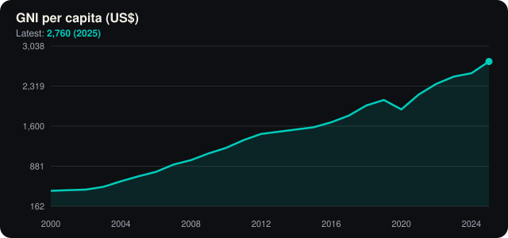
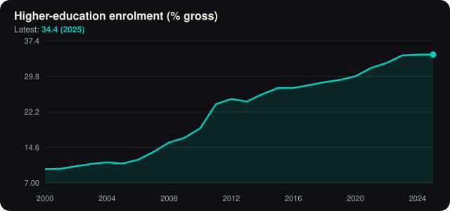
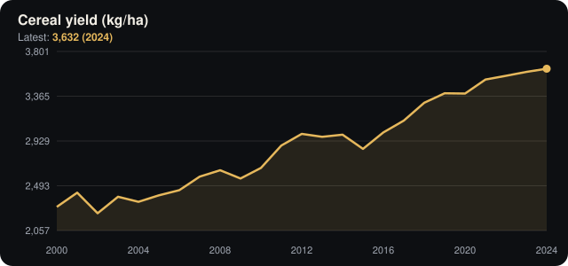
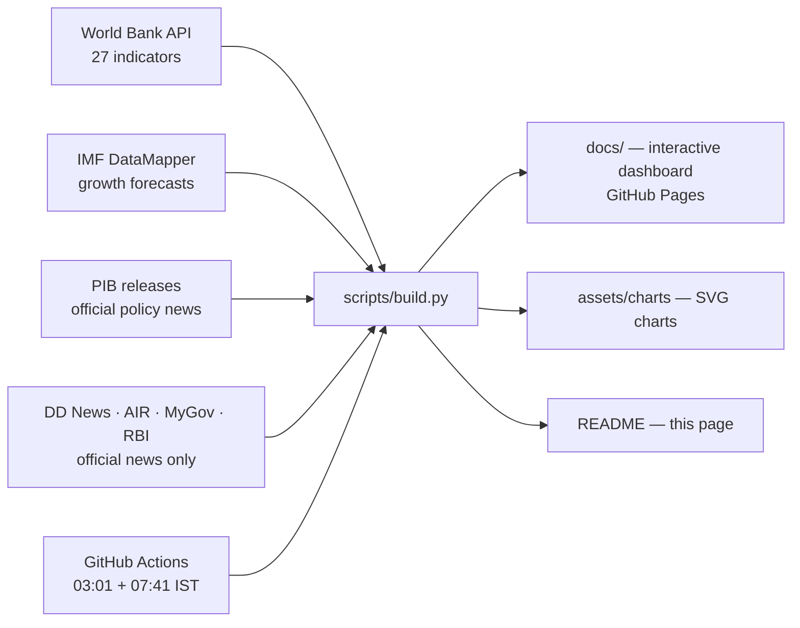

  

  
  
  
  

<b>India's economy, industry, environment and people — in one live, free dashboard.</b> 
GDP and national income from the World Bank, growth forecasts from the IMF, and the day's news for every topic from official government sources only (PIB, DD News, All India Radio, MyGov, RBI) — refreshed automatically twice a day.

  <a href="https://subhadeep998.github.io/India-Development-Dashboard/#economy">📈 Economy</a> ·
  <a href="https://subhadeep998.github.io/India-Development-Dashboard/#industry">🏭 Industry</a> ·
  <a href="https://subhadeep998.github.io/India-Development-Dashboard/#environment">🌿 Environment</a> ·
  <a href="https://subhadeep998.github.io/India-Development-Dashboard/#education">🎓 Education & Scholarships</a> ·
  <a href="https://subhadeep998.github.io/India-Development-Dashboard/#culture">🎭 Arts & Culture</a> ·
  <a href="https://subhadeep998.github.io/India-Development-Dashboard/#food">🌾 Food & Agriculture</a>

---

## 🇮🇳 India at a glance

| 💰 GDP | 📈 Real growth | 👤 GNI per capita | 🔮 IMF growth forecast |
|:--:|:--:|:--:|:--:|
| **US$ 3.96 tn** 2025 | **7.6%** 2025 | **US$ 2,760** 2025 | **7.0% (2026)** IMF WEO |

Last refreshed: 23 Nov 2026, 12:55 IST · Annual figures in current US$ from the World Bank; the forecast is the IMF World Economic Outlook.

---

## 📊 The big trends

<table>
  <tr>
    <td width="50%"></td>
    <td width="50%"></td>
  </tr>
  <tr>
    <td width="50%"></td>
    <td width="50%"></td>
  </tr>
  <tr>
    <td width="50%"></td>
    <td width="50%"></td>
  </tr>
  <tr>
    <td width="50%"></td>
    <td width="50%"></td>
  </tr>
</table>

<a href="https://subhadeep998.github.io/India-Development-Dashboard/"><b>Explore 27 indicators interactively →</b></a>

---

## 📰 Today across India — official sources

### 📈 Economy

GDP, national income, growth, inflation and investment.

- 2026-11-23 · [The New Era of Indian Agriculture and Allied Sectors](https://news.google.com/rss/articles/CBMimgFBVV95cUxPSUZxUkRCX05waVZTZThYT1g1a2h3NXFOTGlfSFFTS0lTTVBDcTl5eXhQZW03aHNzY0E2R0U1VWs3VXNzN2hYRkRpdTJWeGx6MXB0VEpPMGI2dkxzdmg5bmJnSFZhdDRKODlmLW1hb0wzbDh2N3lQQzNwaXRKWXhBbmlWY09ia2FJRXJvTW1Wd2NSMjhkcnYxTEhn?oc=5) — _www.pib.gov.in_
- 2026-11-23 · [Small and Medium Enterprises Growth Fund](https://news.google.com/rss/articles/CBMimgFBVV95cUxOdm03VEc3TWpSYXFDaGxKWUh0WGJvaTJjd0hIT2V6NnZUeXdBUkVRSkpHaURNajdGdF9BRmtfNW5HMW1NZ3pNRFc5RU9qOFBhdjhxdE8yTW1YUUpmVmFUQTYweGZjbTB3WmcwaTc4aUNTdmJmS0UwYm1tYVc0SlRhVlBRYjdtbnZLMHlDcmswNnJqdlNTVWVwNlpR?oc=5) — _pib.gov.in_
- 2026-11-23 · [PM Modi to unveil development projects worth Rs 34,470 crore in Bihar on November 21](https://news.google.com/rss/articles/CBMirgFBVV95cUxPY0pobC1rLVptdXhSMFIwTEk4QXFRUmxJNWt0ZTM5TU5BLWRnWEFnTmZZbldwYmlzZEpJdXdVdkJrOVJvNW55Z1kzU0VEYlI0WWFZSTdtOUFiOUkzUFliSTZoNGZZejlwWTd0cHVYZGtSSlFCNURUb0hFbEpxVk1fdXROSl9oaUd0YkZxd0pGSUdEa1JReUVGcnE1VnZVTlJ4NExCd2tyZF9WdERBU0E?oc=5) — _DD News_
- 2026-11-23 · [PM Modi Welcomes Bloomberg’s Plans to Expand Presence in India](https://news.google.com/rss/articles/CBMikAFBVV95cUxQVV9kRERYSkllemxDR2s3eEEyV0V1cElCZDQ3QTlqMmlTcGtsaml1ZC1BbGhXRUZQVXlCVVc3al9HNGtWR1B4ZGNqUjNLeVNIOTZQdmtRRHdlWWxsQW9pa08tMEM5NkpXSS1RUWY4NERfMWhBS043QWtPSTQ2S3pEUHBnR3pPZ3RtTVBIOGdjUlk?oc=5) — _DD News_

[Open the Economy tab →](https://subhadeep998.github.io/India-Development-Dashboard/#economy)

### 🏭 Industry

Manufacturing, industrial output, structure of the economy and infrastructure.

- 2026-11-23 · [The New Era of Indian Agriculture and Allied Sectors](https://news.google.com/rss/articles/CBMimgFBVV95cUxPSUZxUkRCX05waVZTZThYT1g1a2h3NXFOTGlfSFFTS0lTTVBDcTl5eXhQZW03aHNzY0E2R0U1VWs3VXNzN2hYRkRpdTJWeGx6MXB0VEpPMGI2dkxzdmg5bmJnSFZhdDRKODlmLW1hb0wzbDh2N3lQQzNwaXRKWXhBbmlWY09ia2FJRXJvTW1Wd2NSMjhkcnYxTEhn?oc=5) — _www.pib.gov.in_
- 2026-11-22 · [Union Minister of Commerce and Industry Shri Piyush Goyal Chairs Interaction with Tea Industry Stakeholders at Kurseong…](https://news.google.com/rss/articles/CBMifEFVX3lxTE5EdDVjRU42TFo5VTZWVmJmenRIODY5VHVoYjdlcmVRa25WbkFscTdtZHFWbDRWcGVqQnFTMzNTUG51aFRhaG1uMDhiM0VzUXhYLWFsSWZsWk5ubTh5MkRqYXBKXzRFSGVpMXZkUVNsRUFidUFlcjZOMWktdUE?oc=5) — _pib.gov.in_
- 2026-11-23 · [PM Modi to unveil development projects worth Rs 34,470 crore in Bihar on November 21](https://news.google.com/rss/articles/CBMirgFBVV95cUxPY0pobC1rLVptdXhSMFIwTEk4QXFRUmxJNWt0ZTM5TU5BLWRnWEFnTmZZbldwYmlzZEpJdXdVdkJrOVJvNW55Z1kzU0VEYlI0WWFZSTdtOUFiOUkzUFliSTZoNGZZejlwWTd0cHVYZGtSSlFCNURUb0hFbEpxVk1fdXROSl9oaUd0YkZxd0pGSUdEa1JReUVGcnE1VnZVTlJ4NExCd2tyZF9WdERBU0E?oc=5) — _DD News_
- 2026-11-23 · [Film Industry Veterans Debate Role of Film Schools at 57th IFFI](https://news.google.com/rss/articles/CBMikwFBVV95cUxNOXVrdnFzamRuSlljRS1mdUgwZmlkMDh2MkRVRDRyWUdXMHlRbXBiYWNETjVlRVJvVmhuR1NRNVVfMXAwMjFVU2VIbWhGNGs2Vk9MRGpoSWUxbW9rMUxCNk1PUUduTkJfWW5aMlpFYjVXdHBiZlc3MUZXS01hNDFMWlRGS2FXQ0wtaGlndkYxOWtDUHc?oc=5) — _DD News_

[Open the Industry tab →](https://subhadeep998.github.io/India-Development-Dashboard/#industry)

### 🌿 Environment

Emissions, forests, clean energy and air quality.

- 2026-11-23 · [Nayi Chetna 5.0 to be Launched on 25 November](https://news.google.com/rss/articles/CBMia0FVX3lxTE12d0V0dnA2VHNyUF9kUnQtZm1uWUdCaEZTY1lPamRNcjA4MmxTWlFCZXNHZzk0d3V2WUlrTUVIYkVzMnl6LVdiV1JnZmlra1BJNFBWaWJaWjdDQkxkblAxMTk5ejh0QXBVanlZ?oc=5) — _pib.gov.in_
- 2026-11-22 · [LOK SABHA SPEAKER CALLS FOR A PEOPLE’S MOVEMENT TO MAKE YAMUNA CLEAN AND ENSURE ITS UNINTERRUPTED FLOW](https://news.google.com/rss/articles/CBMia0FVX3lxTE1DRWJBR3lieXpibVI1aEp3QXU5bUtIc2VqamNUdnp1Y3lFaV8ya0FYVTNDODdwZXhyRTJEZTBrcFFmRTQzcU9zY2ZaRElHazRyM2Fld1lRTk8wZXBTLUFWZTZEYk9ETXRPWFAw?oc=5) — _www.pib.gov.in_
- 2026-11-23 · [PM Modi to unveil development projects worth Rs 34,470 crore in Bihar on November 21](https://news.google.com/rss/articles/CBMirgFBVV95cUxPY0pobC1rLVptdXhSMFIwTEk4QXFRUmxJNWt0ZTM5TU5BLWRnWEFnTmZZbldwYmlzZEpJdXdVdkJrOVJvNW55Z1kzU0VEYlI0WWFZSTdtOUFiOUkzUFliSTZoNGZZejlwWTd0cHVYZGtSSlFCNURUb0hFbEpxVk1fdXROSl9oaUd0YkZxd0pGSUdEa1JReUVGcnE1VnZVTlJ4NExCd2tyZF9WdERBU0E?oc=5) — _DD News_
- 2026-11-23 · [COP31 ends without climate pact, Bhupender Yadav says India engaged till the end](https://news.google.com/rss/articles/CBMiqAFBVV95cUxPdkhCeDFhaTFpT08tbldMenJlaTFvTmdrcl9zOUluRkFhWGZaQ3UxMXZmRWp6V1VlNXk1blY1bm1MOWU2a2ZfRU0wV25sQmItVlJHSG83cXBMMTBKWDJLd2ZLOW1YVHliT0VtWlNORjBSQjhjeF85RjNtcWJ5RkNQYzdieEs2ZU5YU2hxTi1GWGFpWjd5SlJ3SnVPaHhpTUs4S1FlN2NRdnE?oc=5) — _DD News_

[Open the Environment tab →](https://subhadeep998.github.io/India-Development-Dashboard/#environment)

### 🎓 Education & Scholarships

Education spending, enrolment, literacy — and where to apply for scholarships.

- 2026-11-23 · [Ayush Pavilion Emerges as a Major Attraction at India International Trade Fair 2026](https://news.google.com/rss/articles/CBMia0FVX3lxTFBYZUpiU3pPLVhsb3Z2X3hsMDJJMEdsbmxUZmRkVmMwVHJBSTFkZkM2WW1vVC1WTnhYZ3pfdERtZE4tZk9pdnBVaUNqYW5IWW4zbUdEaHRza0hIWEc4Qml2WUdkcFg4bV9ST0R3?oc=5) — _www.pib.gov.in_
- 2026-11-22 · [Union Education Minister Pralhad Joshi Lays Foundation Stone for Phase II Construction at IIM Bodh Gaya](https://news.google.com/rss/articles/CBMiaEFVX3lxTE9mOFhfUzIwZEx0a1NPLUt4c2QwMWIxeDhpWTIzX0gtZ0FPSERRWVpueHQzclpRQ3BUX3J1bThtaTc5SEFLSGdhcHRDZ0d4VWlqb1Ezb1REVFNydl94YmdjbDlkOFBhRDAt?oc=5) — _www.pib.gov.in_
- 2026-11-23 · [PM Modi to unveil development projects worth Rs 34,470 crore in Bihar on November 21](https://news.google.com/rss/articles/CBMirgFBVV95cUxPY0pobC1rLVptdXhSMFIwTEk4QXFRUmxJNWt0ZTM5TU5BLWRnWEFnTmZZbldwYmlzZEpJdXdVdkJrOVJvNW55Z1kzU0VEYlI0WWFZSTdtOUFiOUkzUFliSTZoNGZZejlwWTd0cHVYZGtSSlFCNURUb0hFbEpxVk1fdXROSl9oaUd0YkZxd0pGSUdEa1JReUVGcnE1VnZVTlJ4NExCd2tyZF9WdERBU0E?oc=5) — _DD News_
- 2026-11-23 · [Film Industry Veterans Debate Role of Film Schools at 57th IFFI](https://news.google.com/rss/articles/CBMikwFBVV95cUxNOXVrdnFzamRuSlljRS1mdUgwZmlkMDh2MkRVRDRyWUdXMHlRbXBiYWNETjVlRVJvVmhuR1NRNVVfMXAwMjFVU2VIbWhGNGs2Vk9MRGpoSWUxbW9rMUxCNk1PUUduTkJfWW5aMlpFYjVXdHBiZlc3MUZXS01hNDFMWlRGS2FXQ0wtaGlndkYxOWtDUHc?oc=5) — _DD News_

[Open the Education & Scholarships tab →](https://subhadeep998.github.io/India-Development-Dashboard/#education)

### 🎭 Arts & Culture

Heritage, the arts, cultural scholarships and tourism.

- 2026-11-22 · [First SCO Civilisational Dialogue Forum Concludes in New Delhi, Reaffirming Shared Heritage and Strengthening Cultural …](https://news.google.com/rss/articles/CBMifEFVX3lxTE9jNnA3bjhCaFZuVGJ6dEZBZmN0S3ZfdnVoOHg4bS1YYWZmczFWckI3OUpxSDZKV2ZvcHBhRXpyVnFYSVhyc0xraGRjWllxX3B1WmhQcjBMNGRSTjJ3Y1JpOTRueTNRNlFuSlNXTkhMR3ZyYnl5TU4wNk1QczE?oc=5) — _pib.gov.in_
- 2026-11-22 · [North-East Cinema Brings Stories of Cultural Heritage, Identity and Social Realities to 57th IFFI](https://news.google.com/rss/articles/CBMiaEFVX3lxTE1aa1J4TVlQTVQyRE85aUtRX2Q5ZVVjQXlwdS1wM2c4cUZFTkhuc0psMlZDUTJ4Y0dKWjZQLWZKRi1tT3QtRWpHeFVMTTNnQ0ZkY1lsNXlLUEt6aHVPZ0cwOF9YYmFwcEZZ?oc=5) — _www.pib.gov.in_
- 2026-11-23 · [BRICS Film Festival Roundtable Explores Opportunities in Co](https://news.google.com/rss/articles/CBMi3wFBVV95cUxNb1BJNHdMVlRJN2U3bGVfMXpQUS1IQzZFSzFiMzk4U0tCNTNtRXhSNGpjWW80MjZOSDZOQVRiZTI0dE43bkdIeVprbjdlQWNRa3laeUdCbXpKLV8tQTZ4ZkIxYU1wQjVCbVZkOUJoUkQ1aC1TTTZtVENRZHl6cF9hbTZORjhVU3BhMUdpZkZUTU1NSmFwLUFnMkYyMVd1MjhLM0Z0TE5UakF5WDJELUdtLVhxNDhzWFc3WVR3STY2ckdnNC1GSzUxUTZiMktSSjZ5WHYteU00Z2Zhcm5hc2Zz?oc=5) — _DD News_
- 2026-11-23 · [First SCO Civilisational Dialogue Forum Concludes in New Delhi, Focuses on Strengthening Cultural Ties Among Member Nat…](https://news.google.com/rss/articles/CBMi4gFBVV95cUxNdDdBem1ZZUVIS0hCVUIxYUJ1UlZ5WWRCTzVjMFFXQU91Z2RxMXVSd1dXZkVQS09tZ2xxdUpUWWQ4cXQ1MDk3RFoyQXBlUVdSRVhsQ2J2Yl9XMXVGd0EwdklfOUJncWNyS3J6VXBrNmVaUzUyTGs1RXdMMjNIREZiV2FuRlVsQWRNaWJfZl9qTFRVYkZhcGtqMFVTRHlRYXFKM0pqVGtpY3NOYW9jRDNVQnc0RmgtbkdyN1BFazFnTnp3b25rd1oxRjNkTC16NW1WMjNKYzkxbHc3eTFvLXFhWG9n?oc=5) — _DD News_

[Open the Arts & Culture tab →](https://subhadeep998.github.io/India-Development-Dashboard/#culture)

### 🌾 Food & Agriculture

Food security, farm output, nutrition and farmer support.

- 2026-11-23 · [The New Era of Indian Agriculture and Allied Sectors](https://news.google.com/rss/articles/CBMimgFBVV95cUxPSUZxUkRCX05waVZTZThYT1g1a2h3NXFOTGlfSFFTS0lTTVBDcTl5eXhQZW03aHNzY0E2R0U1VWs3VXNzN2hYRkRpdTJWeGx6MXB0VEpPMGI2dkxzdmg5bmJnSFZhdDRKODlmLW1hb0wzbDh2N3lQQzNwaXRKWXhBbmlWY09ia2FJRXJvTW1Wd2NSMjhkcnYxTEhn?oc=5) — _www.pib.gov.in_
- 2026-11-23 · [Nayi Chetna 5.0 to be Launched on 25 November](https://news.google.com/rss/articles/CBMia0FVX3lxTE12d0V0dnA2VHNyUF9kUnQtZm1uWUdCaEZTY1lPamRNcjA4MmxTWlFCZXNHZzk0d3V2WUlrTUVIYkVzMnl6LVdiV1JnZmlra1BJNFBWaWJaWjdDQkxkblAxMTk5ejh0QXBVanlZ?oc=5) — _pib.gov.in_
- 2026-11-23 · [PM Modi to unveil development projects worth Rs 34,470 crore in Bihar on November 21](https://news.google.com/rss/articles/CBMirgFBVV95cUxPY0pobC1rLVptdXhSMFIwTEk4QXFRUmxJNWt0ZTM5TU5BLWRnWEFnTmZZbldwYmlzZEpJdXdVdkJrOVJvNW55Z1kzU0VEYlI0WWFZSTdtOUFiOUkzUFliSTZoNGZZejlwWTd0cHVYZGtSSlFCNURUb0hFbEpxVk1fdXROSl9oaUd0YkZxd0pGSUdEa1JReUVGcnE1VnZVTlJ4NExCd2tyZF9WdERBU0E?oc=5) — _DD News_
- 2026-11-23 · [Punjab Records 6,874 Stubble-Burning Cases, Rs 11.94 Crore Environmental Compensation Imposed](https://news.google.com/rss/articles/CBMiuAFBVV95cUxOV1BhSVIzRk1JWUdRdlJLbTVBMzBmY0NfdzJQU2tOMW9EYmx0V1J0ZnZicWVWdFVqYjZXNDFaR0JleW83S3pXUnhCYkRsV1FiUk9KLVZTM1dSaGNzXzB3YlpITkdSYTZWUkdLLXhZRklSTF9VWGFITTkzbnZSclpxdHMwdVV3S0U5bl84cWgtZTlXWjF3LXV2blMwLUh3NjBzZ1d2VVphdnVCNktYVUtDN1JXVzQzdUxu?oc=5) — _DD News_

[Open the Food & Agriculture tab →](https://subhadeep998.github.io/India-Development-Dashboard/#food)

---

## 🏛️ Government schemes, at a glance

| Area | Start here |
|:--|:--|
| 🎓 **Scholarships** | [National Scholarship Portal](https://scholarships.gov.in) · [PM Vidyalaxmi (education loans)](https://pmvidyalaxmi.co.in) · [INSPIRE](https://online-inspire.gov.in) · [PM Research Fellowship](https://pmrf.in) · [AICTE Pragati & Saksham](https://www.aicte-india.org) |
| 🎭 **Arts & culture** | [Ministry of Culture](https://www.indiaculture.gov.in) · [CCRT scholarships for young artists](https://ccrtindia.gov.in) · [Sangeet Natak Akademi](https://www.sangeetnatak.gov.in) · [Lalit Kala Akademi](https://lalitkala.gov.in) |
| 🌾 **Food** | [National Food Security Act](https://nfsa.gov.in) · [PM-KISAN](https://pmkisan.gov.in) · [PM-POSHAN](https://pmposhan.education.gov.in) · [Eat Right India](https://eatrightindia.gov.in) · [e-NAM](https://enam.gov.in) |
| 🌿 **Environment** | [National Clean Air Programme](https://prana.cpcb.gov.in) · [PM Surya Ghar](https://pmsuryaghar.gov.in) · [PM-KUSUM](https://pmkusum.mnre.gov.in) · [Mission LiFE](https://missionlife-moefcc.nic.in) |
| 🏭 **Industry** | [Make in India](https://www.makeinindia.com) · [PLI schemes](https://www.investindia.gov.in/production-linked-incentives-schemes-india) · [Startup India](https://www.startupindia.gov.in) · [PM Gati Shakti](https://pmgatishakti.gov.in) |
| 📈 **Economy** | [Union Budget](https://www.indiabudget.gov.in) · [RBI](https://www.rbi.org.in) · [MoSPI](https://www.mospi.gov.in) · [GST Council](https://gstcouncil.gov.in) |

> Scheme rules, amounts and deadlines change — always confirm on the official portal before applying.

---

## ⚙️ How it works

- **Runs twice a day** (03:01 and 07:41 IST), away from GitHub's busy hours — if one run is delayed or dropped, the second catches up.
- **Never goes blank:** if a source is down, the last good data is kept.
- **All sources are free and official.** Official sources only — no general media. Only headlines and links are stored — click through to read the original reporting.

> Independent educational project; not affiliated with the Government of India, the World Bank or the IMF.

---

  ⭐ <b>Star</b> to bookmark · 👤 <a href="https://github.com/Subhadeep998"><b>Follow @Subhadeep998</b></a> 
  Built by <a href="https://www.subhadeepaditya.in">Subhadeep Aditya</a> — healthcare intelligence analyst and LL.B. student · Kolkata, India

