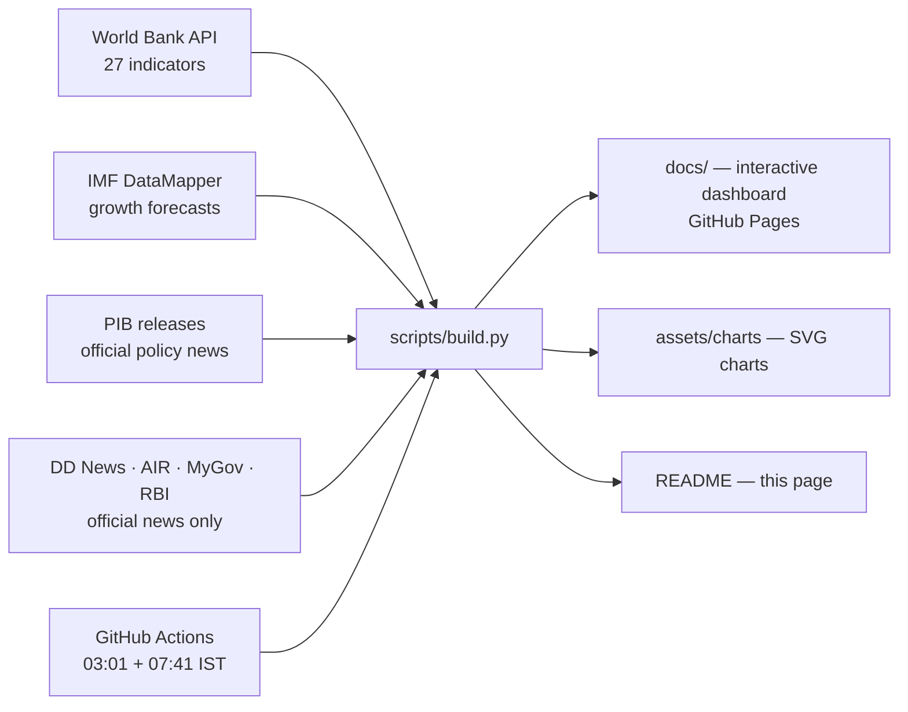

  

  
  
  
  

<b>India's economy, industry, environment and people — in one live, free dashboard.</b> 
GDP and national income from the World Bank, growth forecasts from the IMF, and the day's news for every topic from official government sources only (PIB, DD News, All India Radio, MyGov, RBI) — refreshed automatically twice a day.

  <a href="https://subhadeep998.github.io/India-Development-Dashboard/#economy">📈 Economy</a> ·
  <a href="https://subhadeep998.github.io/India-Development-Dashboard/#industry">🏭 Industry</a> ·
  <a href="https://subhadeep998.github.io/India-Development-Dashboard/#environment">🌿 Environment</a> ·
  <a href="https://subhadeep998.github.io/India-Development-Dashboard/#education">🎓 Education & Scholarships</a> ·
  <a href="https://subhadeep998.github.io/India-Development-Dashboard/#culture">🎭 Arts & Culture</a> ·
  <a href="https://subhadeep998.github.io/India-Development-Dashboard/#food">🌾 Food & Agriculture</a>

---

## 🇮🇳 India at a glance

| 💰 GDP | 📈 Real growth | 👤 GNI per capita | 🔮 IMF growth forecast |
|:--:|:--:|:--:|:--:|
| **US$ 3.96 tn** 2025 | **7.6%** 2025 | **US$ 2,760** 2025 | **7.0% (2026)** IMF WEO |

Last refreshed: 27 Nov 2026, 16:17 IST · Annual figures in current US$ from the World Bank; the forecast is the IMF World Economic Outlook.

---

## 📊 The big trends

<table>
  <tr>
    <td width="50%"></td>
    <td width="50%"></td>
  </tr>
  <tr>
    <td width="50%"></td>
    <td width="50%"></td>
  </tr>
  <tr>
    <td width="50%"></td>
    <td width="50%"></td>
  </tr>
  <tr>
    <td width="50%"></td>
    <td width="50%"></td>
  </tr>
</table>

<a href="https://subhadeep998.github.io/India-Development-Dashboard/"><b>Explore 27 indicators interactively →</b></a>

---

## 📰 Today across India — official sources

### 📈 Economy

GDP, national income, growth, inflation and investment.

- 2026-11-27 · [Rs 1,05,155 crore of gross GST revenue collected in the month of October 2020](https://news.google.com/rss/articles/CBMi6wFBVV95cUxQaDBObmhDV3ZMWFBndGlsMXd2a00wdHJ1NmE2cEVIajZ0Znl5Znc1Zm1kRm1XdmFJQnJwSzd6Y0ZoZGFpdUt6bFVEcXZDeWhsNi1jX0I1WktjQVZiUWRtS3NZTnVxeUtzMzJyRDJWTG1Cb0p1NEdZanpCOXlXUms5WTlLb2NvaG1iZ21zT21sVFNUNDlfamtQeVlCVkpvdHdMT3hoRDhVbmxza2U1cjdvb0tWbTUxM3VNZEVNXzNkSmhqZktNYXNUOUthZHFCV3JaN29HaTRnVVJGcXNUd2VGd1A1QVBuUkR6THlj?oc=5) — _www.pib.gov.in_
- 2026-11-27 · [Small and Medium Enterprises Growth Fund](https://news.google.com/rss/articles/CBMimgFBVV95cUxOdm03VEc3TWpSYXFDaGxKWUh0WGJvaTJjd0hIT2V6NnZUeXdBUkVRSkpHaURNajdGdF9BRmtfNW5HMW1NZ3pNRFc5RU9qOFBhdjhxdE8yTW1YUUpmVmFUQTYweGZjbTB3WmcwaTc4aUNTdmJmS0UwYm1tYVc0SlRhVlBRYjdtbnZLMHlDcmswNnJqdlNTVWVwNlpR?oc=5) — _pib.gov.in_
- 2026-11-27 · [Finance Minister Concludes Pre-Budget Consultations for Union Budget 2027-28](https://news.google.com/rss/articles/CBMipAFBVV95cUxPSXBQSEIzcnZsaTdOSkM0bTNXakRMS211eGM3bTYxV0ptZ1NWbHAwNWZfeVk0Z3BuTWt4T0RpNF9ZeEU1OTRpZHJ1dUoxeW9TcndzcElSMFlSNW96cmZ0eDFZV29CTWpTVmNIU3poRGVTS2pqNmt3M0ZnRDBxTWs1M2s5LTl0aXBPR1czeC1LT2RXV1ExMmJjSlpwenRWbVlyODl2Tg?oc=5) — _DD News_
- 2026-11-27 · [India Retains Third Spot in Lowy’s Asia Power Index 2026, PM Modi Ranked Most Effective Regional Leader](https://news.google.com/rss/articles/CBMixgFBVV95cUxNLWpudjFpM2VkVmVXdHBwWHBVZ0JSQkJtNDIzZWVQRzQzbXlVTzVUT2hKN2k1NHpNWlhYRHpBbk9SLXU1X1o5cExtcGJHLTl4NXRqVVRpUGZMdTFQdTBzUlczUVJwLWt1RUo2bldwR2p0S05jb1hINDJVWWl2YjNSQklLSnRaNVZBeGx3OFZPWllSMXBUWGh4SDhIS25TZG1iV2k3UXk4V250ajJLZFc5ZDZCWHl5S2xGa3AwaGJJU05yVTJ4M1E?oc=5) — _DD News_

[Open the Economy tab →](https://subhadeep998.github.io/India-Development-Dashboard/#economy)

### 🏭 Industry

Manufacturing, industrial output, structure of the economy and infrastructure.

- 2026-11-27 · [India’s Growth Story Remains Strong, Resilient and Trustworthy Amid Global Uncertainties: Union Minister of Commerce an…](https://news.google.com/rss/articles/CBMia0FVX3lxTE5fb2Q0aFJNdVhSalRtaG56b2pSTUlhSXVPbUw4N3NIUFM2Rlc2R25YcmtJUVgyRVhEVi0tTXMtdFZqRTRiUzh4RDVkQWNHSExiVllscmN1U1ctb1lJTjhKQlFYdWdvOHFJeWE0?oc=5) — _www.pib.gov.in_
- 2026-11-27 · [Manufacturing Momentum:Building a Self-Reliant India](https://news.google.com/rss/articles/CBMidkFVX3lxTFBvRmtvLV9MbC1nX2RudWdiZ2xQUnpCRmtTTU0xNkF2eV96Zi1kUUhkVjlrMWNGUkVKZzZXRUdEQjN0eGZRS3AxSm1BWC0tbnVHOXU2LUJDNlR1eDVpY1B0N09Ga01xUG9XSzVRejNpOHRvREdBS3c?oc=5) — _www.pib.gov.in_
- 2026-11-27 · [Finance Minister Concludes Pre-Budget Consultations for Union Budget 2027-28](https://news.google.com/rss/articles/CBMipAFBVV95cUxPSXBQSEIzcnZsaTdOSkM0bTNXakRMS211eGM3bTYxV0ptZ1NWbHAwNWZfeVk0Z3BuTWt4T0RpNF9ZeEU1OTRpZHJ1dUoxeW9TcndzcElSMFlSNW96cmZ0eDFZV29CTWpTVmNIU3poRGVTS2pqNmt3M0ZnRDBxTWs1M2s5LTl0aXBPR1czeC1LT2RXV1ExMmJjSlpwenRWbVlyODl2Tg?oc=5) — _DD News_
- 2026-11-27 · [India Retains Third Spot in Lowy’s Asia Power Index 2026, PM Modi Ranked Most Effective Regional Leader](https://news.google.com/rss/articles/CBMixgFBVV95cUxNLWpudjFpM2VkVmVXdHBwWHBVZ0JSQkJtNDIzZWVQRzQzbXlVTzVUT2hKN2k1NHpNWlhYRHpBbk9SLXU1X1o5cExtcGJHLTl4NXRqVVRpUGZMdTFQdTBzUlczUVJwLWt1RUo2bldwR2p0S05jb1hINDJVWWl2YjNSQklLSnRaNVZBeGx3OFZPWllSMXBUWGh4SDhIS25TZG1iV2k3UXk4V250ajJLZFc5ZDZCWHl5S2xGa3AwaGJJU05yVTJ4M1E?oc=5) — _DD News_

[Open the Industry tab →](https://subhadeep998.github.io/India-Development-Dashboard/#industry)

### 🌿 Environment

Emissions, forests, clean energy and air quality.

- 2026-11-27 · [India’s Renewable Energy Journey: Powering a Cleaner Future](https://news.google.com/rss/articles/CBMifEFVX3lxTE1YMkhNLUFqcUc0d3VxaDlweW9lQVRzdEFwd3h0bmJyZHhjQk54MlYtV2xEazRES0NMSlNrZk9HLVRCRUpWSjRDdHdjbTdHandWZUt5clk1SlFvTlFwY3hnS2cyTURMU3hGSTBLQ1owY3pQd1pzOHBGSmsxVWY?oc=5) — _www.pib.gov.in_
- 2026-11-27 · [STPI Inaugurates its 75th Centre in Bareilly to Strengthen Uttar Pradesh’s IT/ITeS and Startup Ecosystem](https://news.google.com/rss/articles/CBMie0FVX3lxTE1wb1FkQ3VmWG5MSWR6aTB0dUJTUE03alp1TTMzZjFNMDFZMWp1Qk85aFBSVDlja3FUQXpNSHlIeE9VbnpFR2VkdzUzZXd5M1ozVi12VGZLSnh5MG8xaDVIbHNjOGUzYlEza3hFUW1VX0RIekJnS2M3Tlk0VQ?oc=5) — _pib.gov.in_
- 2026-11-27 · [Finance Minister Concludes Pre-Budget Consultations for Union Budget 2027-28](https://news.google.com/rss/articles/CBMipAFBVV95cUxPSXBQSEIzcnZsaTdOSkM0bTNXakRMS211eGM3bTYxV0ptZ1NWbHAwNWZfeVk0Z3BuTWt4T0RpNF9ZeEU1OTRpZHJ1dUoxeW9TcndzcElSMFlSNW96cmZ0eDFZV29CTWpTVmNIU3poRGVTS2pqNmt3M0ZnRDBxTWs1M2s5LTl0aXBPR1czeC1LT2RXV1ExMmJjSlpwenRWbVlyODl2Tg?oc=5) — _DD News_
- 2026-11-27 · [India Retains Third Spot in Lowy’s Asia Power Index 2026, PM Modi Ranked Most Effective Regional Leader](https://news.google.com/rss/articles/CBMixgFBVV95cUxNLWpudjFpM2VkVmVXdHBwWHBVZ0JSQkJtNDIzZWVQRzQzbXlVTzVUT2hKN2k1NHpNWlhYRHpBbk9SLXU1X1o5cExtcGJHLTl4NXRqVVRpUGZMdTFQdTBzUlczUVJwLWt1RUo2bldwR2p0S05jb1hINDJVWWl2YjNSQklLSnRaNVZBeGx3OFZPWllSMXBUWGh4SDhIS25TZG1iV2k3UXk4V250ajJLZFc5ZDZCWHl5S2xGa3AwaGJJU05yVTJ4M1E?oc=5) — _DD News_

[Open the Environment tab →](https://subhadeep998.github.io/India-Development-Dashboard/#environment)

### 🎓 Education & Scholarships

Education spending, enrolment, literacy — and where to apply for scholarships.

- 2026-11-27 · [Press Note Details: Press Information Bureau](https://news.google.com/rss/articles/CBMieEFVX3lxTFBtaG43R1dKZUN5X2k4RzFuTkJqNWpCV2ljU2VvNDdQZVF6cXB6ZjVSSUFjcS10Yl83cXJPZ2F3Q1l3WVkzTmI5dnkxVkdBX3MyUkpkaWtmRTNPdkdPcUFsang1UUl3X1VMQ1Y2dkJMa3hPMTJ5OVZ0VA?oc=5) — _pib.gov.in_
- 2026-11-27 · [National Overseas Scholarship Scheme for Scheduled Tribe Students](https://news.google.com/rss/articles/CBMia0FVX3lxTE1VcnUwUmtnNDZoZWo1OHNNbWphaEE2Vll0WE56UWtIUERDcHoyby00c3NrVXhhSnBLQ0I4VTBWV2Nrb1ZVMUJjYTBKLVMzUlZzQkJveHdvXy1XU1o1RnZ5SW9xZkJfZ3VoVGRV?oc=5) — _www.pib.gov.in_
- 2026-11-27 · [Finance Minister Concludes Pre-Budget Consultations for Union Budget 2027-28](https://news.google.com/rss/articles/CBMipAFBVV95cUxPSXBQSEIzcnZsaTdOSkM0bTNXakRMS211eGM3bTYxV0ptZ1NWbHAwNWZfeVk0Z3BuTWt4T0RpNF9ZeEU1OTRpZHJ1dUoxeW9TcndzcElSMFlSNW96cmZ0eDFZV29CTWpTVmNIU3poRGVTS2pqNmt3M0ZnRDBxTWs1M2s5LTl0aXBPR1czeC1LT2RXV1ExMmJjSlpwenRWbVlyODl2Tg?oc=5) — _DD News_
- 2026-11-27 · [India Retains Third Spot in Lowy’s Asia Power Index 2026, PM Modi Ranked Most Effective Regional Leader](https://news.google.com/rss/articles/CBMixgFBVV95cUxNLWpudjFpM2VkVmVXdHBwWHBVZ0JSQkJtNDIzZWVQRzQzbXlVTzVUT2hKN2k1NHpNWlhYRHpBbk9SLXU1X1o5cExtcGJHLTl4NXRqVVRpUGZMdTFQdTBzUlczUVJwLWt1RUo2bldwR2p0S05jb1hINDJVWWl2YjNSQklLSnRaNVZBeGx3OFZPWllSMXBUWGh4SDhIS25TZG1iV2k3UXk4V250ajJLZFc5ZDZCWHl5S2xGa3AwaGJJU05yVTJ4M1E?oc=5) — _DD News_

[Open the Education & Scholarships tab →](https://subhadeep998.github.io/India-Development-Dashboard/#education)

### 🎭 Arts & Culture

Heritage, the arts, cultural scholarships and tourism.

- 2026-11-27 · [Sacred Relics of Shakyamuni Buddha Arrive at Golden Pagoda, Namsai, Marking the Final Phase of Exposition in Arunachal …](https://news.google.com/rss/articles/CBMifEFVX3lxTE95Y08xSkllXzdkWUc3cjVyRmRRSEJtTmF6SDRJeDVoT1pqU3hjZ0dRWVByeVJvU1RXaExsaFZLSjBaUjhheDhEVzVsd2pzS3Q4ZnlWYnYzZG05MnJwU1BvWkMxdGVtSXh1R3hTdDhBQ2dmS2NYSUp1SjQtNkY?oc=5) — _www.pib.gov.in_
- 2026-11-26 · [Three Antiquities Repatriated from USA and Netherlands Handed Over to Tamil Nadu Police by ASI](https://news.google.com/rss/articles/CBMifkFVX3lxTE5MdDc3YXNJNUliMjZpN0hsMm9QU3RLNzh6MF9wMWk5RzFOLVNOUXY5T3gzOWxOQ3phdlFnZHBwRHMtQnEyeUhYbVJ5T2FYWS15Skhacjd5YXF2TVp4VDZjd2hiekUxMEJzbWp2dW5oY2EwTTJBX1hMT0V1WUh6UQ?oc=5) — _pib.gov.in_
- 2026-11-27 · [New museum to have tech-based crowd management system; restoration work in full swing at North Block](https://news.google.com/rss/articles/CBMiwwFBVV95cUxOMXE2UEpneElib3B0RnpObGJJYWl3bG9EcFJXTTM4ekpENWVzUW4tdzN0NnVuUmszTTFIbjJzZVRVSHNrNXhBQjBvbWMyRkxVTF93clhlRkZlaV9kNnlkd0ZnY2tUMlJSSzRsUzhPb1M1VmNyaXZaUFJQOWEwNi0zRS1yd0t5N3A3V0JvbVVHNXpIcjFQRzdZbE1OSjhQTTFRNVJMck9BQk05NjdXSGc3WC0wdjhaNHdVS0VYTDEtelF4SFU?oc=5) — _DD News_
- 2026-11-27 · [IFFI evenings bring cinema, culture and creative exchanges to Goa](https://news.google.com/rss/articles/CBMilAFBVV95cUxNaXBNR2ttVk8tUXgtTmZhWkhPUXBOV3NJRDhGWGZ2ZXM5SGNKTG5XY2lhNGpBLTJ6QUs3dzgwSjVXZEhHMzJSWTNmU0tDTTI4c21vbHRwZVA0eWtrTWpyY0Z3UTBpdVdqX1NOQmltQ3l6dDh5N0dUcVU0dXFwb19XOEJQcmhMdU04UFZxR0oxM1FzbjZY?oc=5) — _DD News_

[Open the Arts & Culture tab →](https://subhadeep998.github.io/India-Development-Dashboard/#culture)

### 🌾 Food & Agriculture

Food security, farm output, nutrition and farmer support.

- 2026-11-27 · [GRSE delivers Vindhyagiri, the third and final Advanced Guided-Missile Frigate of the P17A series to the Indian Navy](https://news.google.com/rss/articles/CBMiakFVX3lxTE1xWTdGM1dfWUNmYzFodElHajhXd1FlTDAzNU1lc3hwSmUtc1dGQzdQdm9KRXQtVzNQRU5Bb194M0NYRC1UWkdOZ3JEQXZHNWd3QWNrUHhlUGM4OHVuMXduSWk5c3RDQWh6UkE?oc=5) — _pib.gov.in_
- 2026-11-27 · [PRESIDENT OF INDIA GRACES THE VALEDICTORY CEREMONY OF THE GOLDEN JUBILEE CELEBRATIONS OF THE VAIDYARATNAM AYURVEDA COLL…](https://news.google.com/rss/articles/CBMia0FVX3lxTE0zbUM1bnhpckJ4eUw1NEZ5ckpHZmNaOVAxNE5CYzdDUHR4OUxYc1RDZ2QwTWFLcU5CemR1Mk15YWltNUJXc1F1eWljb2lab05mSWk5dnFwbS1QcW5pS2loRXpPd0Rlek5EdzVv?oc=5) — _pib.gov.in_
- 2026-11-27 · [Finance Minister Concludes Pre-Budget Consultations for Union Budget 2027-28](https://news.google.com/rss/articles/CBMipAFBVV95cUxPSXBQSEIzcnZsaTdOSkM0bTNXakRMS211eGM3bTYxV0ptZ1NWbHAwNWZfeVk0Z3BuTWt4T0RpNF9ZeEU1OTRpZHJ1dUoxeW9TcndzcElSMFlSNW96cmZ0eDFZV29CTWpTVmNIU3poRGVTS2pqNmt3M0ZnRDBxTWs1M2s5LTl0aXBPR1czeC1LT2RXV1ExMmJjSlpwenRWbVlyODl2Tg?oc=5) — _DD News_
- 2026-11-27 · [MP govt presents Rs 4.38 lakh crore budget with focus on women, farmers, infra](https://news.google.com/rss/articles/CBMipAFBVV95cUxPeTluRzhxdG42XzhWUF9IY3FvMG1zWEZ6RHp1bkJtc2hINlI4VEZoUzlIYVd4TVpLVGROaUZlYlBDR2s1QXdCNHBSQWJzbU9YY0NVczdTNlMzNmxobG9KN3pSXzZoR1ZwTmRJQlFxZVVfVm9MTG9QZ3M4ZGQyQ3ZOSk5SWG4weWlNNjNJVlo0bXdWWlptTGhTaWwtd3dCNTR1TG1MYQ?oc=5) — _DD News_

[Open the Food & Agriculture tab →](https://subhadeep998.github.io/India-Development-Dashboard/#food)

---

## 🏛️ Government schemes, at a glance

| Area | Start here |
|:--|:--|
| 🎓 **Scholarships** | [National Scholarship Portal](https://scholarships.gov.in) · [PM Vidyalaxmi (education loans)](https://pmvidyalaxmi.co.in) · [INSPIRE](https://online-inspire.gov.in) · [PM Research Fellowship](https://pmrf.in) · [AICTE Pragati & Saksham](https://www.aicte-india.org) |
| 🎭 **Arts & culture** | [Ministry of Culture](https://www.indiaculture.gov.in) · [CCRT scholarships for young artists](https://ccrtindia.gov.in) · [Sangeet Natak Akademi](https://www.sangeetnatak.gov.in) · [Lalit Kala Akademi](https://lalitkala.gov.in) |
| 🌾 **Food** | [National Food Security Act](https://nfsa.gov.in) · [PM-KISAN](https://pmkisan.gov.in) · [PM-POSHAN](https://pmposhan.education.gov.in) · [Eat Right India](https://eatrightindia.gov.in) · [e-NAM](https://enam.gov.in) |
| 🌿 **Environment** | [National Clean Air Programme](https://prana.cpcb.gov.in) · [PM Surya Ghar](https://pmsuryaghar.gov.in) · [PM-KUSUM](https://pmkusum.mnre.gov.in) · [Mission LiFE](https://missionlife-moefcc.nic.in) |
| 🏭 **Industry** | [Make in India](https://www.makeinindia.com) · [PLI schemes](https://www.investindia.gov.in/production-linked-incentives-schemes-india) · [Startup India](https://www.startupindia.gov.in) · [PM Gati Shakti](https://pmgatishakti.gov.in) |
| 📈 **Economy** | [Union Budget](https://www.indiabudget.gov.in) · [RBI](https://www.rbi.org.in) · [MoSPI](https://www.mospi.gov.in) · [GST Council](https://gstcouncil.gov.in) |

> Scheme rules, amounts and deadlines change — always confirm on the official portal before applying.

---

## ⚙️ How it works

- **Runs twice a day** (03:01 and 07:41 IST), away from GitHub's busy hours — if one run is delayed or dropped, the second catches up.
- **Never goes blank:** if a source is down, the last good data is kept.
- **All sources are free and official.** Official sources only — no general media. Only headlines and links are stored — click through to read the original reporting.

> Independent educational project; not affiliated with the Government of India, the World Bank or the IMF.

---

  ⭐ <b>Star</b> to bookmark · 👤 <a href="https://github.com/Subhadeep998"><b>Follow @Subhadeep998</b></a> 
  Built by <a href="https://www.subhadeepaditya.in">Subhadeep Aditya</a> — healthcare intelligence analyst and LL.B. student · Kolkata, India

