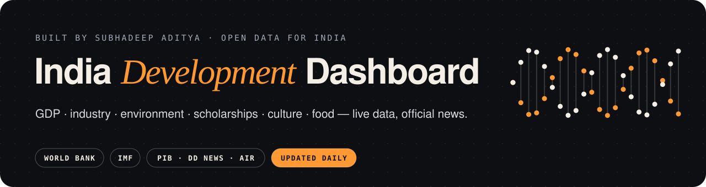
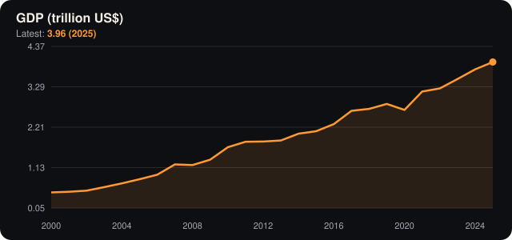
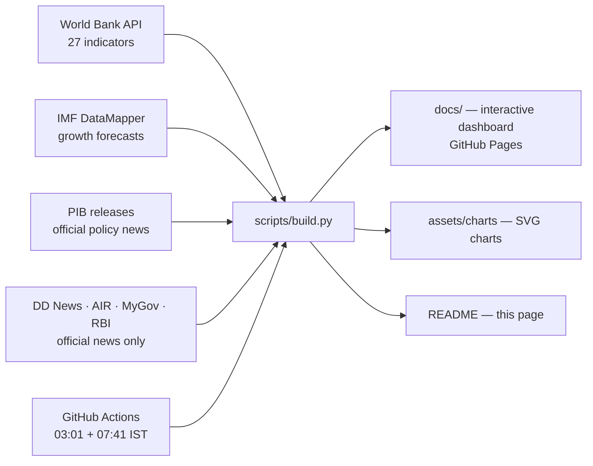

  

  
  
  
  

<b>India's economy, industry, environment and people — in one live, free dashboard.</b> 
GDP and national income from the World Bank, growth forecasts from the IMF, and the day's news for every topic from official government sources only (PIB, DD News, All India Radio, MyGov, RBI) — refreshed automatically twice a day.

  <a href="https://subhadeep998.github.io/India-Development-Dashboard/#economy">📈 Economy</a> ·
  <a href="https://subhadeep998.github.io/India-Development-Dashboard/#industry">🏭 Industry</a> ·
  <a href="https://subhadeep998.github.io/India-Development-Dashboard/#environment">🌿 Environment</a> ·
  <a href="https://subhadeep998.github.io/India-Development-Dashboard/#education">🎓 Education & Scholarships</a> ·
  <a href="https://subhadeep998.github.io/India-Development-Dashboard/#culture">🎭 Arts & Culture</a> ·
  <a href="https://subhadeep998.github.io/India-Development-Dashboard/#food">🌾 Food & Agriculture</a>

---

## 🇮🇳 India at a glance

| 💰 GDP | 📈 Real growth | 👤 GNI per capita | 🔮 IMF growth forecast |
|:--:|:--:|:--:|:--:|
| **US$ 3.96 tn** 2025 | **7.6%** 2025 | **US$ 2,760** 2025 | **7.0% (2026)** IMF WEO |

Last refreshed: 24 Nov 2026, 10:54 IST · Annual figures in current US$ from the World Bank; the forecast is the IMF World Economic Outlook.

---

## 📊 The big trends

<table>
  <tr>
    <td width="50%"></td>
    <td width="50%"></td>
  </tr>
  <tr>
    <td width="50%"></td>
    <td width="50%"></td>
  </tr>
  <tr>
    <td width="50%"></td>
    <td width="50%"></td>
  </tr>
  <tr>
    <td width="50%"></td>
    <td width="50%"></td>
  </tr>
</table>

<a href="https://subhadeep998.github.io/India-Development-Dashboard/"><b>Explore 27 indicators interactively →</b></a>

---

## 📰 Today across India — official sources

### 📈 Economy

GDP, national income, growth, inflation and investment.

- 2026-11-24 · [Manufacturing Momentum:Building a Self-Reliant India](https://news.google.com/rss/articles/CBMidkFVX3lxTFBvRmtvLV9MbC1nX2RudWdiZ2xQUnpCRmtTTU0xNkF2eV96Zi1kUUhkVjlrMWNGUkVKZzZXRUdEQjN0eGZRS3AxSm1BWC0tbnVHOXU2LUJDNlR1eDVpY1B0N09Ga01xUG9XSzVRejNpOHRvREdBS3c?oc=5) — _www.pib.gov.in_
- 2026-11-24 · [Prime Minister shares Sanskrit Subhashitam invoking Goddess Ganga](https://news.google.com/rss/articles/CBMia0FVX3lxTE9DWUxnRzdhMDdvMEpmdjRUaGhMRGRKaUVKcDk4bHlTZDBtcVQzQ2d1WHh1X2QzS3JmOTNnNTdoOGN5c3lYV0FiZnNVWFAxT1JHVzF0NDE1cV9Ta3lCMGdpRUVPeWVYWnRxUHdN?oc=5) — _pib.gov.in_
- 2026-11-24 · [India, South Korea announce 25 key outcomes, elevate ties to ‘futuristic partnership’](https://news.google.com/rss/articles/CBMiqwFBVV95cUxOM3RGeUl2dWZnYVhlTDlVbXd5R3IzUmpwMWpndTRpR19MRlJUOFRpQTlqSWVvQTRyODdFLVZ0OVZQZlVDa3UzUFVCQUc0RGp1V1dQNS1XMW96X3RDOXo4M1RWNzUzYng0ZnlIckozN0VMUkF2ZGR1am4yNlU5SGJ1R1RFb2wtbjc2OHVmaFo4ZmkxUlFMWG94ZXZ5X2NFbXFZbldwd2tWMWtoNk0?oc=5) — _DD News_
- 2026-11-24 · [NSA Ajit Doval visits Vietnam, discusses security and intelligence cooperation](https://news.google.com/rss/articles/CBMipgFBVV95cUxOclFtWTY3dFlNUFVMTUxpcDVLTXQza1RDZVRsMUZybTQwWTZIbXRmaS1QLU05cFBLa2wwajVIa3Q4RFVrYjJsTjZSZ3VPdGNRc01zNmxVYmNaNUI0TW4wcVFzUVU4bXZxWTBxUUlaTndaYmpOdHlud0dscVl0QlFsQ0FCMWUzNXRQZm1qZUVqbTI1RlRUaE00MER4Z3JTNzBMOGRYTVFB?oc=5) — _DD News_

[Open the Economy tab →](https://subhadeep998.github.io/India-Development-Dashboard/#economy)

### 🏭 Industry

Manufacturing, industrial output, structure of the economy and infrastructure.

- 2026-11-24 · [Manufacturing Momentum:Building a Self-Reliant India](https://news.google.com/rss/articles/CBMidkFVX3lxTFBvRmtvLV9MbC1nX2RudWdiZ2xQUnpCRmtTTU0xNkF2eV96Zi1kUUhkVjlrMWNGUkVKZzZXRUdEQjN0eGZRS3AxSm1BWC0tbnVHOXU2LUJDNlR1eDVpY1B0N09Ga01xUG9XSzVRejNpOHRvREdBS3c?oc=5) — _www.pib.gov.in_
- 2026-11-24 · [Prime Minister shares Sanskrit Subhashitam invoking Goddess Ganga](https://news.google.com/rss/articles/CBMia0FVX3lxTE4wS1NvWFM5bkJrc21tMXlfLW5Sc0RvaGpJT3JDdUxmekJFdmVrNng2YVZKM3Jfc1NQZlE0WEJnY2RNQ3FlTHZCemZ5b0owRGxXZlVpcUxSb3JxZFNyU05acHY4bDR4aHdjdXZZ?oc=5) — _pib.gov.in_
- 2026-11-24 · [India bans sugar exports with immediate effect until September 2026](https://news.google.com/rss/articles/CBMimAFBVV95cUxQN0hDSEY1Ml9mQ3NPb2c1eDNrWEN0cVEtTzNhUU50b0xPZEdjeUdZU2kzWUUyVzJSYmZKQ2Jfc0k2Ml9lUEs4NHgyYno1UnFudC1wR3p2UmlwN2dEOGZkYkdXY0o3TGRHb0xBTjZ0a01zR2lobGxDbFc5bi1aeENVZklJby1BdlhGaHF1QUZmU1NQcmUteXVkUA?oc=5) — _DD News_
- 2026-11-24 · [India to host Bharat Renewable Energy Summit & Expo 2026 in New Delhi from November 2–5: Pralhad Joshi](https://news.google.com/rss/articles/CBMiwwFBVV95cUxNaElUZHpwakwzRjhTZEF2T3Q1ODhDdHlMRW9CZ2NqZ1pETmY3bWlNbEJuMnA4Z0ZoZWRlRmFVY2RlU2EyUTZWSGNGSWxFTC1adkNiNmFqOHV1WDdwV1hOOEdVN3hMbWZxdkdQejFrMk8wbFdXNTRSZENNQTA5X0NyV3hKelEtcjZaR1dtbTBpbzBWbnl5b2tGdENacjhleURfaTliYmpZY1o3ZzJoVHMwWFA1X2xhZlVHQ3dyaXI3VTN0aW8?oc=5) — _DD News_

[Open the Industry tab →](https://subhadeep998.github.io/India-Development-Dashboard/#industry)

### 🌿 Environment

Emissions, forests, clean energy and air quality.

- 2026-11-24 · [Prime Minister Shri Narendra Modi inaugurates Bharat Renewable Energy Summit & Expo 2026](https://news.google.com/rss/articles/CBMifkFVX3lxTE9Zdmh5ZEhPcXdaTjhvbmpIdXhwY1lhall2SkhzeVp0TURPTzd0UEpnaWpDQlJCNXR6RmpmRGUtWHF4dkI2VDJUbU8xQTRtRDlNd2RpZ2ViMWE0bjJ1ZWc4Yll2S2xxRGFObndDMFNpV2laSlZTZHlGa1RpQVcwZw?oc=5) — _pib.gov.in_
- 2026-11-23 · [IITM Celebrates 65th Foundation Day, Highlights Major Advances in Weather and Climate Research](https://news.google.com/rss/articles/CBMifEFVX3lxTE5IMnFyeFdYMDZoVjVmSEczRngwdWZmUEFYbERhWktFb1lFVGk0TUd1dklLSWlMc1NDVm1jQzgyVW1GRTVlMnV3VlFvR3A4eldZSnZGZGsxbUxMT0Z2VlNuLWpzckJndHFQbUlsTS1tWHk4YUhaanptNjhRdUw?oc=5) — _www.pib.gov.in_
- 2026-11-24 · [India to host Bharat Renewable Energy Summit & Expo 2026 in New Delhi from November 2–5: Pralhad Joshi](https://news.google.com/rss/articles/CBMiwwFBVV95cUxNaElUZHpwakwzRjhTZEF2T3Q1ODhDdHlMRW9CZ2NqZ1pETmY3bWlNbEJuMnA4Z0ZoZWRlRmFVY2RlU2EyUTZWSGNGSWxFTC1adkNiNmFqOHV1WDdwV1hOOEdVN3hMbWZxdkdQejFrMk8wbFdXNTRSZENNQTA5X0NyV3hKelEtcjZaR1dtbTBpbzBWbnl5b2tGdENacjhleURfaTliYmpZY1o3ZzJoVHMwWFA1X2xhZlVHQ3dyaXI3VTN0aW8?oc=5) — _DD News_
- 2026-11-24 · [India, South Korea announce 25 key outcomes, elevate ties to ‘futuristic partnership’](https://news.google.com/rss/articles/CBMiqwFBVV95cUxOM3RGeUl2dWZnYVhlTDlVbXd5R3IzUmpwMWpndTRpR19MRlJUOFRpQTlqSWVvQTRyODdFLVZ0OVZQZlVDa3UzUFVCQUc0RGp1V1dQNS1XMW96X3RDOXo4M1RWNzUzYng0ZnlIckozN0VMUkF2ZGR1am4yNlU5SGJ1R1RFb2wtbjc2OHVmaFo4ZmkxUlFMWG94ZXZ5X2NFbXFZbldwd2tWMWtoNk0?oc=5) — _DD News_

[Open the Environment tab →](https://subhadeep998.github.io/India-Development-Dashboard/#environment)

### 🎓 Education & Scholarships

Education spending, enrolment, literacy — and where to apply for scholarships.

- 2026-11-23 · [ICMR’s SAMPADA survey shows lower prevalence of anaemia compared to previous national surveys](https://news.google.com/rss/articles/CBMia0FVX3lxTE1Tc1c0b0Vva0owekppUHBvcWFHZVRFazhDRUdvbnUwalhhTGV3SDhfMkVNNEFERmZISUJIODByUEhPcnBqcGVzYVhLcndhUDVvUHVWSVBLakR1OV9jYXJXQ3Q5V0pnWXBEdWpj?oc=5) — _www.pib.gov.in_
- 2026-11-23 · [Advancing Higher Education through NFSC Fellowship](https://news.google.com/rss/articles/CBMiaEFVX3lxTFBQT2tzNTF4amxrUF8xQ2w5N2ZaUmd5SGtQNjFsd3c3aDFLb01ZcFY4UnUteFptZElCbnVfeElMUXBOZjZFakZGenFOR3YtaDB4Ul81bGp6Um9NTEJWNmFRa01XQzNZOXR5?oc=5) — _www.pib.gov.in_
- 2026-11-24 · [Nearly 16 lakh candidates download NEET-UG 2026 re-exam admit cards as NTA eases access ahead of June 21 test](https://news.google.com/rss/articles/CBMi0AFBVV95cUxOSU1YNU1ld2M1UTNIVEdZVmZhXzJyZGpHLUJaUDV1VlhHQnNTaE5Zckw3cldtUGlXUnVzLVpIY3l3a0xvRkVUQzhYaVFZSDlCV1FmVGJHNDF1VGtoUFNEUGtVVGFnWml4QVIzcWxjU0VWZzJpUmt3NnJJTUxuM2YzcFY4YkgtbmJHUDNmUW0wZkJ0ODBkSTA3WE93M3pqRjVUa2VFRXpRd0VTSFlxWm9TdWNWbFFQM2puWjFEQzNULXFjTlhUTjMxc28xeUtLTW1u?oc=5) — _DD News_
- 2026-11-24 · [Extreme poverty has declined from 27.1% to 2.6%, says Shivraj Singh Chouhan](https://news.google.com/rss/articles/CBMitwFBVV95cUxNNkdWdDNvNmhtNWNvSWlyUkVZUjRiaFdPWndBandCOW5yby1Ianh4emtQTk1BOVFaXzJQalhNcEdoSGJ0WWljVGVjV2FQYjJxNmpFN0lWc1ptOWFNTjVJQjRtNDNFbmJPZktpMGFkdVZGeFoyM2xlNTNyRkZ4OGN0eGNNT1ZGZUt1NUFkT2wtdkJrM0dfVE5PNGhFTzdFc1BnUjB0bEtKNUo4cmV5X0RWR000V3NMSDA?oc=5) — _DD News_

[Open the Education & Scholarships tab →](https://subhadeep998.github.io/India-Development-Dashboard/#education)

### 🎭 Arts & Culture

Heritage, the arts, cultural scholarships and tourism.

- 2026-11-23 · [First SCO Civilisational Dialogue Forum – “Purana Qila”](https://news.google.com/rss/articles/CBMipgFBVV95cUxOQXUyRFlVQi1Ec1ZGUHBYbnY3eUVJb1VReWxFWHFSamFMXzhqWjFfUndXT2xMUmFXT2ZjQlVCdXZ2Q3lmU2NvYktBNlFvbFY3RGNYZnBLV1lWRlNjWm5ieW1DYzdfSDFmOTNCQU1vV1pTbm9yaUM5YmlKMmJSTWNUaWhySUZSN0t6QzlXOG1Dd2cwSE83cDRDaGRVOEhJak5aR1BkbUlR?oc=5) — _static.pib.gov.in_
- 2026-11-23 · [Gyan Bharatam Session at the 1st SCO Civilization Dialogue Forum Reconnects the Manuscript Heritage; Language, Script a…](https://news.google.com/rss/articles/CBMifkFVX3lxTE1EcVJPLVRpRHdjSld0WDhxd015Ujd5YUVKR2toWDZQcnFWbDB4bFIyN2sxWjN6RFdINHBMQUZRMkpTVld3S2VlTC1haVFfbUd0UzhOUFZFUlJkRHpxeDRGWFJVNUE2NEJaZXBoQTZzWFA4SFlaWHRrTXRDQWRRUQ?oc=5) — _pib.gov.in_
- 2026-11-24 · [Paweł Pawlikowski’s ‘Fatherland’ opens 57th IFFI with India premiere, explores divided post-war Germany](https://news.google.com/rss/articles/CBMiwwFBVV95cUxNQVNfN3VrUzhidWpBUXRzV2xMNU14V215bXAtN3RNQ1Q1QU9QNUl6UGFIMDFIaThPVmdBU1lVZDJFaXA0Z2FNRTQyZlpjeFA5TjBPYm4ydENJSmU2STRLMHhkRTA3VGwyMkp0M2ItcWU3MVJEeUFYT25QR3FjQlg2aDdmWWtUQXYzX0hlQzUwc0xsdmR5WTdTeXRCbUVzdGJuQkxWd2NGT0t3S0VsSGhTQWpHUjVwS3RKQnlYUGFiLXpTRjQ?oc=5) — _DD News_
- 2026-11-24 · [PM Modi shares article on Emergency, says Constitutional values must be strengthened through historical awareness](https://news.google.com/rss/articles/CBMi1AFBVV95cUxQWEg0WU5TVzJVdk5seXdzdmF5enJGQXhqdTF3c2tnNkVMdUp2S2RwVjNqWDhLMVRqMzl1bXRCM3RPWTFfRDFpdl95X3VOSWp2WHppNm9IeUNlcS1scXBKNGhiYy1TekRsMnVTQzUtU2xFRXFsRTNWMEhha18zMkJtVDNhMmwyX2tDem9abHpYVG5URFBuN0hqQkpEUkJzVnlobUYxbGZ2Ykh4b0hHV1hEbFFMeGFYXzJFemlfb1lGR1NlZjZNeHdJaXV4Umg0dEZHNWRfSw?oc=5) — _DD News_

[Open the Arts & Culture tab →](https://subhadeep998.github.io/India-Development-Dashboard/#culture)

### 🌾 Food & Agriculture

Food security, farm output, nutrition and farmer support.

- 2026-11-24 · [Prime Minister shares Sanskrit Subhashitam invoking Goddess Ganga](https://news.google.com/rss/articles/CBMia0FVX3lxTE9DWUxnRzdhMDdvMEpmdjRUaGhMRGRKaUVKcDk4bHlTZDBtcVQzQ2d1WHh1X2QzS3JmOTNnNTdoOGN5c3lYV0FiZnNVWFAxT1JHVzF0NDE1cV9Ta3lCMGdpRUVPeWVYWnRxUHdN?oc=5) — _pib.gov.in_
- 2026-11-24 · [Prime Minister conveys Kartik Purnima and Dev Deepawali greetings to all citizens](https://news.google.com/rss/articles/CBMifEFVX3lxTE1XY052bVhZZEVWNG9oQUZ3aHlfX2ViUVlvVUtwU25DU0c0ZGtHeEpjZXF2dF8xY1o0Z1VmQmRVOVVBQW10VW1Cb1ZFRHpPNjdHWVdqNWtnNWNENVYwbG1HWE5CcEgtbmtOQlhDbHVSRUx4cW9QeE1RbDVIOGk?oc=5) — _pib.gov.in_
- 2026-11-24 · [Pradhan Mantri Kisan Samman Nidhi: How India’s largest direct benefit transfer scheme is reshaping rural prosperity](https://news.google.com/rss/articles/CBMi1gFBVV95cUxNeG15UUpFYTZud1pWSERndFlaZWJ3b0lGc0dHQjFSV3ZsVC1PSWphbFQ3dVVXeDdRdDgtelhDaDhuVGk1RUZDbDB6YkJhY3V2bTNSZkI1MFMwTHFTNW1UMS11azZKbzJNa0lyWUoxLTFzMU1yQVZsR1VnRnUtYjhIblZtanhJUWJndjRnRk1NbDJiN0h3SEJLMVJ6bWpEX2F1bXJTTDNoT0ZEOFFNLS1NNGVHWkI2ZGxVRGRwSkFLclFJTGdnZmU0TWQ2UHpZUHNLaE5LaGpB?oc=5) — _DD News_
- 2026-11-24 · [Extreme poverty has declined from 27.1% to 2.6%, says Shivraj Singh Chouhan](https://news.google.com/rss/articles/CBMitwFBVV95cUxNNkdWdDNvNmhtNWNvSWlyUkVZUjRiaFdPWndBandCOW5yby1Ianh4emtQTk1BOVFaXzJQalhNcEdoSGJ0WWljVGVjV2FQYjJxNmpFN0lWc1ptOWFNTjVJQjRtNDNFbmJPZktpMGFkdVZGeFoyM2xlNTNyRkZ4OGN0eGNNT1ZGZUt1NUFkT2wtdkJrM0dfVE5PNGhFTzdFc1BnUjB0bEtKNUo4cmV5X0RWR000V3NMSDA?oc=5) — _DD News_

[Open the Food & Agriculture tab →](https://subhadeep998.github.io/India-Development-Dashboard/#food)

---

## 🏛️ Government schemes, at a glance

| Area | Start here |
|:--|:--|
| 🎓 **Scholarships** | [National Scholarship Portal](https://scholarships.gov.in) · [PM Vidyalaxmi (education loans)](https://pmvidyalaxmi.co.in) · [INSPIRE](https://online-inspire.gov.in) · [PM Research Fellowship](https://pmrf.in) · [AICTE Pragati & Saksham](https://www.aicte-india.org) |
| 🎭 **Arts & culture** | [Ministry of Culture](https://www.indiaculture.gov.in) · [CCRT scholarships for young artists](https://ccrtindia.gov.in) · [Sangeet Natak Akademi](https://www.sangeetnatak.gov.in) · [Lalit Kala Akademi](https://lalitkala.gov.in) |
| 🌾 **Food** | [National Food Security Act](https://nfsa.gov.in) · [PM-KISAN](https://pmkisan.gov.in) · [PM-POSHAN](https://pmposhan.education.gov.in) · [Eat Right India](https://eatrightindia.gov.in) · [e-NAM](https://enam.gov.in) |
| 🌿 **Environment** | [National Clean Air Programme](https://prana.cpcb.gov.in) · [PM Surya Ghar](https://pmsuryaghar.gov.in) · [PM-KUSUM](https://pmkusum.mnre.gov.in) · [Mission LiFE](https://missionlife-moefcc.nic.in) |
| 🏭 **Industry** | [Make in India](https://www.makeinindia.com) · [PLI schemes](https://www.investindia.gov.in/production-linked-incentives-schemes-india) · [Startup India](https://www.startupindia.gov.in) · [PM Gati Shakti](https://pmgatishakti.gov.in) |
| 📈 **Economy** | [Union Budget](https://www.indiabudget.gov.in) · [RBI](https://www.rbi.org.in) · [MoSPI](https://www.mospi.gov.in) · [GST Council](https://gstcouncil.gov.in) |

> Scheme rules, amounts and deadlines change — always confirm on the official portal before applying.

---

## ⚙️ How it works

- **Runs twice a day** (03:01 and 07:41 IST), away from GitHub's busy hours — if one run is delayed or dropped, the second catches up.
- **Never goes blank:** if a source is down, the last good data is kept.
- **All sources are free and official.** Official sources only — no general media. Only headlines and links are stored — click through to read the original reporting.

> Independent educational project; not affiliated with the Government of India, the World Bank or the IMF.

---

  ⭐ <b>Star</b> to bookmark · 👤 <a href="https://github.com/Subhadeep998"><b>Follow @Subhadeep998</b></a> 
  Built by <a href="https://www.subhadeepaditya.in">Subhadeep Aditya</a> — healthcare intelligence analyst and LL.B. student · Kolkata, India

