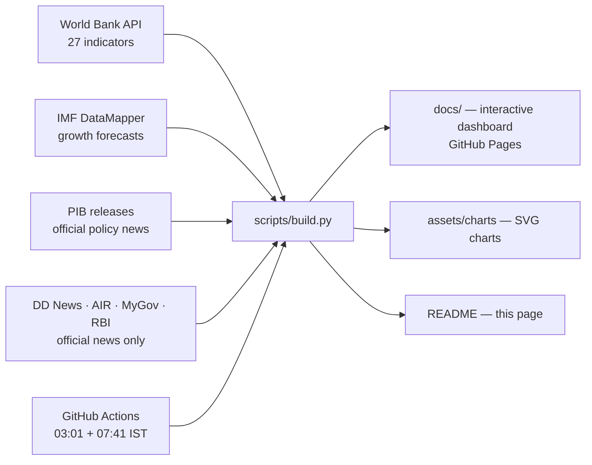

  

  
  
  
  

<b>India's economy, industry, environment and people — in one live, free dashboard.</b> 
GDP and national income from the World Bank, growth forecasts from the IMF, and the day's news for every topic from official government sources only (PIB, DD News, All India Radio, MyGov, RBI) — refreshed automatically twice a day.

  <a href="https://subhadeep998.github.io/India-Development-Dashboard/#economy">📈 Economy</a> ·
  <a href="https://subhadeep998.github.io/India-Development-Dashboard/#industry">🏭 Industry</a> ·
  <a href="https://subhadeep998.github.io/India-Development-Dashboard/#environment">🌿 Environment</a> ·
  <a href="https://subhadeep998.github.io/India-Development-Dashboard/#education">🎓 Education & Scholarships</a> ·
  <a href="https://subhadeep998.github.io/India-Development-Dashboard/#culture">🎭 Arts & Culture</a> ·
  <a href="https://subhadeep998.github.io/India-Development-Dashboard/#food">🌾 Food & Agriculture</a>

---

## 🇮🇳 India at a glance

| 💰 GDP | 📈 Real growth | 👤 GNI per capita | 🔮 IMF growth forecast |
|:--:|:--:|:--:|:--:|
| **US$ 3.96 tn** 2025 | **7.6%** 2025 | **US$ 2,760** 2025 | **7.0% (2026)** IMF WEO |

Last refreshed: 26 Nov 2026, 09:11 IST · Annual figures in current US$ from the World Bank; the forecast is the IMF World Economic Outlook.

---

## 📊 The big trends

<table>
  <tr>
    <td width="50%"></td>
    <td width="50%"></td>
  </tr>
  <tr>
    <td width="50%"></td>
    <td width="50%"></td>
  </tr>
  <tr>
    <td width="50%"></td>
    <td width="50%"></td>
  </tr>
  <tr>
    <td width="50%"></td>
    <td width="50%"></td>
  </tr>
</table>

<a href="https://subhadeep998.github.io/India-Development-Dashboard/"><b>Explore 27 indicators interactively →</b></a>

---

## 📰 Today across India — official sources

### 📈 Economy

GDP, national income, growth, inflation and investment.

- 2026-11-26 · [Empowering Governance through Digital Infrastructure](https://news.google.com/rss/articles/CBMid0FVX3lxTE5hQXQ1bVdGeGxka0FadS15dnU2NTJNeXJmdXB5Q2RQLVBwRWlISFlYU2ZaR0R4SklpUGxWbzU3UmpHQVF0dzJqYXA3Z0xzRkIyN2x4RVVkOE9zWk93VE8zRW1SSE12bkQ0QTQ5N2pOYkpfU0ZmRnRR?oc=5) — _www.pib.gov.in_
- 2026-11-26 · [The Micro, Small and Medium Enterprises Development (Amendment) Bill, 2026](https://news.google.com/rss/articles/CBMid0FVX3lxTE9FZTBOb2xsNFIxaDFIei1YaU1ERnZwbW5pa3BDcDJhVnZmaEF3clJKVGFMcFJLYTJMeWtIb2RPclZNZXdLMGt0ajJPNTh5NS1wTS13bG12VU9rOUE3UmZhVG9oN0dPbHZ5ZHFJSVk0MVROeFVuUGtn?oc=5) — _pib.gov.in_
- 2026-11-26 · [India’s space economy projected to reach $40-45 billion as private sector drives growth: Jitendra Singh](https://news.google.com/rss/articles/CBMixAFBVV95cUxNbFp6c294TnhUakR4Z1lVVW1VS2txVDdLaGN4dUNXWEgwOF9QLU56REI4WmhvekFoTXN5YnNkOWM4TWNZNGE0UFVwdXR3Wk5Mb0l3NDJBMGxrbzM3YlIteno1RFZxZnVBRDl4T3RNd3FyN1VrbnR4dTlOajI5dzMtUEtpdXNHeWFMTU53SUdhai1iLVlQa201N3d1X3A4Zk1oUnhEcGhxTDl4Vi1rNXNDcHAwWlVhZ2JXMENtVnVPZUJ1M19U?oc=5) — _DD News_
- 2026-11-26 · [India Wins Visitors’ Lion for Best National Participation at Venice Art Biennale 2026](https://news.google.com/rss/articles/CBMirwFBVV95cUxPYmwxM2NDUFdSaHoyV2d6VHBhX1I2b1VHUmJFVGxpeGJHeXdOZXRvdmxoS1BPQ1hpdkhoYWJEYm9JazR2aWFBV1ZXNllPX0ZRVDdaVkthNER0SGo0V2VuNzJfNE5Od3VvWXNSeWNEd0c1RjBSbG9iWUVqM21QWXloNWJobkdnWWQ4WWltUUJRUDI5NTl0d2lUMlQyNDdJUmNkcWpqdmdpVy1zTHRiZmVr?oc=5) — _DD News_

[Open the Economy tab →](https://subhadeep998.github.io/India-Development-Dashboard/#economy)

### 🏭 Industry

Manufacturing, industrial output, structure of the economy and infrastructure.

- 2026-11-25 · [PM chairs 55th PRAGATI meeting](https://news.google.com/rss/articles/CBMie0FVX3lxTE14NVRQUXNYbFJ1dzZwcGNSOERKSk95R1lKNTd5cTRlMnU0SjJ3RFJpQkkzTnZBUm1UTV9KOGRjS01wYVRKS2pTdDdqVHJ5WDR0c1FXNjE3LTlVdFFHdzBXeTMzRHNJZXVCS1N1RTFHdmYwTmJCUENDRTl5NA?oc=5) — _www.pib.gov.in_
- 2026-11-25 · [Sixth Edition of Creative Minds of Tomorrow Celebrates Emerging Filmmaking Talent at IFFI 2026](https://news.google.com/rss/articles/CBMie0FVX3lxTE5zNlVNQXdzWVIyYlc5aktRckxJR2w0WExHcHBXSXV5ekV3WGhLbUJsZlZKMUJqcm53WUVTbE5TMmVoUGVwbnRwMkJlZEhZVU1yNk9kVTVNV1pZVUVUc3hmUDhCSS01OEp3blhnODhhVDcybjFjdng5dWZ3WQ?oc=5) — _www.pib.gov.in_
- 2026-11-26 · [India’s space economy projected to reach $40-45 billion as private sector drives growth: Jitendra Singh](https://news.google.com/rss/articles/CBMixAFBVV95cUxNbFp6c294TnhUakR4Z1lVVW1VS2txVDdLaGN4dUNXWEgwOF9QLU56REI4WmhvekFoTXN5YnNkOWM4TWNZNGE0UFVwdXR3Wk5Mb0l3NDJBMGxrbzM3YlIteno1RFZxZnVBRDl4T3RNd3FyN1VrbnR4dTlOajI5dzMtUEtpdXNHeWFMTU53SUdhai1iLVlQa201N3d1X3A4Zk1oUnhEcGhxTDl4Vi1rNXNDcHAwWlVhZ2JXMENtVnVPZUJ1M19U?oc=5) — _DD News_
- 2026-11-26 · [PM Modi Invokes Gandhi’s 1930 Message of Swadeshi, Says Industry Still Affected by Bitter Experience with Previous Gove…](https://news.google.com/rss/articles/CBMi5AFBVV95cUxNQ2JhMHpzMm15UTZjUlh5RkVwTTZETkVkRGxRMDhwYmJVMVFCOC0ya3B6LVcydFVKZkpkcmFIbl9HV1hsTDdpLXZOeGQxSDVmaUd4WGlWTXBkZUJCU05pS2lFS0R6SkFqTC1WNG43Q2J6Xy10cHczR2locTRWcWtNdE1vaFc3ZGJOcDB2U1haUEpWMlhCSnI3ckhfODJ5ODdNZ3d4NFlWZ0lBaHVXNXh3THpfWFI3a0YyRF9PZXNEdGFVbTJ6aWtJOGtYTExrRm9SR3BTTVFzWk1DVFNFV1NWSU9YQlo?oc=5) — _DD News_

[Open the Industry tab →](https://subhadeep998.github.io/India-Development-Dashboard/#industry)

### 🌿 Environment

Emissions, forests, clean energy and air quality.

- 2026-11-25 · [Announcement of National Gopal Ratna Award 2026 winners -reg.](https://news.google.com/rss/articles/CBMifEFVX3lxTFBXVEViT2l3aFFOUTRybnNBbWsxR1liNzNsbnVmQWEwZ3czVnVEUmprYW0xZjdSTmI4d0VHVG1ydkZQNEdOWl95QUhsNEJtazlMd3VzQnBNT0g2OElxZng2ck8wWDN3OUtVU2c3dXNTVHVwT2FrOWZxMUlpSWI?oc=5) — _pib.gov.in_
- 2026-11-25 · [India calls for Equity, Climate Justice and Fulfilment of Climate Finance Obligations at UNFCCC COP31, at Antalya (Türk…](https://news.google.com/rss/articles/CBMihAFBVV95cUxPb3RJWWR0Nm5iVVpneEZpX1Y1SjV3aXFabDFVQkxlbjcwTlZjR2hCQjNiQWFkTHplUmlvU29EWFRybHhuM216QWJ5VEpibmVTS1o0STFFZlBGUUVtNjhVcV9yLW9CVzZDaF9OUjNVRHhQQkQtTkF1UmZpU00yNWRIWlRoSlE?oc=5) — _www.pib.gov.in_
- 2026-11-26 · [India Wins Visitors’ Lion for Best National Participation at Venice Art Biennale 2026](https://news.google.com/rss/articles/CBMirwFBVV95cUxPYmwxM2NDUFdSaHoyV2d6VHBhX1I2b1VHUmJFVGxpeGJHeXdOZXRvdmxoS1BPQ1hpdkhoYWJEYm9JazR2aWFBV1ZXNllPX0ZRVDdaVkthNER0SGo0V2VuNzJfNE5Od3VvWXNSeWNEd0c1RjBSbG9iWUVqM21QWXloNWJobkdnWWQ4WWltUUJRUDI5NTl0d2lUMlQyNDdJUmNkcWpqdmdpVy1zTHRiZmVr?oc=5) — _DD News_
- 2026-11-26 · [India’s space economy projected to reach $40-45 billion as private sector drives growth: Jitendra Singh](https://news.google.com/rss/articles/CBMixAFBVV95cUxNbFp6c294TnhUakR4Z1lVVW1VS2txVDdLaGN4dUNXWEgwOF9QLU56REI4WmhvekFoTXN5YnNkOWM4TWNZNGE0UFVwdXR3Wk5Mb0l3NDJBMGxrbzM3YlIteno1RFZxZnVBRDl4T3RNd3FyN1VrbnR4dTlOajI5dzMtUEtpdXNHeWFMTU53SUdhai1iLVlQa201N3d1X3A4Zk1oUnhEcGhxTDl4Vi1rNXNDcHAwWlVhZ2JXMENtVnVPZUJ1M19U?oc=5) — _DD News_

[Open the Environment tab →](https://subhadeep998.github.io/India-Development-Dashboard/#environment)

### 🎓 Education & Scholarships

Education spending, enrolment, literacy — and where to apply for scholarships.

- 2026-11-25 · [From Financial Hardship To Academic Aspirations](https://news.google.com/rss/articles/CBMie0FVX3lxTE1NOUhZSlVuYlFJN25ESzJUc2FHQmFodTNHQVdKa1hDMC1Qd1VzVHNPXy1XN2dlRHlCTUVrLWpkbUgtMVVwSDJUU0Y2U2xfNnJIU3YyVV9ISVViWVEzaVA2enZMVUF0RkVjaGtWR1BqMXl3MEJQOExrUTFUYw?oc=5) — _www.pib.gov.in_
- 2026-11-25 · [Only Five Days Left to Apply for SHRESHTA (NETS) 2027; Ministry of Social Justice and Empowerment Encourages Eligible S…](https://news.google.com/rss/articles/CBMifEFVX3lxTE9LYlQxVmRIYkYzSkdZNUVNcUNEOE5kOTRpc1pZV2dibFhZakczdDNnR1lna19lTlFOSEg1X042WjhPTmRnOHpUVXhuNjlWR3d4ODZDZkk0ZF9WQ1A4MmpKaWJ4VUZnMkg1Q3VoMnE5bVFXU2E1elhFTExSeUY?oc=5) — _www.pib.gov.in_
- 2026-11-26 · [Union Health Secretary Punya Salila Srivastava Inaugurates Sleep Study Facility, Autism Lab at IIT Madras](https://news.google.com/rss/articles/CBMiygFBVV95cUxPZTNqaUNvM25UZ1JKOXdKT21sT3VjMEwtX2hqZVRqVnhyTHY0eFFUNHcyNTlSazhvRGxDRmtua2pHWXRhT09nZ0FaTFFzeUh5T182MFFnVkk2Z09IdXhjMFJnblVyemRFWVV4cVRLaTQ3cTh3OHI4LUpmd1loOFpyMjdKQU0tOWduSWEwb3F2NUltVkg1SmFkYjk5OUtNQWdNTUw4a21mTllvaXBMQ0kxWGVqd1lVUDY0SjRVTlRqTzVrYzd2V3BZUnF3?oc=5) — _DD News_
- 2026-11-26 · [India’s space economy projected to reach $40-45 billion as private sector drives growth: Jitendra Singh](https://news.google.com/rss/articles/CBMixAFBVV95cUxNbFp6c294TnhUakR4Z1lVVW1VS2txVDdLaGN4dUNXWEgwOF9QLU56REI4WmhvekFoTXN5YnNkOWM4TWNZNGE0UFVwdXR3Wk5Mb0l3NDJBMGxrbzM3YlIteno1RFZxZnVBRDl4T3RNd3FyN1VrbnR4dTlOajI5dzMtUEtpdXNHeWFMTU53SUdhai1iLVlQa201N3d1X3A4Zk1oUnhEcGhxTDl4Vi1rNXNDcHAwWlVhZ2JXMENtVnVPZUJ1M19U?oc=5) — _DD News_

[Open the Education & Scholarships tab →](https://subhadeep998.github.io/India-Development-Dashboard/#education)

### 🎭 Arts & Culture

Heritage, the arts, cultural scholarships and tourism.

- 2026-11-25 · [Sixth Edition of Creative Minds of Tomorrow Celebrates Emerging Filmmaking Talent at IFFI 2026](https://news.google.com/rss/articles/CBMie0FVX3lxTE5zNlVNQXdzWVIyYlc5aktRckxJR2w0WExHcHBXSXV5ekV3WGhLbUJsZlZKMUJqcm53WUVTbE5TMmVoUGVwbnRwMkJlZEhZVU1yNk9kVTVNV1pZVUVUc3hmUDhCSS01OEp3blhnODhhVDcybjFjdng5dWZ3WQ?oc=5) — _www.pib.gov.in_
- 2026-11-25 · [Announcement of National Gopal Ratna Award 2026 winners -reg.](https://news.google.com/rss/articles/CBMifEFVX3lxTFBXVEViT2l3aFFOUTRybnNBbWsxR1liNzNsbnVmQWEwZ3czVnVEUmprYW0xZjdSTmI4d0VHVG1ydkZQNEdOWl95QUhsNEJtazlMd3VzQnBNT0g2OElxZng2ck8wWDN3OUtVU2c3dXNTVHVwT2FrOWZxMUlpSWI?oc=5) — _pib.gov.in_
- 2026-11-26 · [India Wins Visitors’ Lion for Best National Participation at Venice Art Biennale 2026](https://news.google.com/rss/articles/CBMirwFBVV95cUxPYmwxM2NDUFdSaHoyV2d6VHBhX1I2b1VHUmJFVGxpeGJHeXdOZXRvdmxoS1BPQ1hpdkhoYWJEYm9JazR2aWFBV1ZXNllPX0ZRVDdaVkthNER0SGo0V2VuNzJfNE5Od3VvWXNSeWNEd0c1RjBSbG9iWUVqM21QWXloNWJobkdnWWQ4WWltUUJRUDI5NTl0d2lUMlQyNDdJUmNkcWpqdmdpVy1zTHRiZmVr?oc=5) — _DD News_
- 2026-11-26 · [India’s space economy projected to reach $40-45 billion as private sector drives growth: Jitendra Singh](https://news.google.com/rss/articles/CBMixAFBVV95cUxNbFp6c294TnhUakR4Z1lVVW1VS2txVDdLaGN4dUNXWEgwOF9QLU56REI4WmhvekFoTXN5YnNkOWM4TWNZNGE0UFVwdXR3Wk5Mb0l3NDJBMGxrbzM3YlIteno1RFZxZnVBRDl4T3RNd3FyN1VrbnR4dTlOajI5dzMtUEtpdXNHeWFMTU53SUdhai1iLVlQa201N3d1X3A4Zk1oUnhEcGhxTDl4Vi1rNXNDcHAwWlVhZ2JXMENtVnVPZUJ1M19U?oc=5) — _DD News_

[Open the Arts & Culture tab →](https://subhadeep998.github.io/India-Development-Dashboard/#culture)

### 🌾 Food & Agriculture

Food security, farm output, nutrition and farmer support.

- 2026-11-25 · [FSSAI West Region Organised Mega Street Food Vendors Training and Awareness Programme under Seva Saptah 2026 at Shegaon](https://news.google.com/rss/articles/CBMifEFVX3lxTFAxMzZ2Q3RYdG9ab1RtUnVZUnhjQzhjb0lPM1NmbE9Ca2N1X3EwS0NoTEdkU1EyMW9TSDJaQlhoTE5kX0h3MzgzTnFtUzBtd1VzV1d5dEFvTUZ2aFlXUkxBa2JxdDYydTNDN0lhbFJxZ1QteEFCZWx1Ri1SYUY?oc=5) — _pib.gov.in_
- 2026-11-25 · [Manager Marketing, Telangana State Shri S. KARUPPAIAH organized PM-PRANAM - Kissan Sangosthi at Telangana State](https://news.google.com/rss/articles/CBMifEFVX3lxTE5KUlpaWjdfSmZNMDFndDk5VHBDeXlQc2VoUTNVVmVOcHQ0M3V5aFJrUUlYdVA3aWg1TWFMMkZWVFJDS1ZSaDVlcW05cXViMklPdGZQUEo2Tm9ia3k0VHl5d0lOcS1FNU9Kb0NGdzllTmlGa2JhYmlEeWt5V24?oc=5) — _pib.gov.in_
- 2026-11-26 · [Shivraj Singh Chouhan reviews Kharif 2026 preparations, orders weekly El Nino monitoring](https://news.google.com/rss/articles/CBMiswFBVV95cUxQbi03bXhvSDNMdTZoYnNhc3ctczdjUkkxNVItamxkcUY5WllwM2h1aElyQ0hEQUNMNlloWV9XdFdtVE90QjNMQUpTdDBNU3gzenpvelRNd2VyRlNzMzV6T0NHQktkb1ZObUhoODFTb1Q1bS1vdHFRc1d1SlJoOVBtM1JQemFxemcwRzV0cGRWYkk5dUdTRS1vd1E2ekVRRUoxM0EtcGpFRWl1Vng1ZlVFWEc2SQ?oc=5) — _DD News_
- 2026-11-26 · [Cabinet approves higher MSP for 14 Kharif crops for 2026-27 marketing season](https://news.google.com/rss/articles/CBMipAFBVV95cUxPVGJSNkRGOEd6ZmVOUUlDTGxPdl9xaFIzUHZYN0pRcnc4Y1JraTRKeGliWGtyMHRpN0pWS1BCMUJwZ1RkUEpndkRwNFNqMlRJSkRqaHE4WTJnSlNnZHBUVFhfZ3BhY1o3VU1MX2NlM2l4ZFd5Y043VXRrU0JvWUNkRU43RjNpOFBodzFLdG9DeDJKTU5QRWFyUzFSZ2NGMFZJLThXQg?oc=5) — _DD News_

[Open the Food & Agriculture tab →](https://subhadeep998.github.io/India-Development-Dashboard/#food)

---

## 🏛️ Government schemes, at a glance

| Area | Start here |
|:--|:--|
| 🎓 **Scholarships** | [National Scholarship Portal](https://scholarships.gov.in) · [PM Vidyalaxmi (education loans)](https://pmvidyalaxmi.co.in) · [INSPIRE](https://online-inspire.gov.in) · [PM Research Fellowship](https://pmrf.in) · [AICTE Pragati & Saksham](https://www.aicte-india.org) |
| 🎭 **Arts & culture** | [Ministry of Culture](https://www.indiaculture.gov.in) · [CCRT scholarships for young artists](https://ccrtindia.gov.in) · [Sangeet Natak Akademi](https://www.sangeetnatak.gov.in) · [Lalit Kala Akademi](https://lalitkala.gov.in) |
| 🌾 **Food** | [National Food Security Act](https://nfsa.gov.in) · [PM-KISAN](https://pmkisan.gov.in) · [PM-POSHAN](https://pmposhan.education.gov.in) · [Eat Right India](https://eatrightindia.gov.in) · [e-NAM](https://enam.gov.in) |
| 🌿 **Environment** | [National Clean Air Programme](https://prana.cpcb.gov.in) · [PM Surya Ghar](https://pmsuryaghar.gov.in) · [PM-KUSUM](https://pmkusum.mnre.gov.in) · [Mission LiFE](https://missionlife-moefcc.nic.in) |
| 🏭 **Industry** | [Make in India](https://www.makeinindia.com) · [PLI schemes](https://www.investindia.gov.in/production-linked-incentives-schemes-india) · [Startup India](https://www.startupindia.gov.in) · [PM Gati Shakti](https://pmgatishakti.gov.in) |
| 📈 **Economy** | [Union Budget](https://www.indiabudget.gov.in) · [RBI](https://www.rbi.org.in) · [MoSPI](https://www.mospi.gov.in) · [GST Council](https://gstcouncil.gov.in) |

> Scheme rules, amounts and deadlines change — always confirm on the official portal before applying.

---

## ⚙️ How it works

- **Runs twice a day** (03:01 and 07:41 IST), away from GitHub's busy hours — if one run is delayed or dropped, the second catches up.
- **Never goes blank:** if a source is down, the last good data is kept.
- **All sources are free and official.** Official sources only — no general media. Only headlines and links are stored — click through to read the original reporting.

> Independent educational project; not affiliated with the Government of India, the World Bank or the IMF.

---

  ⭐ <b>Star</b> to bookmark · 👤 <a href="https://github.com/Subhadeep998"><b>Follow @Subhadeep998</b></a> 
  Built by <a href="https://www.subhadeepaditya.in">Subhadeep Aditya</a> — healthcare intelligence analyst and LL.B. student · Kolkata, India

