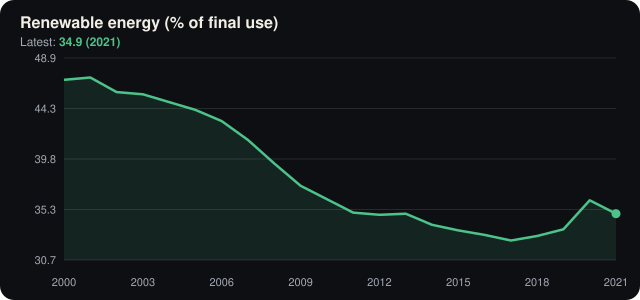
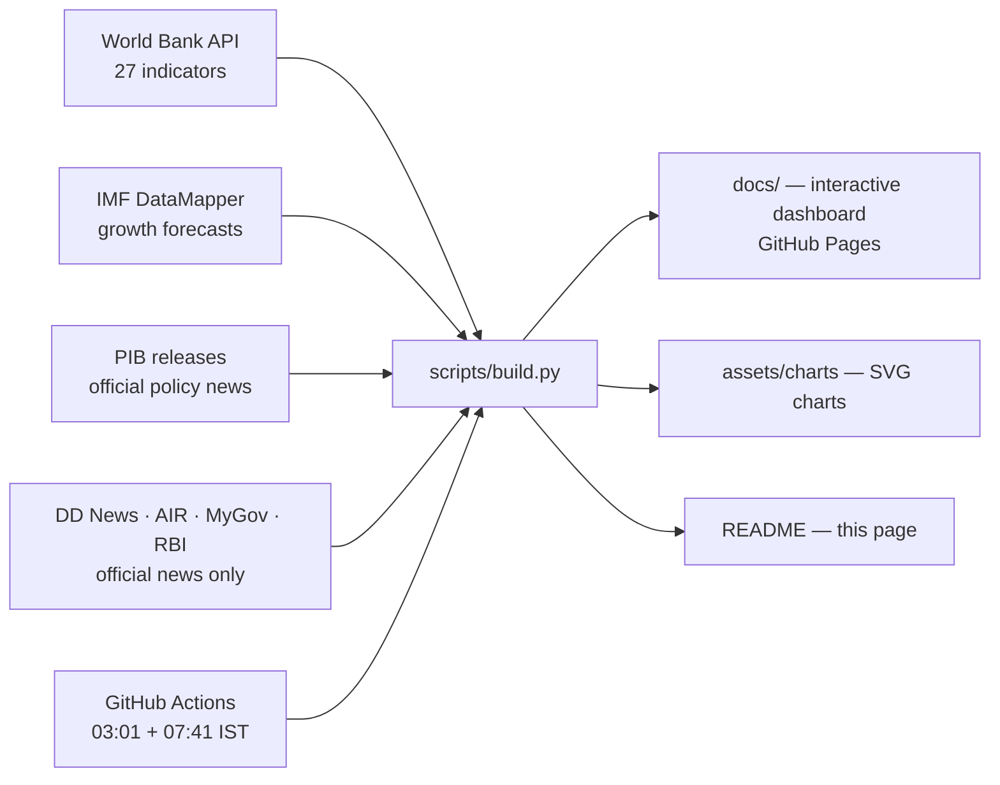

  

  
  
  
  

<b>India's economy, industry, environment and people — in one live, free dashboard.</b> 
GDP and national income from the World Bank, growth forecasts from the IMF, and the day's news for every topic from official government sources only (PIB, DD News, All India Radio, MyGov, RBI) — refreshed automatically twice a day.

  <a href="https://subhadeep998.github.io/India-Development-Dashboard/#economy">📈 Economy</a> ·
  <a href="https://subhadeep998.github.io/India-Development-Dashboard/#industry">🏭 Industry</a> ·
  <a href="https://subhadeep998.github.io/India-Development-Dashboard/#environment">🌿 Environment</a> ·
  <a href="https://subhadeep998.github.io/India-Development-Dashboard/#education">🎓 Education & Scholarships</a> ·
  <a href="https://subhadeep998.github.io/India-Development-Dashboard/#culture">🎭 Arts & Culture</a> ·
  <a href="https://subhadeep998.github.io/India-Development-Dashboard/#food">🌾 Food & Agriculture</a>

---

## 🇮🇳 India at a glance

| 💰 GDP | 📈 Real growth | 👤 GNI per capita | 🔮 IMF growth forecast |
|:--:|:--:|:--:|:--:|
| **US$ 3.96 tn** 2025 | **7.6%** 2025 | **US$ 2,760** 2025 | **7.0% (2026)** IMF WEO |

Last refreshed: 27 Nov 2026, 09:12 IST · Annual figures in current US$ from the World Bank; the forecast is the IMF World Economic Outlook.

---

## 📊 The big trends

<table>
  <tr>
    <td width="50%"></td>
    <td width="50%"></td>
  </tr>
  <tr>
    <td width="50%"></td>
    <td width="50%"></td>
  </tr>
  <tr>
    <td width="50%"></td>
    <td width="50%"></td>
  </tr>
  <tr>
    <td width="50%"></td>
    <td width="50%"></td>
  </tr>
</table>

<a href="https://subhadeep998.github.io/India-Development-Dashboard/"><b>Explore 27 indicators interactively →</b></a>

---

## 📰 Today across India — official sources

### 📈 Economy

GDP, national income, growth, inflation and investment.

- 2026-11-27 · [Small and Medium Enterprises Growth Fund](https://news.google.com/rss/articles/CBMimgFBVV95cUxOdm03VEc3TWpSYXFDaGxKWUh0WGJvaTJjd0hIT2V6NnZUeXdBUkVRSkpHaURNajdGdF9BRmtfNW5HMW1NZ3pNRFc5RU9qOFBhdjhxdE8yTW1YUUpmVmFUQTYweGZjbTB3WmcwaTc4aUNTdmJmS0UwYm1tYVc0SlRhVlBRYjdtbnZLMHlDcmswNnJqdlNTVWVwNlpR?oc=5) — _pib.gov.in_
- 2026-11-27 · [Manufacturing Momentum:Building a Self-Reliant India](https://news.google.com/rss/articles/CBMidkFVX3lxTFBvRmtvLV9MbC1nX2RudWdiZ2xQUnpCRmtTTU0xNkF2eV96Zi1kUUhkVjlrMWNGUkVKZzZXRUdEQjN0eGZRS3AxSm1BWC0tbnVHOXU2LUJDNlR1eDVpY1B0N09Ga01xUG9XSzVRejNpOHRvREdBS3c?oc=5) — _www.pib.gov.in_
- 2026-11-27 · [RBI keeps repo rate unchanged; Projects India’s real GDP growth for current fiscal at 6.9% \| Akashvani News](https://news.google.com/rss/articles/CBMivgFBVV95cUxOTGFSNzg0VzlJdnMwYWh2TzliX3libXhnd0pFajdsbW05R3dZU3Y5V3BjRU5uV2Q0aDVOZWZNX3dDdHpvNXpGOXRTQlNnQVRScklzNU5QdjVmV2YzOWlFVWZXMXFSZWxscFJIdFY0UHhleHZreWhkRmhqNGpCeTBYTVlpZ3AxcFN5X0h6SkFqSHJzSTBhWER6N1lkQXB3cnlLRXU4TF95ZjNWdC01XzBkTm0zOGN3RmpXc1lQSkdR?oc=5) — _News On AIR_
- 2026-11-27 · [World Bank raises India’s growth forecast from 6.3 to 6.6 percent for current financial year](https://news.google.com/rss/articles/CBMiuAFBVV95cUxPTzJsaXdFWEo5UmtPT2tCT25pWkplN0NwYy1iWVlnUWlaal8yb0FURUpjeXJoS0JFR2pxT0FpdnZ4UHM5ZE13a05ueE9fMFQ4dUlUUzJGelJBZGRRRDViZFBJS0NvSkg0YlZ2N0pZUmdGMi1fSlliakpBVXlVcFVxdHJJSkpEMEdOdGFNcGdqaUExVEc5OXhkdlVsbEZhNGpaOWczT2tTaVc2T3ktX3A5S2lWYllkX3F6?oc=5) — _News On AIR_

[Open the Economy tab →](https://subhadeep998.github.io/India-Development-Dashboard/#economy)

### 🏭 Industry

Manufacturing, industrial output, structure of the economy and infrastructure.

- 2026-11-27 · [Manufacturing Momentum:Building a Self-Reliant India](https://news.google.com/rss/articles/CBMidkFVX3lxTFBvRmtvLV9MbC1nX2RudWdiZ2xQUnpCRmtTTU0xNkF2eV96Zi1kUUhkVjlrMWNGUkVKZzZXRUdEQjN0eGZRS3AxSm1BWC0tbnVHOXU2LUJDNlR1eDVpY1B0N09Ga01xUG9XSzVRejNpOHRvREdBS3c?oc=5) — _www.pib.gov.in_
- 2026-11-27 · [Small and Medium Enterprises Growth Fund](https://news.google.com/rss/articles/CBMimgFBVV95cUxOdm03VEc3TWpSYXFDaGxKWUh0WGJvaTJjd0hIT2V6NnZUeXdBUkVRSkpHaURNajdGdF9BRmtfNW5HMW1NZ3pNRFc5RU9qOFBhdjhxdE8yTW1YUUpmVmFUQTYweGZjbTB3WmcwaTc4aUNTdmJmS0UwYm1tYVc0SlRhVlBRYjdtbnZLMHlDcmswNnJqdlNTVWVwNlpR?oc=5) — _pib.gov.in_
- 2026-11-27 · [6th Edition of ‘Creative Minds of Tomorrow’ concludes at IFFI in Goa](https://news.google.com/rss/articles/CBMixwFBVV95cUxPem9Kbm9yMldJdTgwVnVpa0tWZXpHd3hJMHRkRGE1aXJGR19vbWR1R2pHdmw2Qi1OWS03NGdlYVJuMmtMYmt5bWJMLVRVWk5hcmZzeWVCS2Y1X3NBbTlJVWVkeWkxZ3RnclBFYzkwTUFqZXQtZDhBdXVWWDJINGlnWGRVUnI0eTFCVVlmMFRwNTlDRGQyOHRTMnhydlZqWTBIdW5KcFVyaWtObmw0MDNlS1FrYUdvckZXUHZYMUJkMkJ1YW5LVTBV?oc=5) — _News On AIR_
- 2026-11-27 · [Union Minister Ashwini Vaishnaw to visit Tamil Nadu on Nov 26](https://news.google.com/rss/articles/CBMikAFBVV95cUxQOXhQZ3d5WFlhVHBvZzdmdEF2REdyb0Y4YjBFTS1pZlRrRDhzY21wTVptUVphZExiTEItSUpHT1NWTTNmd3VlM0dsb0NXYnlEOWIyMDcxVldOM2VSYnUzeXlPM2NzS2NTSGxFZXVZbS1VbThXbTFLcy1sRGh3cjRTbnVKM2tKQVF3SjhwVXFkNmU?oc=5) — _News On AIR_

[Open the Industry tab →](https://subhadeep998.github.io/India-Development-Dashboard/#industry)

### 🌿 Environment

Emissions, forests, clean energy and air quality.

- 2026-11-26 · [Chennai Sorting Division conducts Walkathon as part of Swachhata Pakhwada 2026](https://news.google.com/rss/articles/CBMiaEFVX3lxTE91X3NPVVpIQkw0d0pIdGR4LXRLcTBXTGg5U2x1LUNCV0ctaTBmaUg4U3ZjUWVEZUpGQTFNN2JYUnlHTHRmVzNRVGotc2Zsa0VucXdwQzBIWWJ3MUdrMkxoYzFpYmhialhT?oc=5) — _www.pib.gov.in_
- 2026-11-26 · [PM to Inaugurate Bharat Renewable Energy Summit & Expo 2026 on 2nd November](https://news.google.com/rss/articles/CBMifEFVX3lxTFBkNUEtSEpIdDZHdkpfSm1MSEpEeHVjZS1xVUtYblNMWGFfdWFlWXd4emUzXzZGTGV2eFQ5RlBxTjVWNEEzSTRLQ1AxclNqc3RldXdSaVlZd2FRMURtTmgyWlhQQmVudWVmdVpKd2lBX3VBdXFqNERkaEs3U3M?oc=5) — _pib.gov.in_
- 2026-11-27 · [World Bank raises India’s growth forecast from 6.3 to 6.6 percent for current financial year](https://news.google.com/rss/articles/CBMiuAFBVV95cUxPTzJsaXdFWEo5UmtPT2tCT25pWkplN0NwYy1iWVlnUWlaal8yb0FURUpjeXJoS0JFR2pxT0FpdnZ4UHM5ZE13a05ueE9fMFQ4dUlUUzJGelJBZGRRRDViZFBJS0NvSkg0YlZ2N0pZUmdGMi1fSlliakpBVXlVcFVxdHJJSkpEMEdOdGFNcGdqaUExVEc5OXhkdlVsbEZhNGpaOWczT2tTaVc2T3ktX3A5S2lWYllkX3F6?oc=5) — _News On AIR_
- 2026-11-26 · [India Wins Visitors’ Lion for Best National Participation at Venice Art Biennale 2026](https://news.google.com/rss/articles/CBMirwFBVV95cUxPYmwxM2NDUFdSaHoyV2d6VHBhX1I2b1VHUmJFVGxpeGJHeXdOZXRvdmxoS1BPQ1hpdkhoYWJEYm9JazR2aWFBV1ZXNllPX0ZRVDdaVkthNER0SGo0V2VuNzJfNE5Od3VvWXNSeWNEd0c1RjBSbG9iWUVqM21QWXloNWJobkdnWWQ4WWltUUJRUDI5NTl0d2lUMlQyNDdJUmNkcWpqdmdpVy1zTHRiZmVr?oc=5) — _DD News_

[Open the Environment tab →](https://subhadeep998.github.io/India-Development-Dashboard/#environment)

### 🎓 Education & Scholarships

Education spending, enrolment, literacy — and where to apply for scholarships.

- 2026-11-26 · [Manipur University Marks Constitution Day as Vice-Chancellor Leads Reading of the Preamble](https://news.google.com/rss/articles/CBMiaEFVX3lxTFBxblY3aFFIeDdIRUhtM0pTNlhuMHowcnJoRURnT0lQTW9PUWZscHd0Ql9PV2xwWGxuS1BZR2Zlb3NyUWtGTUl6Y1JBeVY1Sk9zdHdyNE9FQ0hNajBxZEdxX3F0MVh5QTZr?oc=5) — _www.pib.gov.in_
- 2026-11-26 · [NIPER Hyderabad to Confer Degrees on 225 Graduating Students at its 14th Convocation Ceremony](https://news.google.com/rss/articles/CBMie0FVX3lxTE1mdVp4ZTFkN2hYdExLdGhQMmJ1ZkU2eHozMk9ndHpxOWJiMXVVQ254Yno4U0lVa04wV0VTdkdJNll2UHB3OGVicjRHREFqbzF1YktObFJOZVJOSEEwQkhwUm9OWGVjaUJJdkdRa1BBQ0pOQmdaM3lhdnFqTQ?oc=5) — _pib.gov.in_
- 2026-11-27 · [IIT Madras invites registrations for January 2027 batch of School Connect Programme](https://news.google.com/rss/articles/CBMirgFBVV95cUxNdlAxak54Q05laDVDM21ueXl5SDh1aWZOUTRnMGplVERQM3ZiM1FkZUUzZzczejZnOG9wR3BwN2o3akdQcnNyR2NUTllLenp5TGZ4N2l0UU5VMUdFTkduUDNtYmo3VlpQemJ4M3ZJank5QlJTcmJ4azhheEFMS1lfNVJFR0l6N3AzUUFVWHJyaHBYaHM5UkRVV1JabjVlN1F6SkprV1VQYUtqQXNTanc?oc=5) — _News On AIR_
- 2026-11-27 · [EAM Jaishankar says, India-European Union FTA will come into force soon to provide new dynamism in the relationship](https://news.google.com/rss/articles/CBMiywFBVV95cUxPSmxrR192RG5ZdVpJYmFMd1NKeF9CMWxqeElSTFNmREtpb05qb2pnY1hVdWtpM1dCQVFZaGltTXFCNzkxNkpUdExfbkt5dDhYZWlDQUdDUGtjc2xHT2FEeGFfNHhqX29ac0xSZTFnMXdMbE9BWjhXOWdrS3FuTTRjbTBMSHAwNEF0UDhxT0pKcjFoMlRpTlhiN2VUNHgzaGFZOWl1bDZGRHU3ejNjRDVBdGtuRXJacjVTeXU1V1d5TldvRHRnb2tqN09VMA?oc=5) — _News On AIR_

[Open the Education & Scholarships tab →](https://subhadeep998.github.io/India-Development-Dashboard/#education)

### 🎭 Arts & Culture

Heritage, the arts, cultural scholarships and tourism.

- 2026-11-27 · [Sacred Relics of Shakyamuni Buddha Arrive at Golden Pagoda, Namsai, Marking the Final Phase of Exposition in Arunachal …](https://news.google.com/rss/articles/CBMifEFVX3lxTE95Y08xSkllXzdkWUc3cjVyRmRRSEJtTmF6SDRJeDVoT1pqU3hjZ0dRWVByeVJvU1RXaExsaFZLSjBaUjhheDhEVzVsd2pzS3Q4ZnlWYnYzZG05MnJwU1BvWkMxdGVtSXh1R3hTdDhBQ2dmS2NYSUp1SjQtNkY?oc=5) — _www.pib.gov.in_
- 2026-11-26 · [Union Minister for Culture and Tourism Shri Gajendra Singh Shekhawat Attends Closing Programme of Observance of 350th S…](https://news.google.com/rss/articles/CBMifEFVX3lxTE9Sd1FROUZ3aDhsaXQ4ZlRyV1F2bEpmWFk1ekxHUGd4VE0weEwwNWZIdk44Z0FCdDdtWVN0UV9Mb2t2eXMtaXRSV19HeVZuRUlpRFl5SUNrRmN6cUZnczRyakxLZFotQk9xRk9mRHpBZk5RWEljOEhVZDF5bWE?oc=5) — _pib.gov.in_
- 2026-11-27 · [New museum to have tech-based crowd management system; restoration work in full swing at North Block](https://news.google.com/rss/articles/CBMiwwFBVV95cUxOMXE2UEpneElib3B0RnpObGJJYWl3bG9EcFJXTTM4ekpENWVzUW4tdzN0NnVuUmszTTFIbjJzZVRVSHNrNXhBQjBvbWMyRkxVTF93clhlRkZlaV9kNnlkd0ZnY2tUMlJSSzRsUzhPb1M1VmNyaXZaUFJQOWEwNi0zRS1yd0t5N3A3V0JvbVVHNXpIcjFQRzdZbE1OSjhQTTFRNVJMck9BQk05NjdXSGc3WC0wdjhaNHdVS0VYTDEtelF4SFU?oc=5) — _DD News_
- 2026-11-27 · [6th Edition of ‘Creative Minds of Tomorrow’ concludes at IFFI in Goa](https://news.google.com/rss/articles/CBMixwFBVV95cUxPem9Kbm9yMldJdTgwVnVpa0tWZXpHd3hJMHRkRGE1aXJGR19vbWR1R2pHdmw2Qi1OWS03NGdlYVJuMmtMYmt5bWJMLVRVWk5hcmZzeWVCS2Y1X3NBbTlJVWVkeWkxZ3RnclBFYzkwTUFqZXQtZDhBdXVWWDJINGlnWGRVUnI0eTFCVVlmMFRwNTlDRGQyOHRTMnhydlZqWTBIdW5KcFVyaWtObmw0MDNlS1FrYUdvckZXUHZYMUJkMkJ1YW5LVTBV?oc=5) — _News On AIR_

[Open the Arts & Culture tab →](https://subhadeep998.github.io/India-Development-Dashboard/#culture)

### 🌾 Food & Agriculture

Food security, farm output, nutrition and farmer support.

- 2026-11-26 · [Union Health Secretary Calls for Strengthening State-Level Regulatory Capacity to Ensure Safer Food and Quality Medicin…](https://news.google.com/rss/articles/CBMifEFVX3lxTE5xRDktNHNNQmFsWkU1aGpmLWhocGhMVTU0YnB4VFZWZWhTUXc3aGt4NURmLTFDaW1QamFZR25uNDllTmt1OWRjd3BhVGhwZzQyU3VKS1RBcWNPSmdqTEp3VkpsNkNKdjZGeEFoSnFBazhqNUdvam9Wak81V3E?oc=5) — _www.pib.gov.in_
- 2026-11-26 · [Agriculture Pavilion in IITF 2026 Witnesses Massive Footfall](https://news.google.com/rss/articles/CBMifEFVX3lxTE9zVjB3dGlBTUdlMlV0T0E3V3VTRTlLTjdsSTZzcVpIMG9pVm9Mb0kyLURfNnBPUk9KYi12MmFLUE5KZ3VIZGtscW9GR0JSU0lnWUtVSE93bVdMNzBIbFJrWHhPMWJiX3NSWm14azJVSHJ1TFZVbFk0UHlGZDI?oc=5) — _pib.gov.in_
- 2026-11-27 · [Sustainable agriculture key to developed India by 2047, says Om Birla](https://news.google.com/rss/articles/CBMimgFBVV95cUxNQkN4di11VWhXY1VJYTlybVJ0Q0QwWXZBd3VGeHVHbnZDVUpnZy1lOEJlVXI2X3gtU2dYSXk1Zmw3T2R2ak5ad3hnZzBlT2J6V1hhVlREaTFyMEp2WG9KR0czMmEtaUVfX28wOEwxa0xwUkFzaFRETVBYNjJJTU9vTDJDTHNMVGhjeExTbTIzZGlBMDFDTFFzN2FB?oc=5) — _DD News_
- 2026-11-27 · [India has lifted 50 crore people out of extreme poverty through whole-of-government approach, says Agriculture Minister](https://news.google.com/rss/articles/CBMi3AFBVV95cUxPY3BDLXh0QVkyMHh0aHFJbVBoV3I3TXN5em1pQkZfOFpMRkFlRDMwaVl0eHVkLW81d3lXNDVOU21kMFVZbTBNV3dzMVRCQ1dLLU84WlppWWNaaUFlVW1PM0ZIZlljSTJNMGN0WTYzRDJNOG5ldG1EQjhuc2hHLVFtNWdtRm9jcVpaY2xDWnNGOUszdFE0TmQxYXJHdldrbHg2SGJvZUFES0hOZ1o3YXprdERZWEJDcW05bDd0bHhjX01rOXg1Yk0wazItSnpjVlpDUFBaSG5RbDJCSFM1?oc=5) — _News On AIR_

[Open the Food & Agriculture tab →](https://subhadeep998.github.io/India-Development-Dashboard/#food)

---

## 🏛️ Government schemes, at a glance

| Area | Start here |
|:--|:--|
| 🎓 **Scholarships** | [National Scholarship Portal](https://scholarships.gov.in) · [PM Vidyalaxmi (education loans)](https://pmvidyalaxmi.co.in) · [INSPIRE](https://online-inspire.gov.in) · [PM Research Fellowship](https://pmrf.in) · [AICTE Pragati & Saksham](https://www.aicte-india.org) |
| 🎭 **Arts & culture** | [Ministry of Culture](https://www.indiaculture.gov.in) · [CCRT scholarships for young artists](https://ccrtindia.gov.in) · [Sangeet Natak Akademi](https://www.sangeetnatak.gov.in) · [Lalit Kala Akademi](https://lalitkala.gov.in) |
| 🌾 **Food** | [National Food Security Act](https://nfsa.gov.in) · [PM-KISAN](https://pmkisan.gov.in) · [PM-POSHAN](https://pmposhan.education.gov.in) · [Eat Right India](https://eatrightindia.gov.in) · [e-NAM](https://enam.gov.in) |
| 🌿 **Environment** | [National Clean Air Programme](https://prana.cpcb.gov.in) · [PM Surya Ghar](https://pmsuryaghar.gov.in) · [PM-KUSUM](https://pmkusum.mnre.gov.in) · [Mission LiFE](https://missionlife-moefcc.nic.in) |
| 🏭 **Industry** | [Make in India](https://www.makeinindia.com) · [PLI schemes](https://www.investindia.gov.in/production-linked-incentives-schemes-india) · [Startup India](https://www.startupindia.gov.in) · [PM Gati Shakti](https://pmgatishakti.gov.in) |
| 📈 **Economy** | [Union Budget](https://www.indiabudget.gov.in) · [RBI](https://www.rbi.org.in) · [MoSPI](https://www.mospi.gov.in) · [GST Council](https://gstcouncil.gov.in) |

> Scheme rules, amounts and deadlines change — always confirm on the official portal before applying.

---

## ⚙️ How it works

- **Runs twice a day** (03:01 and 07:41 IST), away from GitHub's busy hours — if one run is delayed or dropped, the second catches up.
- **Never goes blank:** if a source is down, the last good data is kept.
- **All sources are free and official.** Official sources only — no general media. Only headlines and links are stored — click through to read the original reporting.

> Independent educational project; not affiliated with the Government of India, the World Bank or the IMF.

---

  ⭐ <b>Star</b> to bookmark · 👤 <a href="https://github.com/Subhadeep998"><b>Follow @Subhadeep998</b></a> 
  Built by <a href="https://www.subhadeepaditya.in">Subhadeep Aditya</a> — healthcare intelligence analyst and LL.B. student · Kolkata, India

