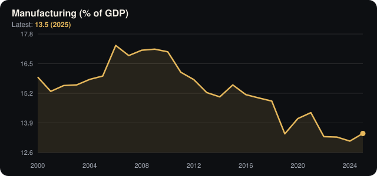
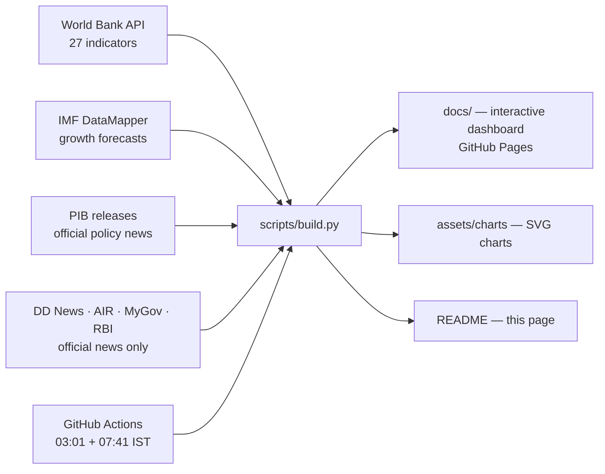

  

  
  
  
  

<b>India's economy, industry, environment and people — in one live, free dashboard.</b> 
GDP and national income from the World Bank, growth forecasts from the IMF, and the day's news for every topic from official government sources only (PIB, DD News, All India Radio, MyGov, RBI) — refreshed automatically twice a day.

  <a href="https://subhadeep998.github.io/India-Development-Dashboard/#economy">📈 Economy</a> ·
  <a href="https://subhadeep998.github.io/India-Development-Dashboard/#industry">🏭 Industry</a> ·
  <a href="https://subhadeep998.github.io/India-Development-Dashboard/#environment">🌿 Environment</a> ·
  <a href="https://subhadeep998.github.io/India-Development-Dashboard/#education">🎓 Education & Scholarships</a> ·
  <a href="https://subhadeep998.github.io/India-Development-Dashboard/#culture">🎭 Arts & Culture</a> ·
  <a href="https://subhadeep998.github.io/India-Development-Dashboard/#food">🌾 Food & Agriculture</a>

---

## 🇮🇳 India at a glance

| 💰 GDP | 📈 Real growth | 👤 GNI per capita | 🔮 IMF growth forecast |
|:--:|:--:|:--:|:--:|
| **US$ 3.96 tn** 2025 | **7.6%** 2025 | **US$ 2,760** 2025 | **7.0% (2026)** IMF WEO |

Last refreshed: 24 Nov 2026, 17:53 IST · Annual figures in current US$ from the World Bank; the forecast is the IMF World Economic Outlook.

---

## 📊 The big trends

<table>
  <tr>
    <td width="50%"></td>
    <td width="50%"></td>
  </tr>
  <tr>
    <td width="50%"></td>
    <td width="50%"></td>
  </tr>
  <tr>
    <td width="50%"></td>
    <td width="50%"></td>
  </tr>
  <tr>
    <td width="50%"></td>
    <td width="50%"></td>
  </tr>
</table>

<a href="https://subhadeep998.github.io/India-Development-Dashboard/"><b>Explore 27 indicators interactively →</b></a>

---

## 📰 Today across India — official sources

### 📈 Economy

GDP, national income, growth, inflation and investment.

- 2026-11-24 · [Manufacturing Momentum:Building a Self-Reliant India](https://news.google.com/rss/articles/CBMidkFVX3lxTFBvRmtvLV9MbC1nX2RudWdiZ2xQUnpCRmtTTU0xNkF2eV96Zi1kUUhkVjlrMWNGUkVKZzZXRUdEQjN0eGZRS3AxSm1BWC0tbnVHOXU2LUJDNlR1eDVpY1B0N09Ga01xUG9XSzVRejNpOHRvREdBS3c?oc=5) — _www.pib.gov.in_
- 2026-11-24 · [India’s Space Economy Set for a Massive Leap to USD 40–45 billion as Private Sector Rewrites Growth Story: Dr. Jitendra…](https://news.google.com/rss/articles/CBMia0FVX3lxTE9pbzBpQzBsTWpaYUJfZjJ5ajRrcDRsTnVDVGdnT0JFV3BpOWFDaVlDWkl4ZmF6d1hpR2JOUEZQbU1IcExsZGRfb212bmttVVZvV3NybEZ3UDFHVVpPNG5vV2RlWVNyeEdOMjZF?oc=5) — _पीआईबी_
- 2026-11-24 · [India Retains Third Spot in Lowy’s Asia Power Index 2026, PM Modi Ranked Most Effective Regional Leader](https://news.google.com/rss/articles/CBMixgFBVV95cUxNLWpudjFpM2VkVmVXdHBwWHBVZ0JSQkJtNDIzZWVQRzQzbXlVTzVUT2hKN2k1NHpNWlhYRHpBbk9SLXU1X1o5cExtcGJHLTl4NXRqVVRpUGZMdTFQdTBzUlczUVJwLWt1RUo2bldwR2p0S05jb1hINDJVWWl2YjNSQklLSnRaNVZBeGx3OFZPWllSMXBUWGh4SDhIS25TZG1iV2k3UXk4V250ajJLZFc5ZDZCWHl5S2xGa3AwaGJJU05yVTJ4M1E?oc=5) — _DD News_
- 2026-11-24 · [Ayush Pavilion Emerges as a Major Attraction at India International Trade Fair 2026](https://news.google.com/rss/articles/CBMirgFBVV95cUxOZVVJTjdwUDI0TXlfMXlTR1J5SXFtREZMUm84SXVGMENYR1JpaG1DM1BaWWxvOE80Q0JBVjlnWUVaeWpLRTNRLWg2RC12T1ZlZ3Bobk5tQ1R5UnRDWElIamZqWWU3ZEtMNjI3Mk84MXZyaTNvNGJFbWEyLVZaS1A3d19uOGdRZUU3Snh6RFVacE5aM1RVTW1uTVNhQ0R6ZWNycWpnMjNUT19YV3FUNGc?oc=5) — _DD News_

[Open the Economy tab →](https://subhadeep998.github.io/India-Development-Dashboard/#economy)

### 🏭 Industry

Manufacturing, industrial output, structure of the economy and infrastructure.

- 2026-11-24 · [Manufacturing Momentum:Building a Self-Reliant India](https://news.google.com/rss/articles/CBMidkFVX3lxTFBvRmtvLV9MbC1nX2RudWdiZ2xQUnpCRmtTTU0xNkF2eV96Zi1kUUhkVjlrMWNGUkVKZzZXRUdEQjN0eGZRS3AxSm1BWC0tbnVHOXU2LUJDNlR1eDVpY1B0N09Ga01xUG9XSzVRejNpOHRvREdBS3c?oc=5) — _www.pib.gov.in_
- 2026-11-24 · [Prime Minister shares an article highlighting India’s growing focus on skill development and making skilling a preferre…](https://news.google.com/rss/articles/CBMia0FVX3lxTFA2Yi0wNVdxX2poNkNsaE9NbTJYMkVrRmpfeHFMdjZtUEk0ZW9PQ3FQNXh5V2g4UUItQmNUVnBIM3Flc0E1aExITE1KLWg3WnU0dXd5a2RxSWNRcGhySjNjaDhtdHpLc1BHUXQ0?oc=5) — _www.pib.gov.in_
- 2026-11-24 · [APEDA flags off first export shipment of frozen green peas, mixed vegetables from Farrukhabad to Qatar](https://news.google.com/rss/articles/CBMixgFBVV95cUxOTTJDZUNSN1ZRNnp1SXNuNl9CN2NlTzQwdmJnaFYtWHZDdk45QUY2UGZMXzFsSnNsZVJuaTdjZlNKYXd6WGJmMkxwVVk2d2oyQUJNc0otV0lzMHdqWGNwdFl4S2RMZFN5aHh5MjFzQTFoVnBySGZWQ1pFYUREVVFfNEhNckladmR0OGVzb0NIdTItLU9wZGg1aEU3TEptTzd3TUZoWGNTZXJTenhGaWJhNU9pSEp3N0Rldm1zbWpLcVpjbHA4X1E?oc=5) — _DD News_
- 2026-11-24 · [India to host Bharat Renewable Energy Summit & Expo 2026 in New Delhi from November 2–5: Pralhad Joshi](https://news.google.com/rss/articles/CBMiwwFBVV95cUxNaElUZHpwakwzRjhTZEF2T3Q1ODhDdHlMRW9CZ2NqZ1pETmY3bWlNbEJuMnA4Z0ZoZWRlRmFVY2RlU2EyUTZWSGNGSWxFTC1adkNiNmFqOHV1WDdwV1hOOEdVN3hMbWZxdkdQejFrMk8wbFdXNTRSZENNQTA5X0NyV3hKelEtcjZaR1dtbTBpbzBWbnl5b2tGdENacjhleURfaTliYmpZY1o3ZzJoVHMwWFA1X2xhZlVHQ3dyaXI3VTN0aW8?oc=5) — _DD News_

[Open the Industry tab →](https://subhadeep998.github.io/India-Development-Dashboard/#industry)

### 🌿 Environment

Emissions, forests, clean energy and air quality.

- 2026-11-24 · [National Milk Day 2026 to Be Celebrated in Patna, Bihar, with Launch of Key Initiatives and Dedication of Major Dairy a…](https://news.google.com/rss/articles/CBMiakFVX3lxTE5ZMHZnYnBtUHQxZTl3WVRsYnM1U1RKYnlvSlRSNmVGME8wZDJwSEVtd2VSRnM4Vmo4M1p2bmJjZlNJWnhnaFVlVWdsWG4zc0UwWi1vUlItNGJEa0hwblVzSVZwcVV2RzdNeEE?oc=5) — _pib.gov.in_
- 2026-11-24 · [Union Minister Shri Jyotiraditya M. Scindia Chairs Telecom Startups and MSME Conclave 2026; Calls for Strengthening Ind…](https://news.google.com/rss/articles/CBMia0FVX3lxTE1Ibmx4ZVRHSkhLVG9DbUpOS1BTanM2N2RfMS1vcEdKWlVTd1BZOE0zVzRjbjFrNzBfanp6OF9ldVUtQzlBaXdXNnMwUFNmNGVYenNBTlc3WEMwMWlTQTFBVXBMLXlNeTZnSnFr?oc=5) — _pib.gov.in_
- 2026-11-24 · [India Retains Third Spot in Lowy’s Asia Power Index 2026, PM Modi Ranked Most Effective Regional Leader](https://news.google.com/rss/articles/CBMixgFBVV95cUxNLWpudjFpM2VkVmVXdHBwWHBVZ0JSQkJtNDIzZWVQRzQzbXlVTzVUT2hKN2k1NHpNWlhYRHpBbk9SLXU1X1o5cExtcGJHLTl4NXRqVVRpUGZMdTFQdTBzUlczUVJwLWt1RUo2bldwR2p0S05jb1hINDJVWWl2YjNSQklLSnRaNVZBeGx3OFZPWllSMXBUWGh4SDhIS25TZG1iV2k3UXk4V250ajJLZFc5ZDZCWHl5S2xGa3AwaGJJU05yVTJ4M1E?oc=5) — _DD News_
- 2026-11-24 · [Ayush Pavilion Emerges as a Major Attraction at India International Trade Fair 2026](https://news.google.com/rss/articles/CBMirgFBVV95cUxOZVVJTjdwUDI0TXlfMXlTR1J5SXFtREZMUm84SXVGMENYR1JpaG1DM1BaWWxvOE80Q0JBVjlnWUVaeWpLRTNRLWg2RC12T1ZlZ3Bobk5tQ1R5UnRDWElIamZqWWU3ZEtMNjI3Mk84MXZyaTNvNGJFbWEyLVZaS1A3d19uOGdRZUU3Snh6RFVacE5aM1RVTW1uTVNhQ0R6ZWNycWpnMjNUT19YV3FUNGc?oc=5) — _DD News_

[Open the Environment tab →](https://subhadeep998.github.io/India-Development-Dashboard/#environment)

### 🎓 Education & Scholarships

Education spending, enrolment, literacy — and where to apply for scholarships.

- 2026-11-24 · [Press Note Details: Press Information Bureau](https://news.google.com/rss/articles/CBMieEFVX3lxTFBxMHp0ZkpLSjFXSTc1VEZ4ZE81WFN2d1FGNFRjWkhEcDFrRUJQXzNleV9vOV9HRGVJeFM1YUJHU0IwbDZmVGdhR0Z2WndaajRUeHZuQ0Rud00zVzl4ZDR4QjB2YU9ZTjFxWWZ1TkxBS0w1ZzJ2Um1nSg?oc=5) — _www.pib.gov.in_
- 2026-11-24 · [India’s Space Economy Set for a Massive Leap to USD 40–45 billion as Private Sector Rewrites Growth Story: Dr. Jitendra…](https://news.google.com/rss/articles/CBMia0FVX3lxTE9pbzBpQzBsTWpaYUJfZjJ5ajRrcDRsTnVDVGdnT0JFV3BpOWFDaVlDWkl4ZmF6d1hpR2JOUEZQbU1IcExsZGRfb212bmttVVZvV3NybEZ3UDFHVVpPNG5vV2RlWVNyeEdOMjZF?oc=5) — _पीआईबी_
- 2026-11-24 · [India Retains Third Spot in Lowy’s Asia Power Index 2026, PM Modi Ranked Most Effective Regional Leader](https://news.google.com/rss/articles/CBMixgFBVV95cUxNLWpudjFpM2VkVmVXdHBwWHBVZ0JSQkJtNDIzZWVQRzQzbXlVTzVUT2hKN2k1NHpNWlhYRHpBbk9SLXU1X1o5cExtcGJHLTl4NXRqVVRpUGZMdTFQdTBzUlczUVJwLWt1RUo2bldwR2p0S05jb1hINDJVWWl2YjNSQklLSnRaNVZBeGx3OFZPWllSMXBUWGh4SDhIS25TZG1iV2k3UXk4V250ajJLZFc5ZDZCWHl5S2xGa3AwaGJJU05yVTJ4M1E?oc=5) — _DD News_
- 2026-11-24 · [Ayush Pavilion Emerges as a Major Attraction at India International Trade Fair 2026](https://news.google.com/rss/articles/CBMirgFBVV95cUxOZVVJTjdwUDI0TXlfMXlTR1J5SXFtREZMUm84SXVGMENYR1JpaG1DM1BaWWxvOE80Q0JBVjlnWUVaeWpLRTNRLWg2RC12T1ZlZ3Bobk5tQ1R5UnRDWElIamZqWWU3ZEtMNjI3Mk84MXZyaTNvNGJFbWEyLVZaS1A3d19uOGdRZUU3Snh6RFVacE5aM1RVTW1uTVNhQ0R6ZWNycWpnMjNUT19YV3FUNGc?oc=5) — _DD News_

[Open the Education & Scholarships tab →](https://subhadeep998.github.io/India-Development-Dashboard/#education)

### 🎭 Arts & Culture

Heritage, the arts, cultural scholarships and tourism.

- 2026-11-24 · [The Black Sea Explores Universal Human Emotions Through a Distinctive Cinematic Approach at IFFI 2026](https://news.google.com/rss/articles/CBMie0FVX3lxTE5WSzlPVUtHZS1QNk9TeGZBcmFCWXpXYno1QjRlMFR0RVpDZzlSaDFmM1hlcjZKRjRqTDRaSjNvWFJCZ3VwQkpsQXBoQzUtRkJ4b3NnaXNVOTBMZjdQX0p1d2lvaHRKSjcwVlBMeXp4d3l3UnNsaFBTemdfZw?oc=5) — _www.pib.gov.in_
- 2026-11-24 · [Her Lens, Her Legacy, Her Liberty: Women Filmmakers on Redefining Narratives in World Cinema at 57th IFFI](https://news.google.com/rss/articles/CBMia0FVX3lxTE5sTnpjUy1hcWNKdEtqN2gwaTJPdlFpME94UW1fTW9pZERVTERGRVdOXzNZVDRybkZiRmY1NnZRdzF5U3FhU2V1Mm5JdzFIUGZPWFotSFQyRmpwYXBnQTJnQi1RTXJhTzlBTGR3?oc=5) — _www.pib.gov.in_
- 2026-11-24 · [Ayush Pavilion Emerges as a Major Attraction at India International Trade Fair 2026](https://news.google.com/rss/articles/CBMirgFBVV95cUxOZVVJTjdwUDI0TXlfMXlTR1J5SXFtREZMUm84SXVGMENYR1JpaG1DM1BaWWxvOE80Q0JBVjlnWUVaeWpLRTNRLWg2RC12T1ZlZ3Bobk5tQ1R5UnRDWElIamZqWWU3ZEtMNjI3Mk84MXZyaTNvNGJFbWEyLVZaS1A3d19uOGdRZUU3Snh6RFVacE5aM1RVTW1uTVNhQ0R6ZWNycWpnMjNUT19YV3FUNGc?oc=5) — _DD News_
- 2026-11-24 · [57th IFFI to open in Goa on November 20 with global cinema, music and cultural celebrations](https://news.google.com/rss/articles/CBMitwFBVV95cUxPQmEtVmxrUWdLTFlURGxGU0hTMUpsb3hLSzR1akszNFlJbHE3S1VfMVk0alo5djF5ZXN3ZnRock43U2dzbW5SWWt4OVA4Z21scVZJaUVfenRNM2xGYlVPMFozNEFHbjBBRzZObk04cVNYeHQ3X0lQQUp2bHlmT25NV1l2X0xPdmRlTDZGSTNJQmJJTnM0SjVxaXFjdFc4OVN2Ml9oekZZbmxsT0RNMG9NNFJIMWJDblU?oc=5) — _DD News_

[Open the Arts & Culture tab →](https://subhadeep998.github.io/India-Development-Dashboard/#culture)

### 🌾 Food & Agriculture

Food security, farm output, nutrition and farmer support.

- 2026-11-24 · [APEDA organises stakeholder interaction programme in Varanasi](https://news.google.com/rss/articles/CBMiekFVX3lxTFBMTjdzaW80VnhyYmNWN1BiU2l3ZEhveExlMk82alAzTE1iVGhHYUs5Nkt6REdUSEhSMkpfdzBIVk5BSHUxbkh3dVJWREF3SkVsNzZza0wzeW12TW8yb0pGZkNoSDJHQzlXOTlZSUJ5ZjUzc3FDbWN6cmpB?oc=5) — _www.pib.gov.in_
- 2026-11-24 · [Eastern Zone Regional Agricultural Fair 2026 Concludes at ICAR-CIWA, Bhubaneswar](https://news.google.com/rss/articles/CBMia0FVX3lxTE1YVDgwVmx6dzJpOWR3eWxQUE1haTlnTC0zbEpnaXJaOE15dnptb05uUmRKUll4X2tWU1Zxc1NudXlmRkRHZld5MUgwTDdyT3lwZ2RaeVdlOUxmMnplQWFrdDdVV1FGQndKTEtB?oc=5) — _pib.gov.in_
- 2026-11-24 · [Pradhan Mantri Kisan Samman Nidhi: How India’s largest direct benefit transfer scheme is reshaping rural prosperity](https://news.google.com/rss/articles/CBMi1gFBVV95cUxNeG15UUpFYTZud1pWSERndFlaZWJ3b0lGc0dHQjFSV3ZsVC1PSWphbFQ3dVVXeDdRdDgtelhDaDhuVGk1RUZDbDB6YkJhY3V2bTNSZkI1MFMwTHFTNW1UMS11azZKbzJNa0lyWUoxLTFzMU1yQVZsR1VnRnUtYjhIblZtanhJUWJndjRnRk1NbDJiN0h3SEJLMVJ6bWpEX2F1bXJTTDNoT0ZEOFFNLS1NNGVHWkI2ZGxVRGRwSkFLclFJTGdnZmU0TWQ2UHpZUHNLaE5LaGpB?oc=5) — _DD News_
- 2026-11-24 · [Extreme poverty has declined from 27.1% to 2.6%, says Shivraj Singh Chouhan](https://news.google.com/rss/articles/CBMitwFBVV95cUxNNkdWdDNvNmhtNWNvSWlyUkVZUjRiaFdPWndBandCOW5yby1Ianh4emtQTk1BOVFaXzJQalhNcEdoSGJ0WWljVGVjV2FQYjJxNmpFN0lWc1ptOWFNTjVJQjRtNDNFbmJPZktpMGFkdVZGeFoyM2xlNTNyRkZ4OGN0eGNNT1ZGZUt1NUFkT2wtdkJrM0dfVE5PNGhFTzdFc1BnUjB0bEtKNUo4cmV5X0RWR000V3NMSDA?oc=5) — _DD News_

[Open the Food & Agriculture tab →](https://subhadeep998.github.io/India-Development-Dashboard/#food)

---

## 🏛️ Government schemes, at a glance

| Area | Start here |
|:--|:--|
| 🎓 **Scholarships** | [National Scholarship Portal](https://scholarships.gov.in) · [PM Vidyalaxmi (education loans)](https://pmvidyalaxmi.co.in) · [INSPIRE](https://online-inspire.gov.in) · [PM Research Fellowship](https://pmrf.in) · [AICTE Pragati & Saksham](https://www.aicte-india.org) |
| 🎭 **Arts & culture** | [Ministry of Culture](https://www.indiaculture.gov.in) · [CCRT scholarships for young artists](https://ccrtindia.gov.in) · [Sangeet Natak Akademi](https://www.sangeetnatak.gov.in) · [Lalit Kala Akademi](https://lalitkala.gov.in) |
| 🌾 **Food** | [National Food Security Act](https://nfsa.gov.in) · [PM-KISAN](https://pmkisan.gov.in) · [PM-POSHAN](https://pmposhan.education.gov.in) · [Eat Right India](https://eatrightindia.gov.in) · [e-NAM](https://enam.gov.in) |
| 🌿 **Environment** | [National Clean Air Programme](https://prana.cpcb.gov.in) · [PM Surya Ghar](https://pmsuryaghar.gov.in) · [PM-KUSUM](https://pmkusum.mnre.gov.in) · [Mission LiFE](https://missionlife-moefcc.nic.in) |
| 🏭 **Industry** | [Make in India](https://www.makeinindia.com) · [PLI schemes](https://www.investindia.gov.in/production-linked-incentives-schemes-india) · [Startup India](https://www.startupindia.gov.in) · [PM Gati Shakti](https://pmgatishakti.gov.in) |
| 📈 **Economy** | [Union Budget](https://www.indiabudget.gov.in) · [RBI](https://www.rbi.org.in) · [MoSPI](https://www.mospi.gov.in) · [GST Council](https://gstcouncil.gov.in) |

> Scheme rules, amounts and deadlines change — always confirm on the official portal before applying.

---

## ⚙️ How it works

- **Runs twice a day** (03:01 and 07:41 IST), away from GitHub's busy hours — if one run is delayed or dropped, the second catches up.
- **Never goes blank:** if a source is down, the last good data is kept.
- **All sources are free and official.** Official sources only — no general media. Only headlines and links are stored — click through to read the original reporting.

> Independent educational project; not affiliated with the Government of India, the World Bank or the IMF.

---

  ⭐ <b>Star</b> to bookmark · 👤 <a href="https://github.com/Subhadeep998"><b>Follow @Subhadeep998</b></a> 
  Built by <a href="https://www.subhadeepaditya.in">Subhadeep Aditya</a> — healthcare intelligence analyst and LL.B. student · Kolkata, India

