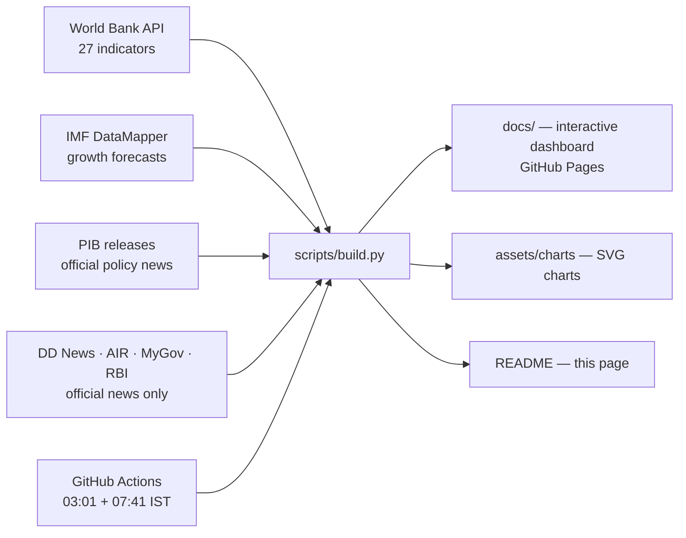

  

  
  
  
  

<b>India's economy, industry, environment and people — in one live, free dashboard.</b> 
GDP and national income from the World Bank, growth forecasts from the IMF, and the day's news for every topic from official government sources only (PIB, DD News, All India Radio, MyGov, RBI) — refreshed automatically twice a day.

  <a href="https://subhadeep998.github.io/India-Development-Dashboard/#economy">📈 Economy</a> ·
  <a href="https://subhadeep998.github.io/India-Development-Dashboard/#industry">🏭 Industry</a> ·
  <a href="https://subhadeep998.github.io/India-Development-Dashboard/#environment">🌿 Environment</a> ·
  <a href="https://subhadeep998.github.io/India-Development-Dashboard/#education">🎓 Education & Scholarships</a> ·
  <a href="https://subhadeep998.github.io/India-Development-Dashboard/#culture">🎭 Arts & Culture</a> ·
  <a href="https://subhadeep998.github.io/India-Development-Dashboard/#food">🌾 Food & Agriculture</a>

---

## 🇮🇳 India at a glance

| 💰 GDP | 📈 Real growth | 👤 GNI per capita | 🔮 IMF growth forecast |
|:--:|:--:|:--:|:--:|
| **US$ 3.96 tn** 2025 | **7.6%** 2025 | **US$ 2,760** 2025 | **7.0% (2026)** IMF WEO |

Last refreshed: 26 Nov 2026, 16:17 IST · Annual figures in current US$ from the World Bank; the forecast is the IMF World Economic Outlook.

---

## 📊 The big trends

<table>
  <tr>
    <td width="50%"></td>
    <td width="50%"></td>
  </tr>
  <tr>
    <td width="50%"></td>
    <td width="50%"></td>
  </tr>
  <tr>
    <td width="50%"></td>
    <td width="50%"></td>
  </tr>
  <tr>
    <td width="50%"></td>
    <td width="50%"></td>
  </tr>
</table>

<a href="https://subhadeep998.github.io/India-Development-Dashboard/"><b>Explore 27 indicators interactively →</b></a>

---

## 📰 Today across India — official sources

### 📈 Economy

GDP, national income, growth, inflation and investment.

- 2026-11-26 · [Empowering Governance through Digital Infrastructure](https://news.google.com/rss/articles/CBMid0FVX3lxTE5hQXQ1bVdGeGxka0FadS15dnU2NTJNeXJmdXB5Q2RQLVBwRWlISFlYU2ZaR0R4SklpUGxWbzU3UmpHQVF0dzJqYXA3Z0xzRkIyN2x4RVVkOE9zWk93VE8zRW1SSE12bkQ0QTQ5N2pOYkpfU0ZmRnRR?oc=5) — _www.pib.gov.in_
- 2026-11-26 · [NLMC holds 22nd Board Meeting; Considers fresh asset monetisation and valuation proposals worth approximately ₹1,300 cr…](https://news.google.com/rss/articles/CBMiaEFVX3lxTE9pTUx2ekxKMEMtRUxlZEN2SWNLRFZNYWdlV0hpU0RDUGY4Z1RrWnVIZjkweWNYajRhRHdaRUV3UVpxdG1OUTFjcHZrdFNaVDZKeFBKYTluV3JPNjNZY3lDOGZvUnBOWFBm?oc=5) — _www.pib.gov.in_
- 2026-11-26 · [India’s space economy projected to reach $40-45 billion as private sector drives growth: Jitendra Singh](https://news.google.com/rss/articles/CBMixAFBVV95cUxNbFp6c294TnhUakR4Z1lVVW1VS2txVDdLaGN4dUNXWEgwOF9QLU56REI4WmhvekFoTXN5YnNkOWM4TWNZNGE0UFVwdXR3Wk5Mb0l3NDJBMGxrbzM3YlIteno1RFZxZnVBRDl4T3RNd3FyN1VrbnR4dTlOajI5dzMtUEtpdXNHeWFMTU53SUdhai1iLVlQa201N3d1X3A4Zk1oUnhEcGhxTDl4Vi1rNXNDcHAwWlVhZ2JXMENtVnVPZUJ1M19U?oc=5) — _DD News_
- 2026-11-26 · [India Retains Third Spot in Lowy’s Asia Power Index 2026, PM Modi Ranked Most Effective Regional Leader](https://news.google.com/rss/articles/CBMixgFBVV95cUxNLWpudjFpM2VkVmVXdHBwWHBVZ0JSQkJtNDIzZWVQRzQzbXlVTzVUT2hKN2k1NHpNWlhYRHpBbk9SLXU1X1o5cExtcGJHLTl4NXRqVVRpUGZMdTFQdTBzUlczUVJwLWt1RUo2bldwR2p0S05jb1hINDJVWWl2YjNSQklLSnRaNVZBeGx3OFZPWllSMXBUWGh4SDhIS25TZG1iV2k3UXk4V250ajJLZFc5ZDZCWHl5S2xGa3AwaGJJU05yVTJ4M1E?oc=5) — _DD News_

[Open the Economy tab →](https://subhadeep998.github.io/India-Development-Dashboard/#economy)

### 🏭 Industry

Manufacturing, industrial output, structure of the economy and infrastructure.

- 2026-11-26 · [Prime Minister shares an article highlighting how the Constitution remains our timeless compass towards social justice …](https://news.google.com/rss/articles/CBMia0FVX3lxTE95aW9jck1IZTBhdUdLek1iWFpQbWdHdFNxTkJrUVFEeS15eTlfREpxTkRBRzVzRTUzY005bTY1Z0Fvd1lQRWY0WHJJVmRTNU93UllQdHhpUmczeWpCOXRZQnVSNF9oMVVUMndN?oc=5) — _www.pib.gov.in_
- 2026-11-26 · [Prime Minister shares an OpEd highlighting the uniqueness of India’s Constitution and efforts towards boosting social a…](https://news.google.com/rss/articles/CBMia0FVX3lxTFBYZmxlT1pfcks5TkJ0Qml5c3BXNUZHWTJxcjc2TG9QMHdhLVozN2Y2RXJSRVFUNmxTRGZEQjJ0Vlc4MGNjcWJnSDdoNnFDaEU3clRqNnQ3WjZacGxPVFZUQm13R2gwaU5UbldV?oc=5) — _www.pib.gov.in_
- 2026-11-26 · [India’s space economy projected to reach $40-45 billion as private sector drives growth: Jitendra Singh](https://news.google.com/rss/articles/CBMixAFBVV95cUxNbFp6c294TnhUakR4Z1lVVW1VS2txVDdLaGN4dUNXWEgwOF9QLU56REI4WmhvekFoTXN5YnNkOWM4TWNZNGE0UFVwdXR3Wk5Mb0l3NDJBMGxrbzM3YlIteno1RFZxZnVBRDl4T3RNd3FyN1VrbnR4dTlOajI5dzMtUEtpdXNHeWFMTU53SUdhai1iLVlQa201N3d1X3A4Zk1oUnhEcGhxTDl4Vi1rNXNDcHAwWlVhZ2JXMENtVnVPZUJ1M19U?oc=5) — _DD News_
- 2026-11-26 · [India Retains Third Spot in Lowy’s Asia Power Index 2026, PM Modi Ranked Most Effective Regional Leader](https://news.google.com/rss/articles/CBMixgFBVV95cUxNLWpudjFpM2VkVmVXdHBwWHBVZ0JSQkJtNDIzZWVQRzQzbXlVTzVUT2hKN2k1NHpNWlhYRHpBbk9SLXU1X1o5cExtcGJHLTl4NXRqVVRpUGZMdTFQdTBzUlczUVJwLWt1RUo2bldwR2p0S05jb1hINDJVWWl2YjNSQklLSnRaNVZBeGx3OFZPWllSMXBUWGh4SDhIS25TZG1iV2k3UXk4V250ajJLZFc5ZDZCWHl5S2xGa3AwaGJJU05yVTJ4M1E?oc=5) — _DD News_

[Open the Industry tab →](https://subhadeep998.github.io/India-Development-Dashboard/#industry)

### 🌿 Environment

Emissions, forests, clean energy and air quality.

- 2026-11-26 · [Press Note Details: Press Information Bureau](https://news.google.com/rss/articles/CBMingFBVV95cUxQQ2ZDNGpFTGJ6cGhEM0pNWm82Yjc4aDlXR3gwNjFwVmNpT3U5VjNJZHQ2cGwzb3paTDBaVnlpWExuN201RlJNTFFWei1aUXF6ekJ4YU1Ma2JxUW1Nci1uOHo4cEVsMkYtX28xSWx6ZWduYlczTGdDMjhWc3UwVUotT2xhd0p0SklNVlF3eXhMa2VLUjNJNmlvWlE1TEFBUQ?oc=5) — _www.pib.gov.in_
- 2026-11-26 · [The Return of the Spotted Sprint](https://news.google.com/rss/articles/CBMilwFBVV95cUxObThScVRIM25TakwwS0UxeDB5dXJKcUtNci1ZeXZyMlhBWWl0ZlpKaHFMQTA5NzRxLXM3NGJrWDFsb09NMmdmYkhPWTdUbW5UMlJ5cVlmNTlxSDdYNE9TSnphQWdxV2FFdVJWY0VZTDctMFVjZzdpUDNkTzE3cjQxTEhIZE5HUVh5S1ZvWVYxZ3REZ0M0azhj?oc=5) — _www.pib.gov.in_
- 2026-11-26 · [India Wins Visitors’ Lion for Best National Participation at Venice Art Biennale 2026](https://news.google.com/rss/articles/CBMirwFBVV95cUxPYmwxM2NDUFdSaHoyV2d6VHBhX1I2b1VHUmJFVGxpeGJHeXdOZXRvdmxoS1BPQ1hpdkhoYWJEYm9JazR2aWFBV1ZXNllPX0ZRVDdaVkthNER0SGo0V2VuNzJfNE5Od3VvWXNSeWNEd0c1RjBSbG9iWUVqM21QWXloNWJobkdnWWQ4WWltUUJRUDI5NTl0d2lUMlQyNDdJUmNkcWpqdmdpVy1zTHRiZmVr?oc=5) — _DD News_
- 2026-11-26 · [India’s space economy projected to reach $40-45 billion as private sector drives growth: Jitendra Singh](https://news.google.com/rss/articles/CBMixAFBVV95cUxNbFp6c294TnhUakR4Z1lVVW1VS2txVDdLaGN4dUNXWEgwOF9QLU56REI4WmhvekFoTXN5YnNkOWM4TWNZNGE0UFVwdXR3Wk5Mb0l3NDJBMGxrbzM3YlIteno1RFZxZnVBRDl4T3RNd3FyN1VrbnR4dTlOajI5dzMtUEtpdXNHeWFMTU53SUdhai1iLVlQa201N3d1X3A4Zk1oUnhEcGhxTDl4Vi1rNXNDcHAwWlVhZ2JXMENtVnVPZUJ1M19U?oc=5) — _DD News_

[Open the Environment tab →](https://subhadeep998.github.io/India-Development-Dashboard/#environment)

### 🎓 Education & Scholarships

Education spending, enrolment, literacy — and where to apply for scholarships.

- 2026-11-25 · [PM chairs 55th PRAGATI meeting](https://news.google.com/rss/articles/CBMie0FVX3lxTE14NVRQUXNYbFJ1dzZwcGNSOERKSk95R1lKNTd5cTRlMnU0SjJ3RFJpQkkzTnZBUm1UTV9KOGRjS01wYVRKS2pTdDdqVHJ5WDR0c1FXNjE3LTlVdFFHdzBXeTMzRHNJZXVCS1N1RTFHdmYwTmJCUENDRTl5NA?oc=5) — _www.pib.gov.in_
- 2026-11-25 · [Cabinet approves continuation of Postal Operations Scheme with an outlay of Rs. 1,141 Crore for 16th Finance Commission…](https://news.google.com/rss/articles/CBMie0FVX3lxTE5EME1ZSl9zY085SnExSnB5VUlKTVpsSEgtakxmQmJFd05OUGtHUFZaN2JXeFBsb1daeHRFSTVMa3laTjFWVWFmajZSOU5qMVphc2dmNTFaVzFnMzdiN0o1UmtTSnV5cWxGM1EyUlNIVlE3b0lUOTJ3a19iOA?oc=5) — _www.pib.gov.in_
- 2026-11-26 · [India’s space economy projected to reach $40-45 billion as private sector drives growth: Jitendra Singh](https://news.google.com/rss/articles/CBMixAFBVV95cUxNbFp6c294TnhUakR4Z1lVVW1VS2txVDdLaGN4dUNXWEgwOF9QLU56REI4WmhvekFoTXN5YnNkOWM4TWNZNGE0UFVwdXR3Wk5Mb0l3NDJBMGxrbzM3YlIteno1RFZxZnVBRDl4T3RNd3FyN1VrbnR4dTlOajI5dzMtUEtpdXNHeWFMTU53SUdhai1iLVlQa201N3d1X3A4Zk1oUnhEcGhxTDl4Vi1rNXNDcHAwWlVhZ2JXMENtVnVPZUJ1M19U?oc=5) — _DD News_
- 2026-11-26 · [India Wins Visitors’ Lion for Best National Participation at Venice Art Biennale 2026](https://news.google.com/rss/articles/CBMirwFBVV95cUxPYmwxM2NDUFdSaHoyV2d6VHBhX1I2b1VHUmJFVGxpeGJHeXdOZXRvdmxoS1BPQ1hpdkhoYWJEYm9JazR2aWFBV1ZXNllPX0ZRVDdaVkthNER0SGo0V2VuNzJfNE5Od3VvWXNSeWNEd0c1RjBSbG9iWUVqM21QWXloNWJobkdnWWQ4WWltUUJRUDI5NTl0d2lUMlQyNDdJUmNkcWpqdmdpVy1zTHRiZmVr?oc=5) — _DD News_

[Open the Education & Scholarships tab →](https://subhadeep998.github.io/India-Development-Dashboard/#education)

### 🎭 Arts & Culture

Heritage, the arts, cultural scholarships and tourism.

- 2026-11-26 · [Ayush Pavilion at IITF 2026 draws strong public response with interactive activities, free consultations and healthy fo…](https://news.google.com/rss/articles/CBMia0FVX3lxTE8wRk5jOEdOOU9HRzhkSUViS0NueDZBUlVGUXl2UEdKWk13eHJCSG9wZUdxWHR0Wjc0SENZYXFRdWJPYXZxZWVQV0ZCUWl3NXdPYllHYTRlMk54VVJ5dUZEbHEzNERoTEVkcDVR?oc=5) — _www.pib.gov.in_
- 2026-11-26 · [NIFT Gandhinagar conducted ‘Fresher’s X Farewell 2026’ with Creativity, Culture and Togetherness](https://news.google.com/rss/articles/CBMiakFVX3lxTE9jSmlYQ3F6RkhEM2pMWExUYXkzRkNZMm90ZS1mVHA5VHZtdFRwdGU5eVk2U3FCMEdkcjdrZEowa1hSRS1obnIyY1RhQWZDdzI2YzhjUGY3ZlZ1VUVNVU11WEtWTm5UMHFJaWc?oc=5) — _pib.gov.in_
- 2026-11-26 · [India Wins Visitors’ Lion for Best National Participation at Venice Art Biennale 2026](https://news.google.com/rss/articles/CBMirwFBVV95cUxPYmwxM2NDUFdSaHoyV2d6VHBhX1I2b1VHUmJFVGxpeGJHeXdOZXRvdmxoS1BPQ1hpdkhoYWJEYm9JazR2aWFBV1ZXNllPX0ZRVDdaVkthNER0SGo0V2VuNzJfNE5Od3VvWXNSeWNEd0c1RjBSbG9iWUVqM21QWXloNWJobkdnWWQ4WWltUUJRUDI5NTl0d2lUMlQyNDdJUmNkcWpqdmdpVy1zTHRiZmVr?oc=5) — _DD News_
- 2026-11-26 · [India’s space economy projected to reach $40-45 billion as private sector drives growth: Jitendra Singh](https://news.google.com/rss/articles/CBMixAFBVV95cUxNbFp6c294TnhUakR4Z1lVVW1VS2txVDdLaGN4dUNXWEgwOF9QLU56REI4WmhvekFoTXN5YnNkOWM4TWNZNGE0UFVwdXR3Wk5Mb0l3NDJBMGxrbzM3YlIteno1RFZxZnVBRDl4T3RNd3FyN1VrbnR4dTlOajI5dzMtUEtpdXNHeWFMTU53SUdhai1iLVlQa201N3d1X3A4Zk1oUnhEcGhxTDl4Vi1rNXNDcHAwWlVhZ2JXMENtVnVPZUJ1M19U?oc=5) — _DD News_

[Open the Arts & Culture tab →](https://subhadeep998.github.io/India-Development-Dashboard/#culture)

### 🌾 Food & Agriculture

Food security, farm output, nutrition and farmer support.

- 2026-11-26 · [Press Note Details: Press Information Bureau](https://news.google.com/rss/articles/CBMingFBVV95cUxQQ2ZDNGpFTGJ6cGhEM0pNWm82Yjc4aDlXR3gwNjFwVmNpT3U5VjNJZHQ2cGwzb3paTDBaVnlpWExuN201RlJNTFFWei1aUXF6ekJ4YU1Ma2JxUW1Nci1uOHo4cEVsMkYtX28xSWx6ZWduYlczTGdDMjhWc3UwVUotT2xhd0p0SklNVlF3eXhMa2VLUjNJNmlvWlE1TEFBUQ?oc=5) — _www.pib.gov.in_
- 2026-11-26 · [Ayush Pavilion at IITF 2026 draws strong public response with interactive activities, free consultations and healthy fo…](https://news.google.com/rss/articles/CBMia0FVX3lxTE8wRk5jOEdOOU9HRzhkSUViS0NueDZBUlVGUXl2UEdKWk13eHJCSG9wZUdxWHR0Wjc0SENZYXFRdWJPYXZxZWVQV0ZCUWl3NXdPYllHYTRlMk54VVJ5dUZEbHEzNERoTEVkcDVR?oc=5) — _www.pib.gov.in_
- 2026-11-26 · [Kharif sowing reaches 787.37 lakh hectares](https://news.google.com/rss/articles/CBMid0FVX3lxTE1yZGZEeDVTVmhEaG51dDk0TDBFQnpXMmxUYmNaUHdFYTNsSlItTFNxZWZqQkFvaEJzRE8zaDJ4SkRXdDFLXzBFOWNyMkM3X2g5Wm9hVWlHTTkzNEgwUWlVN3J2aTFDY3ZlMTh1TDBXS2FkaHZxUDNF?oc=5) — _DD News_
- 2026-11-26 · [USBRL transforms Kashmir connectivity, opens new markets for farmers and businesses: Ashwini Vaishnaw](https://news.google.com/rss/articles/CBMiwwFBVV95cUxOcWpidnhfMzZWOUgweEJNRk1HYTM0djNCOTI1Z3NWdjZOeDZON0tkTXc3MGhDMk5CalZ1M3cwSzh0WHFudW1lYjhOc2kzWVAtMDhLS0x2cklDUmY1R29zRXZhU3J4eWZfd1VMWkYzc0ZBNWxjZjFJS29tTHBGTDlwcEJJblZqR0RRU1J0Wjc0NHNKelVYS2ZsNmVDWl96blJUX1BobjdWX3F4UU9KYWlNdDdUSURsNkhJTzd3M0RPYUNYTmc?oc=5) — _DD News_

[Open the Food & Agriculture tab →](https://subhadeep998.github.io/India-Development-Dashboard/#food)

---

## 🏛️ Government schemes, at a glance

| Area | Start here |
|:--|:--|
| 🎓 **Scholarships** | [National Scholarship Portal](https://scholarships.gov.in) · [PM Vidyalaxmi (education loans)](https://pmvidyalaxmi.co.in) · [INSPIRE](https://online-inspire.gov.in) · [PM Research Fellowship](https://pmrf.in) · [AICTE Pragati & Saksham](https://www.aicte-india.org) |
| 🎭 **Arts & culture** | [Ministry of Culture](https://www.indiaculture.gov.in) · [CCRT scholarships for young artists](https://ccrtindia.gov.in) · [Sangeet Natak Akademi](https://www.sangeetnatak.gov.in) · [Lalit Kala Akademi](https://lalitkala.gov.in) |
| 🌾 **Food** | [National Food Security Act](https://nfsa.gov.in) · [PM-KISAN](https://pmkisan.gov.in) · [PM-POSHAN](https://pmposhan.education.gov.in) · [Eat Right India](https://eatrightindia.gov.in) · [e-NAM](https://enam.gov.in) |
| 🌿 **Environment** | [National Clean Air Programme](https://prana.cpcb.gov.in) · [PM Surya Ghar](https://pmsuryaghar.gov.in) · [PM-KUSUM](https://pmkusum.mnre.gov.in) · [Mission LiFE](https://missionlife-moefcc.nic.in) |
| 🏭 **Industry** | [Make in India](https://www.makeinindia.com) · [PLI schemes](https://www.investindia.gov.in/production-linked-incentives-schemes-india) · [Startup India](https://www.startupindia.gov.in) · [PM Gati Shakti](https://pmgatishakti.gov.in) |
| 📈 **Economy** | [Union Budget](https://www.indiabudget.gov.in) · [RBI](https://www.rbi.org.in) · [MoSPI](https://www.mospi.gov.in) · [GST Council](https://gstcouncil.gov.in) |

> Scheme rules, amounts and deadlines change — always confirm on the official portal before applying.

---

## ⚙️ How it works

- **Runs twice a day** (03:01 and 07:41 IST), away from GitHub's busy hours — if one run is delayed or dropped, the second catches up.
- **Never goes blank:** if a source is down, the last good data is kept.
- **All sources are free and official.** Official sources only — no general media. Only headlines and links are stored — click through to read the original reporting.

> Independent educational project; not affiliated with the Government of India, the World Bank or the IMF.

---

  ⭐ <b>Star</b> to bookmark · 👤 <a href="https://github.com/Subhadeep998"><b>Follow @Subhadeep998</b></a> 
  Built by <a href="https://www.subhadeepaditya.in">Subhadeep Aditya</a> — healthcare intelligence analyst and LL.B. student · Kolkata, India

