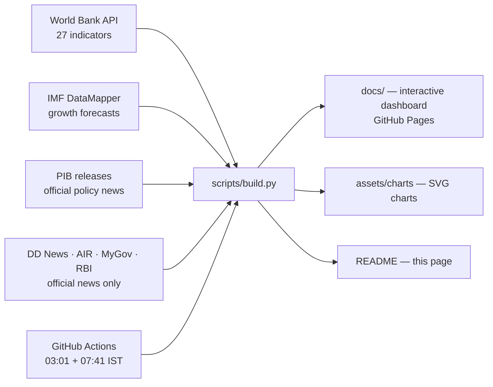

  

  
  
  
  

<b>India's economy, industry, environment and people — in one live, free dashboard.</b> 
GDP and national income from the World Bank, growth forecasts from the IMF, and the day's news for every topic from official government sources only (PIB, DD News, All India Radio, MyGov, RBI) — refreshed automatically twice a day.

  <a href="https://subhadeep998.github.io/India-Development-Dashboard/#economy">📈 Economy</a> ·
  <a href="https://subhadeep998.github.io/India-Development-Dashboard/#industry">🏭 Industry</a> ·
  <a href="https://subhadeep998.github.io/India-Development-Dashboard/#environment">🌿 Environment</a> ·
  <a href="https://subhadeep998.github.io/India-Development-Dashboard/#education">🎓 Education & Scholarships</a> ·
  <a href="https://subhadeep998.github.io/India-Development-Dashboard/#culture">🎭 Arts & Culture</a> ·
  <a href="https://subhadeep998.github.io/India-Development-Dashboard/#food">🌾 Food & Agriculture</a>

---

## 🇮🇳 India at a glance

| 💰 GDP | 📈 Real growth | 👤 GNI per capita | 🔮 IMF growth forecast |
|:--:|:--:|:--:|:--:|
| **US$ 3.96 tn** 2025 | **7.6%** 2025 | **US$ 2,760** 2025 | **7.0% (2026)** IMF WEO |

Last refreshed: 25 Nov 2026, 16:41 IST · Annual figures in current US$ from the World Bank; the forecast is the IMF World Economic Outlook.

---

## 📊 The big trends

<table>
  <tr>
    <td width="50%"></td>
    <td width="50%"></td>
  </tr>
  <tr>
    <td width="50%"></td>
    <td width="50%"></td>
  </tr>
  <tr>
    <td width="50%"></td>
    <td width="50%"></td>
  </tr>
  <tr>
    <td width="50%"></td>
    <td width="50%"></td>
  </tr>
</table>

<a href="https://subhadeep998.github.io/India-Development-Dashboard/"><b>Explore 27 indicators interactively →</b></a>

---

## 📰 Today across India — official sources

### 📈 Economy

GDP, national income, growth, inflation and investment.

- 2026-11-25 · [India’s Bio-Economy Set to Reach 300 million Dollars by 2030; Dr. Jitendra Singh Urges Industry to Seize Opportunities …](https://news.google.com/rss/articles/CBMia0FVX3lxTE9rbmlWT2czejJNbmNIbElxd09xMVZPZnVlOXdFTUpFcVVSWEx4NHpVOFlNWmFrcXdhZjhLcHFSVzdaUHY3RXBPZ1FuY3JwTk96dGFvNF9BSG1aOXJDR3RJMkJ0X2gyWG5rbzRz?oc=5) — _www.pib.gov.in_
- 2026-11-25 · [Cabinet approves development of the Second Container Terminal at Kamarajar Port Limited under Public Private Partnershi…](https://news.google.com/rss/articles/CBMia0FVX3lxTE9LUFlORDNLRDhJd0toUkFCSm9RMDlqZXk4MmdJVFZwTGxIR3VuUHdET1hVX3ZHRFBJcWkyTlVGSlVNT0dxRnNRLVdNY1hNNHllXzRhR0lrUWxnNWRyQUFKVzBGcXNLWlg5X25j?oc=5) — _pib.gov.in_
- 2026-11-25 · [India Retains Third Spot in Lowy’s Asia Power Index 2026, PM Modi Ranked Most Effective Regional Leader](https://news.google.com/rss/articles/CBMixgFBVV95cUxNLWpudjFpM2VkVmVXdHBwWHBVZ0JSQkJtNDIzZWVQRzQzbXlVTzVUT2hKN2k1NHpNWlhYRHpBbk9SLXU1X1o5cExtcGJHLTl4NXRqVVRpUGZMdTFQdTBzUlczUVJwLWt1RUo2bldwR2p0S05jb1hINDJVWWl2YjNSQklLSnRaNVZBeGx3OFZPWllSMXBUWGh4SDhIS25TZG1iV2k3UXk4V250ajJLZFc5ZDZCWHl5S2xGa3AwaGJJU05yVTJ4M1E?oc=5) — _DD News_
- 2026-11-25 · [Nepal PM Balendra Shah’s first official India visit aims to reset bilateral ties](https://news.google.com/rss/articles/CBMiqAFBVV95cUxPdUxHS0VZN3lUWmxNSXp1dC1mT2VtMHl3aER5c3NrRURwWURnU2RjV3hnYW9RODRsa0xwRFJGWlpZNWlTdDFwRlBHQ3BtcHpGZlZPZDFQZ1ctTW43RUhNRUk5NXB0UF9Cakg5aWMzektydUxzQmVPYUZvVE5oR2oxQnJvMnpXZjBoTWxyczVqbkRMc3FQc3F6TFp2dDhSTEVNaEFKQlkyUVo?oc=5) — _DD News_

[Open the Economy tab →](https://subhadeep998.github.io/India-Development-Dashboard/#economy)

### 🏭 Industry

Manufacturing, industrial output, structure of the economy and infrastructure.

- 2026-11-25 · [PLI Scheme for Automobile and Auto Component Industry Records ₹4,385.28 Crore Incentive Disbursement in FY 2026–27](https://news.google.com/rss/articles/CBMia0FVX3lxTE9zT0EtdGM1dXprTnhKRU1VX05sc2RfYnkwUHB0ZnRyR0NVYW4tRDhJUmhKelNLTUZQRzByUGdOeG5tMHZqRU5aWUpLNDhBWlhjcDlWSWcxeEdaX2lrUnU1YVI1clRxSy11Sklv?oc=5) — _www.pib.gov.in_
- 2026-11-25 · [Prime Minister shares an article highlighting India’s journey towards Viksit Bharat 2047 shaped by sustained reforms an…](https://news.google.com/rss/articles/CBMifEFVX3lxTE9EQjJMY21wOHZMdHFfencwSERiTGFELTFKNHowZ3VGVWRkYWp3UnJTZlZMOWs5cms1SGFVTjJHeHZzOEllYjYtTzY4bzRDTmZFZ05iZG5BY1FUa0t5Y0MzTUVCeU1keDJWYjBWWGEwczhERDBTQjIzTy1wc0o?oc=5) — _pib.gov.in_
- 2026-11-25 · [India Retains Third Spot in Lowy’s Asia Power Index 2026, PM Modi Ranked Most Effective Regional Leader](https://news.google.com/rss/articles/CBMixgFBVV95cUxNLWpudjFpM2VkVmVXdHBwWHBVZ0JSQkJtNDIzZWVQRzQzbXlVTzVUT2hKN2k1NHpNWlhYRHpBbk9SLXU1X1o5cExtcGJHLTl4NXRqVVRpUGZMdTFQdTBzUlczUVJwLWt1RUo2bldwR2p0S05jb1hINDJVWWl2YjNSQklLSnRaNVZBeGx3OFZPWllSMXBUWGh4SDhIS25TZG1iV2k3UXk4V250ajJLZFc5ZDZCWHl5S2xGa3AwaGJJU05yVTJ4M1E?oc=5) — _DD News_
- 2026-11-25 · [Nepal PM Balendra Shah’s first official India visit aims to reset bilateral ties](https://news.google.com/rss/articles/CBMiqAFBVV95cUxPdUxHS0VZN3lUWmxNSXp1dC1mT2VtMHl3aER5c3NrRURwWURnU2RjV3hnYW9RODRsa0xwRFJGWlpZNWlTdDFwRlBHQ3BtcHpGZlZPZDFQZ1ctTW43RUhNRUk5NXB0UF9Cakg5aWMzektydUxzQmVPYUZvVE5oR2oxQnJvMnpXZjBoTWxyczVqbkRMc3FQc3F6TFp2dDhSTEVNaEFKQlkyUVo?oc=5) — _DD News_

[Open the Industry tab →](https://subhadeep998.github.io/India-Development-Dashboard/#industry)

### 🌿 Environment

Emissions, forests, clean energy and air quality.

- 2026-11-24 · [Union Minister Dr Virendra Kumar To Launch SAMAVESH And New E-Anudaan Portal Tomorrow November 25](https://news.google.com/rss/articles/CBMifkFVX3lxTE9sSGJPMmlIVHM2Q2xlX1dZemdWVENQbUthU2s2VDZaTHB3eEE4dzBNXzg0d2Rlai1BR0owRDl0Y21Jck1zU3ZGcEJseTREOFFRYlFFSHhYMlZLSGVGWTk1dHBLczBMMkoydGQxcEM0NmZTanY3VFhQMzdxVkFxQQ?oc=5) — _pib.gov.in_
- 2026-11-24 · [Stakeholders meet at Zoological Survey of India, for reinforcing Integrated, Predictive Approach to Zoonotic Disease Su…](https://news.google.com/rss/articles/CBMiY0FVX3lxTE9Wc1FxNXN0NUl6OURUOUlXMmoyTnNiRWRVZzRQand2T1pHTjZuVVRvUU9aa3Q3RGZ1VG9SNGJ4dTYyRmJnakdSaXFaZzE0bkxOaDRpTzdHUkJ5VGNGYmpkb2JHdw?oc=5) — _पीआईबी_
- 2026-11-25 · [India Retains Third Spot in Lowy’s Asia Power Index 2026, PM Modi Ranked Most Effective Regional Leader](https://news.google.com/rss/articles/CBMixgFBVV95cUxNLWpudjFpM2VkVmVXdHBwWHBVZ0JSQkJtNDIzZWVQRzQzbXlVTzVUT2hKN2k1NHpNWlhYRHpBbk9SLXU1X1o5cExtcGJHLTl4NXRqVVRpUGZMdTFQdTBzUlczUVJwLWt1RUo2bldwR2p0S05jb1hINDJVWWl2YjNSQklLSnRaNVZBeGx3OFZPWllSMXBUWGh4SDhIS25TZG1iV2k3UXk4V250ajJLZFc5ZDZCWHl5S2xGa3AwaGJJU05yVTJ4M1E?oc=5) — _DD News_
- 2026-11-25 · [Nepal PM Balendra Shah’s first official India visit aims to reset bilateral ties](https://news.google.com/rss/articles/CBMiqAFBVV95cUxPdUxHS0VZN3lUWmxNSXp1dC1mT2VtMHl3aER5c3NrRURwWURnU2RjV3hnYW9RODRsa0xwRFJGWlpZNWlTdDFwRlBHQ3BtcHpGZlZPZDFQZ1ctTW43RUhNRUk5NXB0UF9Cakg5aWMzektydUxzQmVPYUZvVE5oR2oxQnJvMnpXZjBoTWxyczVqbkRMc3FQc3F6TFp2dDhSTEVNaEFKQlkyUVo?oc=5) — _DD News_

[Open the Environment tab →](https://subhadeep998.github.io/India-Development-Dashboard/#environment)

### 🎓 Education & Scholarships

Education spending, enrolment, literacy — and where to apply for scholarships.

- 2026-11-25 · [Vice-President Inaugurates Swayamsiddha National Conference 2026 on Women’s Empowerment in Nagpur](https://news.google.com/rss/articles/CBMia0FVX3lxTE5kRE5MX3J4UUNlZF9BcTl3bHdEZ2ZQSDlkbTVvZlp4Q295YkZVbWc4LU5aVVlyTFFlbERvRXM4cjhUUE9DR3YyV2hfNzc2SmlRdDJjdmhkOWRRazZWSmJLVS1wQlV6bUd5SVpv?oc=5) — _www.pib.gov.in_
- 2026-11-25 · [Press Note Details: Press Information Bureau](https://news.google.com/rss/articles/CBMieEFVX3lxTE9McXpVMi11SE50a1FHYkphb0ZPeGJyZGVWQklWNG1taXp4RmZSR1N1OHdyVlNXeFZ4Y3o0ZFZYQnZOb2Y5dWRiSjFKXzhNRUZwY3pGZ2tISVNodUlBZFVneUpBOWoxT0NvQlJaOWlFNlFrTndyeTctUw?oc=5) — _www.pib.gov.in_
- 2026-11-25 · [Nepal PM Balendra Shah’s first official India visit aims to reset bilateral ties](https://news.google.com/rss/articles/CBMiqAFBVV95cUxPdUxHS0VZN3lUWmxNSXp1dC1mT2VtMHl3aER5c3NrRURwWURnU2RjV3hnYW9RODRsa0xwRFJGWlpZNWlTdDFwRlBHQ3BtcHpGZlZPZDFQZ1ctTW43RUhNRUk5NXB0UF9Cakg5aWMzektydUxzQmVPYUZvVE5oR2oxQnJvMnpXZjBoTWxyczVqbkRMc3FQc3F6TFp2dDhSTEVNaEFKQlkyUVo?oc=5) — _DD News_
- 2026-11-25 · [India Retains Third Spot in Lowy’s Asia Power Index 2026, PM Modi Ranked Most Effective Regional Leader](https://news.google.com/rss/articles/CBMixgFBVV95cUxNLWpudjFpM2VkVmVXdHBwWHBVZ0JSQkJtNDIzZWVQRzQzbXlVTzVUT2hKN2k1NHpNWlhYRHpBbk9SLXU1X1o5cExtcGJHLTl4NXRqVVRpUGZMdTFQdTBzUlczUVJwLWt1RUo2bldwR2p0S05jb1hINDJVWWl2YjNSQklLSnRaNVZBeGx3OFZPWllSMXBUWGh4SDhIS25TZG1iV2k3UXk4V250ajJLZFc5ZDZCWHl5S2xGa3AwaGJJU05yVTJ4M1E?oc=5) — _DD News_

[Open the Education & Scholarships tab →](https://subhadeep998.github.io/India-Development-Dashboard/#education)

### 🎭 Arts & Culture

Heritage, the arts, cultural scholarships and tourism.

- 2026-11-25 · [Prime Minister shares an article highlighting the growing role of India’s civilisational heritage in shaping global cul…](https://news.google.com/rss/articles/CBMie0FVX3lxTE9leUlvM1ZENllUUGw0ZnZFTUtiaUpMb2NRbTZ2M0QzYmN4WUdhVU9hUWthdXBrYklPYWhjM1lESlQ4c2w2ZDZPeUpXdm5aU01ENm1leHVBMG5SZ2lqZTBkTEtQQlU3dmd6NFRDY201ZVVyU0xRU0NmcDVDYw?oc=5) — _www.pib.gov.in_
- 2026-11-25 · [Cabinet approves continuation of Estates Management Scheme for Department of Posts with an outlay of Rs. 1,491 crore](https://news.google.com/rss/articles/CBMia0FVX3lxTE1JWE52OEpFczg5anVmX2prWTVCVmJPOHpXWVdxQjByOF8zREdFRmx6bkZBajZQb1p2YzB0LTBNZUdaUWs3dWt3NzRNWkxyVmJlZUpmeGlkNlJEZ1NoZlctNXdncU1ZaTc1R3RB?oc=5) — _www.pib.gov.in_
- 2026-11-25 · [Nepal PM Balendra Shah’s first official India visit aims to reset bilateral ties](https://news.google.com/rss/articles/CBMiqAFBVV95cUxPdUxHS0VZN3lUWmxNSXp1dC1mT2VtMHl3aER5c3NrRURwWURnU2RjV3hnYW9RODRsa0xwRFJGWlpZNWlTdDFwRlBHQ3BtcHpGZlZPZDFQZ1ctTW43RUhNRUk5NXB0UF9Cakg5aWMzektydUxzQmVPYUZvVE5oR2oxQnJvMnpXZjBoTWxyczVqbkRMc3FQc3F6TFp2dDhSTEVNaEFKQlkyUVo?oc=5) — _DD News_
- 2026-11-25 · [PM Modi shares an article on India’s civilisational heritage and its growing global cultural influence](https://news.google.com/rss/articles/CBMixgFBVV95cUxQd3p2aU9Xa3Y3NVVOZ3Q3OWZ5V202UlE2clJvWF9DVWZLQlBoc0d5YVdsZWRFaVpFTDZUcDhkajMycHhKNi0wNnd6MXhFZzhqNU1ZQUFsSERUZmJvYU9OdUZZMlQteW1XZkZHQXp2RHp4dlZPVWNNMHMzTkE4d0lubmpjTFdfQVVPV3h2R2N4ZUM4TFZ4cVZOSUREQ0RkUk9YMGFRc1I1WXFZbDRTLU80QVh5V2taaXczd2FwX3l6T1dBLUVybnc?oc=5) — _DD News_

[Open the Arts & Culture tab →](https://subhadeep998.github.io/India-Development-Dashboard/#culture)

### 🌾 Food & Agriculture

Food security, farm output, nutrition and farmer support.

- 2026-11-25 · [Union Agriculture Minister Shri Shivraj Singh Chouhan visits farms in Punjab to improve soil health and increase farmer…](https://news.google.com/rss/articles/CBMifEFVX3lxTE5IOVJRYV9YSXN2M0o0eHp5alQ1aG1UOGFOWTJyNWdJUHdSYzFxSDFhRnVpV1UzUDV1MXdVT3V0cjA5S3lhdFdPUng3N1pSZGNIT2lJRFJLclpqbVNKVDFlRzN4RGlHTFNKdEdvd2h6LXdiQ29yc0wtQlpWWkU?oc=5) — _pib.gov.in_
- 2026-11-25 · [Union Minister Shri Shivraj Singh Chouhan Leads States in Kharif Campaign 2026 Strategy Meet](https://news.google.com/rss/articles/CBMifEFVX3lxTE1majFaWm1raFhUMGdRdXlQOFdmZEVBMUhCR29QcE9oeWZFWFFGNVh4RDBMWFFHTVJqWU55UUl2U1RLUUhaejZtbVFQME5BSlkzdTRVNE5ESWlNb2s2LUJuMl9yR2xGMExMbGdhai1uN0JRNVNxX2pDY0lJOFk?oc=5) — _pib.gov.in_
- 2026-11-25 · [FSSAI begins nationwide surveillance of packaged drinking water quality, results expected in 1-2 months: CEO Punhani](https://news.google.com/rss/articles/CBMi1wFBVV95cUxNNUZsdUpqUU83VUtlVkgxSDI4V0ZZbXZOLXJ4cjdRSGloQ2lRNGVXc2M5TW05WThjVEY3Q281WjBaTlNFZ0VZbjFsd2h1d1dNdEhNOGtveWRRR0xnSXBkajhTaGFvbnFDUnEzZkZ6TF9Lbmdfb0s4WnZNbUdMVy1teG5MaUpIQjJEcTdZX2Z1WTdEb3JYOHRUSEpwVnlVYmVuSGVrRmZkUnU1MW5fQ0tlUDU3dWNEOVc4c3JHc21QemN3MFlBRHpzXzdhZ3BXWjV5R3NPRUlFcw?oc=5) — _DD News_
- 2026-11-25 · [Cabinet approves Rs 62,370-crore Nutrient-Based Subsidy for P&K fertilisers for Rabi 2026-27](https://news.google.com/rss/articles/CBMitwFBVV95cUxPdnZHdjRmNGZXUU5xend6U0tnVkkxYUtZdWwwaWppZDByYTZueUFKdTJzbTMwamtFVzE3Y3pkVzN1ODVnNTdfN3JKaVNjRHFYUUxUbWdfNUlZdTktUU1kaDlhYWJLeVVEYmx3bng0WVRUTnRuNFN6SEV1THVCZk5FV00tZno3ZVBjRkpKX2ZMTTNaXzFoNnJJTUZLMUFJeW42ejE1al9tVTJPUUx4dG5FaUc4eVcwR2c?oc=5) — _DD News_

[Open the Food & Agriculture tab →](https://subhadeep998.github.io/India-Development-Dashboard/#food)

---

## 🏛️ Government schemes, at a glance

| Area | Start here |
|:--|:--|
| 🎓 **Scholarships** | [National Scholarship Portal](https://scholarships.gov.in) · [PM Vidyalaxmi (education loans)](https://pmvidyalaxmi.co.in) · [INSPIRE](https://online-inspire.gov.in) · [PM Research Fellowship](https://pmrf.in) · [AICTE Pragati & Saksham](https://www.aicte-india.org) |
| 🎭 **Arts & culture** | [Ministry of Culture](https://www.indiaculture.gov.in) · [CCRT scholarships for young artists](https://ccrtindia.gov.in) · [Sangeet Natak Akademi](https://www.sangeetnatak.gov.in) · [Lalit Kala Akademi](https://lalitkala.gov.in) |
| 🌾 **Food** | [National Food Security Act](https://nfsa.gov.in) · [PM-KISAN](https://pmkisan.gov.in) · [PM-POSHAN](https://pmposhan.education.gov.in) · [Eat Right India](https://eatrightindia.gov.in) · [e-NAM](https://enam.gov.in) |
| 🌿 **Environment** | [National Clean Air Programme](https://prana.cpcb.gov.in) · [PM Surya Ghar](https://pmsuryaghar.gov.in) · [PM-KUSUM](https://pmkusum.mnre.gov.in) · [Mission LiFE](https://missionlife-moefcc.nic.in) |
| 🏭 **Industry** | [Make in India](https://www.makeinindia.com) · [PLI schemes](https://www.investindia.gov.in/production-linked-incentives-schemes-india) · [Startup India](https://www.startupindia.gov.in) · [PM Gati Shakti](https://pmgatishakti.gov.in) |
| 📈 **Economy** | [Union Budget](https://www.indiabudget.gov.in) · [RBI](https://www.rbi.org.in) · [MoSPI](https://www.mospi.gov.in) · [GST Council](https://gstcouncil.gov.in) |

> Scheme rules, amounts and deadlines change — always confirm on the official portal before applying.

---

## ⚙️ How it works

- **Runs twice a day** (03:01 and 07:41 IST), away from GitHub's busy hours — if one run is delayed or dropped, the second catches up.
- **Never goes blank:** if a source is down, the last good data is kept.
- **All sources are free and official.** Official sources only — no general media. Only headlines and links are stored — click through to read the original reporting.

> Independent educational project; not affiliated with the Government of India, the World Bank or the IMF.

---

  ⭐ <b>Star</b> to bookmark · 👤 <a href="https://github.com/Subhadeep998"><b>Follow @Subhadeep998</b></a> 
  Built by <a href="https://www.subhadeepaditya.in">Subhadeep Aditya</a> — healthcare intelligence analyst and LL.B. student · Kolkata, India

