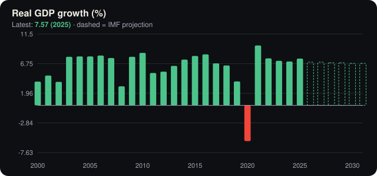
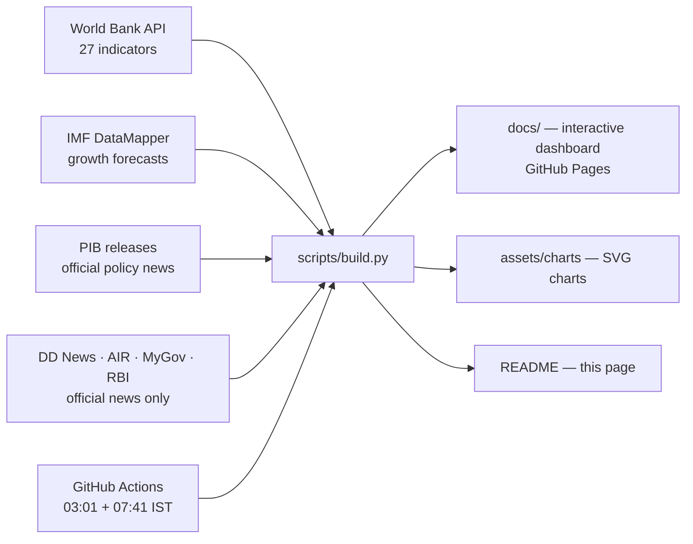

  

  
  
  
  

<b>India's economy, industry, environment and people — in one live, free dashboard.</b> 
GDP and national income from the World Bank, growth forecasts from the IMF, and the day's news for every topic from official government sources only (PIB, DD News, All India Radio, MyGov, RBI) — refreshed automatically twice a day.

  <a href="https://subhadeep998.github.io/India-Development-Dashboard/#economy">📈 Economy</a> ·
  <a href="https://subhadeep998.github.io/India-Development-Dashboard/#industry">🏭 Industry</a> ·
  <a href="https://subhadeep998.github.io/India-Development-Dashboard/#environment">🌿 Environment</a> ·
  <a href="https://subhadeep998.github.io/India-Development-Dashboard/#education">🎓 Education & Scholarships</a> ·
  <a href="https://subhadeep998.github.io/India-Development-Dashboard/#culture">🎭 Arts & Culture</a> ·
  <a href="https://subhadeep998.github.io/India-Development-Dashboard/#food">🌾 Food & Agriculture</a>

---

## 🇮🇳 India at a glance

| 💰 GDP | 📈 Real growth | 👤 GNI per capita | 🔮 IMF growth forecast |
|:--:|:--:|:--:|:--:|
| **US$ 3.96 tn** 2025 | **7.6%** 2025 | **US$ 2,760** 2025 | **7.0% (2026)** IMF WEO |

Last refreshed: 28 Nov 2026, 08:54 IST · Annual figures in current US$ from the World Bank; the forecast is the IMF World Economic Outlook.

---

## 📊 The big trends

<table>
  <tr>
    <td width="50%"></td>
    <td width="50%"></td>
  </tr>
  <tr>
    <td width="50%"></td>
    <td width="50%"></td>
  </tr>
  <tr>
    <td width="50%"></td>
    <td width="50%"></td>
  </tr>
  <tr>
    <td width="50%"></td>
    <td width="50%"></td>
  </tr>
</table>

<a href="https://subhadeep998.github.io/India-Development-Dashboard/"><b>Explore 27 indicators interactively →</b></a>

---

## 📰 Today across India — official sources

### 📈 Economy

GDP, national income, growth, inflation and investment.

- 2026-11-28 · [India's Defence Strength Powering National Security through Self-Reliance](https://news.google.com/rss/articles/CBMid0FVX3lxTE9pSFAtcXlILUJRaHdoSUwtVloydmVja21qQ3FlYVgzV3lrWHNYMjhYcjFtcEg0VTJRS3ZnTkt0c0g2cnRmTS1BR09RWWdOTTJ4dWs4ZHJfU0JtMnVJS0kyb0tuVVplRUNLc3Z6MUh1TXFCWTJ2dTNV?oc=5) — _pib.gov.in_
- 2026-11-28 · [Financial Inclusion in India: Banking Every Citizen, Empowering Every Household](https://news.google.com/rss/articles/CBMieEFVX3lxTFB2X2JHSmV2VlVfX2p5eVROR0NwNnhnT09nNE1HYXBWenNsNGRsQkNGaHF4aVVVTlBZZGEzcGs5WUMtWU1WRGRzbGoyYXBPR3NkQXFHcXh3djd5bktmQl94Q1VLZnN4Zm44ZFBWc2lLOFVyaDM5SzJ6MQ?oc=5) — _pib.gov.in_
- 2026-11-28 · [PM Modi Shares Devotional Chant to Lord Murugan Amid Thiruparankundram Deepam Row](https://news.google.com/rss/articles/CBMiqwFBVV95cUxON2sxbC1PUHppeEZmcE5vcVZiNXJjU3VtMWdrc25wb2xvS0xPNnVrYjZBVW0xTFc3aXBuWkVGOGN0SjZkYnNuR1MzSlowZ2RDbTF3Tnl0Zkh6NWFaM0pyRGRiRlA0RG5ldFlKcHB0dWQ0WU5SY2lsY1k5U081NUNvdDU3MnBXdkw3Z3VHUjZ2Z1dBTjNQUmFYUXJsSGZXTnpzTUVpYTU4d291MG8?oc=5) — _DD News_
- 2026-11-28 · [Lakshadweep and Andaman & Nicobar Islands to drive India’s Blue Economy push through tuna, seaweed and ornamental fishe…](https://news.google.com/rss/articles/CBMi3gFBVV95cUxOQW0yb004aUd4RlJwU0JxNVJTMDVSbDRfazZ1dWZtbnhKQmtWTEhnaW8yN25lTXp6aklBS2xFMFJDRW9sRWNxU0F1My1UVzZ0S3pyMXpubHpYX3FPSnpDYnRadFFMRUViXzFIdXh0X1NaZ3pIQ0xUMDVJVURhTzNqMk5wQWFnMVFoT1FLem9IOWdFTVFhNEotU3ZiQ0EzRG9hOGxRcC1pVGI3eEVHOEJDcC11eVIwSlY4aGx3eDlONDJqemd3cDJ3TzMzSFEwSDl2VzF0dURwME1CSHZvT1E?oc=5) — _DD News_

[Open the Economy tab →](https://subhadeep998.github.io/India-Development-Dashboard/#economy)

### 🏭 Industry

Manufacturing, industrial output, structure of the economy and infrastructure.

- 2026-11-28 · [India's Defence Strength Powering National Security through Self-Reliance](https://news.google.com/rss/articles/CBMid0FVX3lxTE9pSFAtcXlILUJRaHdoSUwtVloydmVja21qQ3FlYVgzV3lrWHNYMjhYcjFtcEg0VTJRS3ZnTkt0c0g2cnRmTS1BR09RWWdOTTJ4dWs4ZHJfU0JtMnVJS0kyb0tuVVplRUNLc3Z6MUh1TXFCWTJ2dTNV?oc=5) — _pib.gov.in_
- 2026-11-27 · [Telecom Manufacturing Zone, Gwalior Gains Momentum with Distribution of Letters of Intent to 25 Companies](https://news.google.com/rss/articles/CBMifEFVX3lxTFBuMnk4Q0dFTDRlSk9Ra1AxV25ycHhNY1FqNEtfeTZ5SFhYRGRGWjQzV1M2NVY0d250ZDBrck92YUI2R3dLUnZiQzRQNkNSS0VOMDV6Vjh5WlpWajFXVEFKemw2Uk5pdmJabzQ0RVpqQVdxU3FGWjUxN2s1b3o?oc=5) — _www.pib.gov.in_
- 2026-11-28 · [India’s Agricultural Exports Gain Momentum, Led by Basmati Rice, Processed Potatoes and Corn](https://news.google.com/rss/articles/CBMitgFBVV95cUxPRTFpbVlxQ2YwaGU0WTgtNlBfVG8tRWZvS3dycExRRDgwUWR4dnl2OWE4bnYyYU5BeDJLaE5SVlRZOGttaW0xVHpHMFlZR0tCSkxZYTFSazNCRlllTDJNQU9SVWowdWtzM0J0T0ZUdTN0RHJqYXNJNlE4QnR4Rlh0YUlBdWtmcDVBS3FjLU1VYmZNanVvVFJLMUpiUk9uamhveldzUVlWbjQ4bk9MdDQ0aFdCeEM3dw?oc=5) — _DD News_
- 2026-11-28 · [Centre proposes amendments to drugs rules to ensure qualified personnel authorise drug batch release](https://news.google.com/rss/articles/CBMixAFBVV95cUxOTnJXdTF5NWppeXBGMUFwRUxmUE9jeEZ0QzNfdjNUMFl0dEx6RzJ0aEN6REdKN2RZQjhvbWI3dnNVS0lEMWRFQnFIcFdyVFlTOTBqM01lUGRURW53bU5oTFNaQkI1Vm12Mm93OUx5SFdsZGVpcU1sYUZUcmpZNFljckdEaUU5ZVB6WkRQMzhtRWd0UzR2bDF3T255SEtkNnVrUTVaNFpybEdMWmVneEg4WFZZR1lwUnhWRk5mMnctY093MnFK?oc=5) — _DD News_

[Open the Industry tab →](https://subhadeep998.github.io/India-Development-Dashboard/#industry)

### 🌿 Environment

Emissions, forests, clean energy and air quality.

- 2026-11-28 · [Strategies to Protect Farmers from Climate Change](https://news.google.com/rss/articles/CBMiggFBVV95cUxPejRjQ0wxQWNxTUN1a05aTnlteW5ZVEthd19nUGY1SlVFd1NJUUpmcUF6TWlHNXRublFHLVM2NlNtcnRDLUwyTHZFYTBkUVVfSXNPaDBJRzZkNTJUdEdvTFZkTEFTbVBqQ1FkUzgzMDlJUE1raXJ1Z0QtQjh6NVppTVRR?oc=5) — _www.pib.gov.in_
- 2026-11-27 · [India’s Renewable Energy Journey: Powering a Cleaner Future](https://news.google.com/rss/articles/CBMifEFVX3lxTE1YMkhNLUFqcUc0d3VxaDlweW9lQVRzdEFwd3h0bmJyZHhjQk54MlYtV2xEazRES0NMSlNrZk9HLVRCRUpWSjRDdHdjbTdHandWZUt5clk1SlFvTlFwY3hnS2cyTURMU3hGSTBLQ1owY3pQd1pzOHBGSmsxVWY?oc=5) — _www.pib.gov.in_
- 2026-11-28 · [PM Modi Shares Devotional Chant to Lord Murugan Amid Thiruparankundram Deepam Row](https://news.google.com/rss/articles/CBMiqwFBVV95cUxON2sxbC1PUHppeEZmcE5vcVZiNXJjU3VtMWdrc25wb2xvS0xPNnVrYjZBVW0xTFc3aXBuWkVGOGN0SjZkYnNuR1MzSlowZ2RDbTF3Tnl0Zkh6NWFaM0pyRGRiRlA0RG5ldFlKcHB0dWQ0WU5SY2lsY1k5U081NUNvdDU3MnBXdkw3Z3VHUjZ2Z1dBTjNQUmFYUXJsSGZXTnpzTUVpYTU4d291MG8?oc=5) — _DD News_
- 2026-11-28 · [“Very salient”: UN climate chief backs PM Modi’s remarks on clean energy cushioning India against oil price shock](https://news.google.com/rss/articles/CBMi0AFBVV95cUxQSkt6dnJ1cWlqd1QyWGZSNmtjOWNMWkdHVFJWLTFvNVBUXy1HUUhGMDN1VF9oM0FSR3d5OTdVbDYtSTdLVXlPWGRSbno5bVRqcU5yanpIZ3lkVjFHMmRSRWl4bVF4d25KLXMtdFNjbzgxSkV5UlFFc1FYQ1NqS3VDeGp2YW52QUtueGJYQ3RZcW41QVA3OHZhVVdDNENMWmZzcWh5LXZjbVRuUUdwcFJlUE9CZzBWU2NUZVFPY1lmY2JYbFVfLVBKUDlkTDBzZklt?oc=5) — _DD News_

[Open the Environment tab →](https://subhadeep998.github.io/India-Development-Dashboard/#environment)

### 🎓 Education & Scholarships

Education spending, enrolment, literacy — and where to apply for scholarships.

- 2026-11-27 · [Vice-President Shri C. P. Radhakrishnan to inaugurate the fifth edition of Kashi Tamil Sangamam 5.0](https://news.google.com/rss/articles/CBMiggFBVV95cUxOVC1POFQyR09MU0dBUFpja2JoQUx0cDI1bTNiZFAxZV94R2hZSVAwaDMzeVNlckhxaUFMR0JyWndtUW1kOGNOd0JFMkRtRHdRdmJ0R3lXZXJNbzc3SVlsUFlLaVRiMkxJazZQcjZqSHVOcTJJNUxGeVJaR01nSHp4VmtB?oc=5) — _www.pib.gov.in_
- 2026-11-27 · [National Overseas Scholarship Scheme for Scheduled Tribe Students](https://news.google.com/rss/articles/CBMifEFVX3lxTE5PNGhIUllXcmtGZWdiWkdzV09DNk9zQ25ZQ1JIOHlCYUMxTDlOWWtGMnJnT2lJVFUtX1lydHlKNG9LWVJEQnJxS0Q0ckZvMmFLbjY2SlpBeTIxMnZqdTV0UkE0Q050d094RUVYSU93NlpZWEtwb0JEa0t1Szc?oc=5) — _www.pib.gov.in_
- 2026-11-28 · [PM Modi Shares Devotional Chant to Lord Murugan Amid Thiruparankundram Deepam Row](https://news.google.com/rss/articles/CBMiqwFBVV95cUxON2sxbC1PUHppeEZmcE5vcVZiNXJjU3VtMWdrc25wb2xvS0xPNnVrYjZBVW0xTFc3aXBuWkVGOGN0SjZkYnNuR1MzSlowZ2RDbTF3Tnl0Zkh6NWFaM0pyRGRiRlA0RG5ldFlKcHB0dWQ0WU5SY2lsY1k5U081NUNvdDU3MnBXdkw3Z3VHUjZ2Z1dBTjNQUmFYUXJsSGZXTnpzTUVpYTU4d291MG8?oc=5) — _DD News_
- 2026-11-28 · [India, UAE Discuss Expanding Cooperation in Education, Skills and Research](https://news.google.com/rss/articles/CBMinwFBVV95cUxOMUNLZ2VxT2oyLXdSNTBwUUU2N1lvamhJOGpQRlF0VExzQ2tpcnRPREw4My00MkZFeGtmVXhYcnppUWoxdG1IUW1GNWN0Tmc5UjByS3FVYV9xLTNTVlRtcTVIaDcwV2l5REI0U19YcGNvRHhaMEdrb2tKUTJ6WkxBZUJjN0VyS2p3MWU2VmhCUGktaVRqdElSUV94bmctbE0?oc=5) — _DD News_

[Open the Education & Scholarships tab →](https://subhadeep998.github.io/India-Development-Dashboard/#education)

### 🎭 Arts & Culture

Heritage, the arts, cultural scholarships and tourism.

- 2026-11-27 · [Vice-President Shri C. P. Radhakrishnan to inaugurate the fifth edition of Kashi Tamil Sangamam 5.0](https://news.google.com/rss/articles/CBMiggFBVV95cUxOVC1POFQyR09MU0dBUFpja2JoQUx0cDI1bTNiZFAxZV94R2hZSVAwaDMzeVNlckhxaUFMR0JyWndtUW1kOGNOd0JFMkRtRHdRdmJ0R3lXZXJNbzc3SVlsUFlLaVRiMkxJazZQcjZqSHVOcTJJNUxGeVJaR01nSHp4VmtB?oc=5) — _www.pib.gov.in_
- 2026-11-27 · [Governor Indra Sena Reddy Nallu inaugurates “Ashtavadhanam” at Tripura Central University](https://news.google.com/rss/articles/CBMiaEFVX3lxTE5KN1puM3MtMWF0MzZFRHdpRHVJVUN5Z2ZWZGxKdlFSSTJDT0hYVWVzVHJNbXR5QzVvRDBEMF9mN0RYdU1ieERRc2FIc3NTb2wyNm5iRWdqUFB2RFIzNTgtMVRuRWRCaHU2?oc=5) — _www.pib.gov.in_
- 2026-11-28 · [Embassy of India Celebrates Shared Cultural Heritage between India and Azerbaijan through Art and Literature](https://news.google.com/rss/articles/CBMizwFBVV95cUxPbExjajlWUHZXektLSTExRzROeUZ0My1BOWIzbTgwd3pRYU9RdXhIZWk2MWczbXpkZFN6UVNOdXU3VDY3dEJiLTA4RzhjWkpHNHRkTkI4bW1POFlkLVhYb2Z1MlVpSkxkbzZNdXZOWGFwaDJCdURNcVZnbElBWjA2Ynhfb0phUXpXMHZnUDhIYmNFRHRGWGEwUWlWN1E1R1JTXzV1ZjNtRVZxWGVqbTlBMW15Q25Idkk0RGJlc2hMMUxDQ3VLbHhrd1doeVhCTlk?oc=5) — _DD News_
- 2026-11-28 · [PM Modi extends Diwali greetings, says festival symbolises resolve to overcome darkness](https://news.google.com/rss/articles/CBMisgFBVV95cUxQWHZsZTNWSFpjNzN1dTh2a2pTcm9GOTd2UTdDblhNNjAxWlBTbVpWdEZnTWlJSzdPNWFiVzcwZUpPX0NrX1ZSRk8wbF9hQkdfQTUyc2hFVnNqNUR5Y1FSd3VSNTJpdG53RHcxcUdYLVRKYXYzRVhEeGZTbWdZLUNKQ3BNd3RYUE81U3B0SVNpQnQzZDNVZjBITk83UTBhX1pUekpmX1NyZmQ0X2Z6MlZvVndR?oc=5) — _DD News_

[Open the Arts & Culture tab →](https://subhadeep998.github.io/India-Development-Dashboard/#culture)

### 🌾 Food & Agriculture

Food security, farm output, nutrition and farmer support.

- 2026-11-28 · [Strategies to Protect Farmers from Climate Change](https://news.google.com/rss/articles/CBMiggFBVV95cUxPejRjQ0wxQWNxTUN1a05aTnlteW5ZVEthd19nUGY1SlVFd1NJUUpmcUF6TWlHNXRublFHLVM2NlNtcnRDLUwyTHZFYTBkUVVfSXNPaDBJRzZkNTJUdEdvTFZkTEFTbVBqQ1FkUzgzMDlJUE1raXJ1Z0QtQjh6NVppTVRR?oc=5) — _www.pib.gov.in_
- 2026-11-27 · [Vice-President Shri C. P. Radhakrishnan to inaugurate the fifth edition of Kashi Tamil Sangamam 5.0](https://news.google.com/rss/articles/CBMiggFBVV95cUxOVC1POFQyR09MU0dBUFpja2JoQUx0cDI1bTNiZFAxZV94R2hZSVAwaDMzeVNlckhxaUFMR0JyWndtUW1kOGNOd0JFMkRtRHdRdmJ0R3lXZXJNbzc3SVlsUFlLaVRiMkxJazZQcjZqSHVOcTJJNUxGeVJaR01nSHp4VmtB?oc=5) — _www.pib.gov.in_
- 2026-11-28 · [Explainer: What is regenerative agriculture and why does India need it?](https://news.google.com/rss/articles/CBMimwFBVV95cUxOejA5TFNMQkhGVW5QXzh4LVdOTHV0bVYySDRRSGV6dUFZNUNVd0o4b3cyaFA1aFpwTGJGQlF0SmhZTmw2cFZqclR0aUZacDlaVkRPSkt1SEF2YkhObUp6MzlDZ0NVeWhHZ1l1a0dSdWV5cTBaay1zTE8zeUZrMnI5WE01MHk1RW9FOVlTZDVHc1haLXp6d3hIcTBhWQ?oc=5) — _DD News_
- 2026-11-28 · [Assam flags off export of GI-tagged Karbi Anglong Ginger to London](https://news.google.com/rss/articles/CBMilwFBVV95cUxOS1p6T2pfS3J2ZjRPUmhfZ25zbHZLejVCUnNGYXNNanE2UlpiVWltVUozTjBnR3lYeGU4bmZJc0dkT3lfcnN0Y1FPMGpVYXN2ZHlJQl9Fd0VONVJQR1VyY1FfNFN6a3BxQnVLUTZhYnhjOWo3R3VBNkowdVFQVnp6LWdDNWt3NUZKSU8xcnNpWmpJc3RyZ3NF?oc=5) — _DD News_

[Open the Food & Agriculture tab →](https://subhadeep998.github.io/India-Development-Dashboard/#food)

---

## 🏛️ Government schemes, at a glance

| Area | Start here |
|:--|:--|
| 🎓 **Scholarships** | [National Scholarship Portal](https://scholarships.gov.in) · [PM Vidyalaxmi (education loans)](https://pmvidyalaxmi.co.in) · [INSPIRE](https://online-inspire.gov.in) · [PM Research Fellowship](https://pmrf.in) · [AICTE Pragati & Saksham](https://www.aicte-india.org) |
| 🎭 **Arts & culture** | [Ministry of Culture](https://www.indiaculture.gov.in) · [CCRT scholarships for young artists](https://ccrtindia.gov.in) · [Sangeet Natak Akademi](https://www.sangeetnatak.gov.in) · [Lalit Kala Akademi](https://lalitkala.gov.in) |
| 🌾 **Food** | [National Food Security Act](https://nfsa.gov.in) · [PM-KISAN](https://pmkisan.gov.in) · [PM-POSHAN](https://pmposhan.education.gov.in) · [Eat Right India](https://eatrightindia.gov.in) · [e-NAM](https://enam.gov.in) |
| 🌿 **Environment** | [National Clean Air Programme](https://prana.cpcb.gov.in) · [PM Surya Ghar](https://pmsuryaghar.gov.in) · [PM-KUSUM](https://pmkusum.mnre.gov.in) · [Mission LiFE](https://missionlife-moefcc.nic.in) |
| 🏭 **Industry** | [Make in India](https://www.makeinindia.com) · [PLI schemes](https://www.investindia.gov.in/production-linked-incentives-schemes-india) · [Startup India](https://www.startupindia.gov.in) · [PM Gati Shakti](https://pmgatishakti.gov.in) |
| 📈 **Economy** | [Union Budget](https://www.indiabudget.gov.in) · [RBI](https://www.rbi.org.in) · [MoSPI](https://www.mospi.gov.in) · [GST Council](https://gstcouncil.gov.in) |

> Scheme rules, amounts and deadlines change — always confirm on the official portal before applying.

---

## ⚙️ How it works

- **Runs twice a day** (03:01 and 07:41 IST), away from GitHub's busy hours — if one run is delayed or dropped, the second catches up.
- **Never goes blank:** if a source is down, the last good data is kept.
- **All sources are free and official.** Official sources only — no general media. Only headlines and links are stored — click through to read the original reporting.

> Independent educational project; not affiliated with the Government of India, the World Bank or the IMF.

---

  ⭐ <b>Star</b> to bookmark · 👤 <a href="https://github.com/Subhadeep998"><b>Follow @Subhadeep998</b></a> 
  Built by <a href="https://www.subhadeepaditya.in">Subhadeep Aditya</a> — healthcare intelligence analyst and LL.B. student · Kolkata, India

